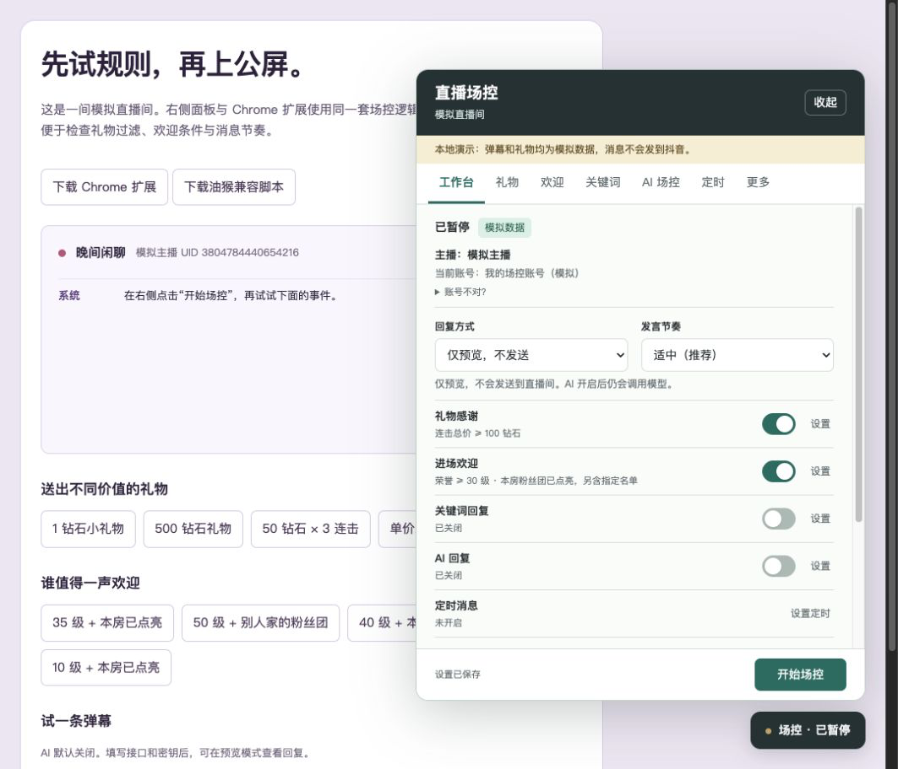

# 抖音直播运营助手（Chrome 扩展）

Chrome Manifest V3 扩展：礼物价值筛选、连击感谢、本主播粉丝团与荣誉等级欢迎、指定用户欢迎、AI 公屏互动、关键词回复和定时消息。界面用表单完成配置，不需要编辑 JSON；默认暂停、仅预览，所有功能共用消息队列和频率限制。仍附带油猴兼容脚本。

**当前版本 0.1.1。规则、身份识别、扩展隔离和模拟器已验证，真实直播推送和真实发送尚未完成端到端验收。** 详细证据见 [验证报告](docs/validation.zh-CN.md)，功能调研见 [市场调研](docs/market-research.zh-CN.md)，参考脚本静态分析见 [LiveBot 复盘](docs/livebot-review.zh-CN.md)。

导航分为“回复、互动、设置”三类；设置下集中管理运行模式、发言节奏和模块开关，各模块页面只保留自己的规则。礼物动态位于礼物页，最近回复和待审核消息位于回复记录，账号识别及运行日志位于连接页。悬浮控制按钮可拖到浏览器边缘停靠，位置会自动记住。礼物、欢迎、点赞、关键词和每组定时消息都可分别选择“规则话术”或“AI 优先”；AI 服务及密钥统一在“AI 设置”配置，默认使用规则话术。AI 关闭、限频、失败、跳过或结果未通过检查时，会记录原因并回退到该模块规则话术。各模块顶部显示当前规则摘要；运行中改设置会提示“保存并暂停”，高级选项收在折叠区。

各模块分别处理：礼物页设置连击总价/单价阈值，提供 50/100/500/1000 钻快捷值；欢迎页设置荣誉、粉丝团和点亮条件，指定名单可绕过条件；点赞页设置话术轮换和单人冷却；关键词页按顺序匹配固定话术；AI 页选择触发方式、服务和频率；定时页支持多组间隔及时段；“更多”集中连接检查、身份、过滤、页面适配和导入导出。

观众 @ 当前登录账号时，协议字段 `WebcastChatMessage.atUser`（字段 12）会按 UID 精确匹配，并优先触发 AI；回复上下文包括最近公屏。辱骂提醒使用可配置本地词表和滚动计数。房间响应若明确包含 `admin_user_ids`，会与登录 UID 精确比对；字段缺失时显示未验证。`WebcastMemberMessage.isSetToAdmin` 描述管理员设置事件，不能证明当前账号拥有管理权限。管理员身份虽可按名单识别，但封禁操作契约未验证，因此本版本不自动封禁。

## 安装 Chrome 扩展（推荐）

1. 从 [GitHub Releases](https://github.com/EitanWong/douyin-live-operations-assistant/releases/latest) 下载 `douyin-live-operations-assistant-chrome.zip` 并解压。也可以按下方“本地模拟与开发”生成扩展目录。
2. 打开 `chrome://extensions`，打开右上角“开发者模式”，点击“加载已解压的扩展”，选择解压后的 `chrome-extension` 文件夹。
3. 打开或刷新抖音直播间，点击浏览器工具栏的“抖音直播运营助手”图标，再点击“打开直播间面板”。扩展只匹配 `live.douyin.com`。
4. AI 服务在扩展弹窗中按需授权域名；密钥只保存在扩展私有存储，导出配置不包含密钥。

扩展的 MAIN 世界只观察直播 WebSocket，ISOLATED 世界处理规则、面板、AI 和页面发送；网页事件属于不可信公屏数据，不会成为扩展权限或密钥的入口。安装后先用“仅预览”检查真实事件，再选择需要的发送方式。

## 油猴兼容安装

1. 使用新版 Chrome / Edge 和 [Tampermonkey](https://www.tampermonkey.net/)。
2. 在油猴管理面板选择“添加新脚本”，删除默认内容，粘贴从 [GitHub Releases](https://github.com/EitanWong/douyin-live-operations-assistant/releases/latest) 下载的 `douyin-live-operations-assistant.user.js`，保存并启用。
3. 在浏览器正常登录抖音，打开直播间，然后**刷新直播页**。脚本必须在直播 WebSocket 创建前加载。无需导入 Cookies。
4. 点击右下角“场控”，在“更多”点击“检查连接与发送控件”。页面观察器、连接和解析帧应正常；真实发送还需唯一识别输入框与发送控件。
5. 保持“仅预览”，点击“开始场控”，查看运行记录中的真实事件和筛选结果。确认后改为“人工审核”，保存并重新开始；最终可选择“自动发送”。

Chrome 若不执行用户脚本，按油猴的官方提示检查扩展的用户脚本权限/开发者模式及页面注入设置。只运行一个场控插件，避免与 LiveBot 等其他脚本重复回复。

## 推荐起步设置

| 设置 | 默认值 | 含义 |
| --- | --- | --- |
| 礼物阈值 | 100 钻石，连击总价 | 50 钻石 ×3 达标，1 钻石 ×1 跳过 |
| 连击等待 | 4 秒 | 收到结束标记立即结算；连续长连击每 30 秒阶段结算 |
| 礼物用户冷却 | 1 秒 | 限制同一用户的连续感谢；全局发送节奏仍单独生效 |
| 最低荣誉等级 | 30 | 与粉丝团等级独立比较 |
| 粉丝团 | 本主播、等级≥1、已点亮 | 他房粉丝牌、未点亮、数据缺失均不通过 |
| 欢迎用户冷却 | 600 秒 | 同一用户反复进场不重复刷屏 |
| 全局发送 | 间隔≥10 秒，每分钟≤4 条 | 礼物、欢迎、关键词、AI、定时合计 |
| 单条长度 | 50 字符 | 超长候选拒绝，人工修改后再次检查 |
| 重复话术冷却 | 120 秒 | 普通回复避免重复；礼物感谢不因相同文本被去重丢弃 |
| AI | 关闭 | 开启后预览模式也会调用服务 |
| 定时消息 | 关闭，每组默认 300 秒 | 开始后从第一个间隔计时 |

钻石是礼物事件的价值单位，不自动换算人民币。连击累计 1、2、3 按 3 个计，不累加为 6 个；阶段结算只感谢新增数量。默认话术轮换四种称呼“大哥”的感谢句。未知单价不猜测，可在礼物页的“补充未知礼物的单价”表单按礼物 ID 或名字补充。冷却中的礼物直接略过，不在稍后补发；已达阈值的礼物不会因为话术文本重复而被过滤。

礼物页的“近期送礼”显示本页面最近 50 组送礼事件中的最新 8 条，包括送礼昵称、礼物和数量；协议给出单价时显示钻石价值，缺失时标为未知。最近观众列表最多保留 60 位，可在欢迎页选中送礼用户加入名单。数据仅存于当前页面内存，刷新或关闭即清除。

## 配置“大哥”欢迎

“欢迎”页设置最低荣誉等级、最低粉丝团等级、“必须加入本直播间粉丝团”和“粉丝牌必须已点亮”。当前解析按粉丝团状态值 1 判断点亮；协议变化或缺字段会拒绝条件欢迎。主播和登录账号通过当前房间资料与登录账号接口自动识别；查询失败时可点“重新识别”或手动补充，链接 `anchor_id` 作为初始值，**房间号不是主播 UID**。

欢迎话术可改为：

```text
欢迎 {user} 大哥回家，感谢陪伴！
{user} 来啦，欢迎一起聊天！
```

也可在“更多 → 导入配置”载入 [通用示例配置](examples/sample-room.json)，检查后保存。示例不包含真实账号或房间信息，并保持预览模式和 AI 关闭。

名单可直接从最近观众选择，或点击“手动添加用户”并选择数字 UID、sec UID、精确昵称；无需写前缀或 JSON。数字 UID 最可靠，昵称可能重名。“条件达标或指定用户”允许名单成员不受等级/粉丝团条件限制；需要严格条件时选“仅条件达标用户”。

欢迎变量：`{user}`、`{level}`、`{fanLevel}`。礼物变量：`{user}`、`{gift}`、`{count}`、`{value}`、`{unit}`。每行一条话术，按顺序轮换。昵称为普通文本，不执行 HTML，也不是平台真实 @提及。

## AI 设置

1. 打开“AI 设置”，选择服务预设；展开“接口与模型”核对完整接口地址及模型名称。
2. 填入 API Key，写场控风格和本场已核实的资料，例如开播时间、直播主题、商品事实。
3. 点击“测试 AI 连接”；结果只显示在面板，测试内容不会进入公屏队列。
4. 选择提问、呼叫词或所有弹幕触发；勾选 AI 开关，保存，先在预览/人工审核模式开始。

| 服务 | 完整接口 | 模型说明 |
| --- | --- | --- |
| DeepSeek | `https://api.deepseek.com/chat/completions` | 预设 `deepseek-flash`，可编辑；当前官方模型短回复关闭思考 |
| 通义千问 | `https://dashscope.aliyuncs.com/compatible-mode/v1/chat/completions` | 预设 `qwen-plus`，以账号可用模型为准 |
| 火山方舟 | `https://ark.cn-beijing.volces.com/api/v3/chat/completions` | 填账号已开通模型或接入点 ID |
| 本地 Ollama | `http://localhost:11434/v1/chat/completions` | 填本地已安装模型；模拟网页可能需要 CORS 配置 |
| 自定义 | HTTPS 的完整 `/chat/completions` 地址 | 需兼容 `messages` 与 `choices[0].message.content` |

默认每 45 秒至多调用一次，同用户 120 秒冷却，每小时 30 次，最多参考最近 180 秒的 30 条弹幕。冷场邀请需单独开启。固定关键词规则优先，首条命中后不再调用 AI。模型输出 `[SKIP]` 时跳过。AI 输出仍经过字数、屏蔽词、重复和全局队列检查；提示词不能保证模型永远正确，商品和事实类回复应先审核。

开启 AI 后，近期公屏昵称、弹幕和你填写的资料会传给指定服务，**不附带抖音 Cookies 或观众 UID**。密钥默认仅本页有效；勾选记住才写入扩展（或油猴兼容版）私有存储，按服务域名隔离，不包含在导出配置中。切换到其他域名要填写对应密钥。API 费用由所选服务收取。

## 定时、审核与暂停

定时支持话术轮换、多组任务、北京时间生效时段及跨午夜时段。时段不是准点发送功能：任务按间隔循环，仅在配置时段内进入队列。开始或结束留空表示全天。互动避让会略过本轮；后台恢复不补发错过的消息。浏览器休眠、节流和断网会影响实际时间。

队列优先级：礼物 → 欢迎 → 关键词 → AI → 定时。礼物候选 120 秒过期，其他候选 45 秒过期；人工审核可编辑、批准或丢弃。点击“立即暂停”会清空候选和弹幕上下文，旧 AI 响应不会在重启后发送。暂停不一定能取消已提交给浏览器的网络请求。

自动/审核发送遇到连接异常、输入草稿、输入被截断或发送控件异常会暂停；下播和切换房间也暂停。刷新后需手动开始。使用 Web Locks/油猴租约阻止同房间多标签同时运行，但不同浏览器配置文件及其他插件不在锁范围内。

## 排查

- 没有礼物/欢迎事件：刷新直播页，在更多查看连接、帧数和解析错误。DOM 备用通道只读新弹幕，无法补出礼物价值、等级或粉丝牌。没有可核实字段时不会擅自欢迎。
- 连接正常但输入框识别失败：更多页点“定位输入框”/“定位发送按钮”，在网页点对应控件，然后保存。手动定位不能解决编辑器协议变化。
- 当前抖音富文本输入通过纯文本粘贴处理器/浏览器编辑命令写入，等待界面更新后重新定位发送图标；文字不一致就暂停。记录“已提交”仅代表点击了控件，**不代表平台已接受或公屏已回显**。
- 同时有其他场控：暂停其他插件；发送账号 UID 可填入更多页以排除自己的弹幕。
- AI 失败：检查模型、完整地址、Key、余额、扩展弹窗中的 AI 服务域名授权及运行记录。HTTP 429 不自动重试。
- 导入配置后：检查内容并保存，重新开始。导出运行记录可能包含公屏昵称和回复。

## 本地模拟与开发

```sh
npm ci
npm run build
npm test
npm run check
npm run demo
```

访问 `http://127.0.0.1:4178/`。窄屏时先收起面板，再操作左侧事件按钮。模拟器使用实际源码，审核/自动模式只模拟提交，不向抖音发言。配置保存在内存，刷新清空。扩展和兼容脚本无第三方运行时依赖，安装使用无需 Node.js。



源码职责：`core.js` 规则与队列、`protocol.js` 帧解析、`adapter.js` 页面适配与多标签锁、`ai.js` 模型接口、`ui.js` 面板、`app.js` 集成。`npm run build` 后在扩展管理页点击“重新加载”，再刷新直播页；油猴兼容版用生成的单文件更新。

MIT License。项目独立维护于 GitHub；版本通过 `vX.Y.Z` 标签发布，并由 GitHub Actions 自动生成 Chrome 扩展包和油猴兼容脚本。
