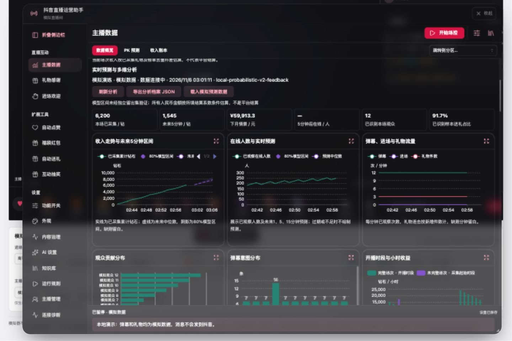

<p align="center">
  
</p>

<h1 align="center">抖音直播运营助手</h1>

<p align="center">把直播互动、AI 场控和主播数据，放进一个浏览器工作台。</p>

<p align="center">
  <a href="https://github.com/EitanWong/douyin-live-operations-assistant/releases/latest">下载 v0.1.3</a> ·
  <a href="#安装扩展">安装步骤</a> ·
  <a href="#第一次使用">开始使用</a> ·
  <a href="CHANGELOG.md">更新日志</a>
</p>

面向抖音网页直播间的开源 Chrome / Edge 扩展，适合主播、管理员与场控使用。支持自动答谢、观众互动、AI 回复和直播数据分析，可为不同主播分别保存配置。基础互动无需购买 AI 服务。



*当前版本的实际界面截图，使用本地模拟直播间与演示数据；统计金额不代表真实收益。*

## 能做什么

| 功能 | 主要用途 |
| --- | --- |
| 自动互动 | 礼物感谢、连击合并、条件欢迎、点赞感谢、关键词回复和多组定时消息 |
| AI 场控 | 结合弹幕、礼物、PK 与本场资料回复；支持云端接口、可选本地模型、知识库、联网查询和问答测试 |
| 直播感知 | 按配置读取直播音轨或画面，为 AI 提供现场语境；支持可选原生组件 |
| 观众互动 | 成语接龙、猜数字、真心话、大冒险，以及多奖品、加权互动抽奖 |
| 主播数据 | 礼物与收入估算、场次/月度账本、PK 战绩、任务与展馆、多维图表、预测参考及导出 |
| 扩展工具 | 自动点赞、福袋红包自动参与、带消费上限的自动送礼、账号钻石余额查询 |
| 管理与恢复 | 内容治理、多主播独立配置、等待开播与自动恢复、运行记录、配置导入导出 |

窗口支持拖动、缩放、主题切换和窄屏布局。统计只覆盖已采集的时段；收入与预测是参考值，平台结算以官方记录为准。禁言等管理操作需要当前账号拥有相应权限。

## 安装扩展

需要电脑上的 **Chrome 或 Microsoft Edge 120 及以上版本**。目前通过下载扩展包安装；普通使用无需安装 Node.js、Python，也无需运行命令。

1. **下载。** 打开 [最新版本下载页](https://github.com/EitanWong/douyin-live-operations-assistant/releases/latest)，在页面的 **Assets（附件）** 中下载 `douyin-live-operations-assistant-chrome.zip`。不要选择 `Source code`，那是给开发者使用的源码。
2. **解压。** 右键 ZIP 文件，选择“全部解压缩”或“解压到…”。Mac 可直接双击。把解压后的文件夹放到固定位置，例如“文档 / 抖音直播助手”；安装后请保留这个文件夹。
3. **打开扩展管理。** Chrome 用户将 `chrome://extensions` 粘贴到浏览器地址栏并按回车；Edge 用户使用 `edge://extensions`。
4. **开启开发者模式。** 在扩展管理页面找到“开发者模式”并打开。
5. **加载文件夹。** 点击“加载已解压的扩展程序”（Edge 中可能显示“加载解压缩的扩展”），选择解压出来的 **`chrome-extension` 文件夹**。选中的文件夹里应直接能看到 `manifest.json`。不要选择 ZIP 文件或它的上一级文件夹。
6. **确认安装。** 页面出现“抖音直播运营助手”即安装成功。可点击浏览器右上角的拼图图标，将助手固定到工具栏，方便设置服务授权。

## 第一次使用

1. 在同一个浏览器中登录抖音，打开一个 [抖音网页直播间](https://live.douyin.com/)。已打开的直播间请先刷新一次。
2. 点击直播页边缘的 **“场控”** 按钮，打开助手工作台。
3. 进入 **设置 → 运行规则**，将“回复方式”设为 **“仅预览，不发送”**，先熟悉效果。默认模式为自动发送，请在开始前核对。
4. 进入 **设置 → 功能开关**，只开启需要的功能；再到“礼物感谢”“进场欢迎”等页面修改话术和条件，点击 **保存**。
5. 点击顶部 **开始场控**。收到符合条件的互动后，在最近回复与运行记录中查看结果；预览模式不会向公屏发送回复。
6. 确认话术与触发条件合适后，将“回复方式”改为 **自动发送**，保存后即可按规则回复到当前直播间。不需要运行时点击 **暂停场控**。

普通感谢、欢迎和关键词回复可直接使用预设话术。每个主播的配置独立保存，切换直播间后请核对当前配置；更多操作见 [完整使用指南](docs/guides/usage.zh-CN.md)。

> **自动送礼会真实消耗钻石。** 它在“扩展工具”中单独配置并手动开始，不受场控预览模式保护。请先核对礼物、数量、间隔及消费上限。

## 配置 AI（可选）

- **云端 AI：** 在“AI 设置 → 连接与模型”填写服务接口、模型和密钥；点击浏览器工具栏的助手图标，授权该服务域名，然后测试连接、启用所需 AI 功能并保存。第三方服务可能收费。
- **本地 AI：** 在“AI 设置 → 本地与性能”点击“一键启用本地 AI”，按界面进度等待模型下载与准备。独立开关控制本地回复与识别；可与云端共存，云端优先、本地仅兜底，不自动勾选“仅使用本地回复模型”，不改变云端感知组合。本地推理无需模型密钥；本地文字回复需要浏览器支持 WebGPU，首次使用需要联网下载模型。
- **进阶能力：** 联网搜索、直播音视频感知及原生加速组件按需配置，详见 [AI 使用说明](docs/guides/ai-context.zh-CN.md) 和 [本地 AI 快速开始](docs/ai-foundation.zh-CN.md#快速开始)。原生自动安装目前支持 macOS / Linux，Windows 可使用浏览器本地方案；本地视觉识别尚未实现。

启用云端 AI、搜索或媒体识别时，相关上下文会发送至你选择的服务。只开启需要的能力，并妥善保管服务密钥。

## 更新与常见问题

**如何更新到 0.1.3？** 先在设置中导出配置备份，暂停场控及独立工具任务。下载新版并解压，将新版 `chrome-extension` 文件夹的全部内容替换到原安装文件夹，保留原路径；回到扩展管理页面点击该扩展的刷新图标，再刷新直播间。请勿先卸载扩展，以免删除本机数据。配置导出不包含密钥，直播账本需使用数据页提供的导出功能另行备份。

**提示“找不到清单文件”？** 选错了文件夹。重新选择直接包含 `manifest.json` 的 `chrome-extension` 文件夹。

**安装后没有“场控”按钮？** 确认扩展已开启、页面地址以 `https://live.douyin.com/` 开头，再刷新直播页。抖音手机 App 中无法使用此扩展。

**已开始却没有回复？** 检查功能开关、预览/自动发送模式与触发条件；查看底部消息和运行记录。使用 AI 时再检查连接测试和域名授权。网页改版或平台限制可能影响采集与操作，详见 [排查说明](docs/guides/usage.zh-CN.md#排查)。

**电脑休眠或浏览器关闭后还能运行吗？** 不能依赖扩展继续采集或发送。持续监控需要浏览器与直播页保持运行；恢复能力不等于离线挂机。

**已有 Tampermonkey？** 可从同一下载页获取 `douyin-live-operations-assistant.user.js`，在脚本管理器中新建脚本、粘贴文件内容并保存，然后刷新直播页。完整功能建议使用 Chrome / Edge 扩展；同一直播页请只启用一种安装方式。

## 本地开发

需要 Node.js 20 或以上版本：

```sh
git clone https://github.com/EitanWong/douyin-live-operations-assistant.git
cd douyin-live-operations-assistant
npm ci
npm run dev
```

在扩展管理页加载 `dist/chrome-extension`。开发监听会自动构建；正式构建前先停止监听，或用 `DOUYIN_DIST_DIR` 指定独立输出目录。

| 命令 | 用途 |
| --- | --- |
| `npm run build` | 构建正式扩展与 Tampermonkey 兼容脚本 |
| `npm run demo` | 启动本地模拟直播间：`http://127.0.0.1:4178`（先构建） |
| `npm test` | 运行全部 JavaScript 测试 |
| `npm run test:native` | 运行原生组件测试，需先准备对应依赖 |
| `npm run agent:index` | 源码变更后更新导航索引 |
| `npm run check` | 校验索引与源码、构建产物语法 |

工程按 `src/`（业务）、`extension/`（浏览器入口）、`native/`（可选本机组件）、`scripts/`（构建工具）、`tests/`（测试）和 `docs/`（文档）组织。`dist/`、依赖及本地测试输出不提交到仓库。

## 文档与许可

[完整使用指南](docs/guides/usage.zh-CN.md) · [AI 配置](docs/guides/ai-context.zh-CN.md) · [互动抽奖](docs/guides/giveaway.zh-CN.md) · [主播数据与预测](docs/features/anchor-prediction.zh-CN.md) · [开发指南](docs/development/contributing.zh-CN.md) · [全部文档](docs/README.md)

采用 [MIT 许可证](LICENSE)。本项目为独立开源工具，与抖音官方无隶属关系。
