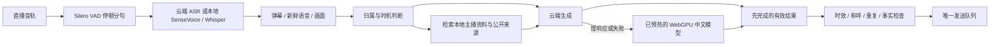

# AI 基础链路与中文端侧使用说明

核对日期：2026-11-03。版本保持 0.1.2；本次是 dev 集成，不创建稳定版发布。

## 已落地的链路



- 默认自动调优：依据已准备模型的实测耗时，设置 500–1500ms 的本地竞速延迟；云端硬时限 8000ms，整次上限 16000ms。关闭自动调优后可手工设置。没有准备好的本地模型时只运行云端，不触发首次下载。竞速只产生一个候选回复，另一路实际取消；不新增发送出口。
- Cockatiel 按接口与模型管理熔断：连续两次可恢复错误后打开30秒，随后允许恢复探测；取消不计入服务故障。认证、权限、计费等错误保留原有诊断。HTTP 402 或明确的余额/额度耗尽暂停该提供方5分钟，立即尝试已准备的本地模型，随后允许恢复探测。工具自己的云端每小时上限耗尽也能继续用本地独立额度。
- 停止、切主播、修改AI配置、资料删除或失效会阻止旧结果使用；明确 @ 场控可以取消生成中的普通插话。任务级时限也会中止底层HTTP或本地Worker，不再只丢弃 Promise 的结果。
- 普通语音闲聊不等待画面；含“这两个、看看、手里”等视觉指代时保留最多3秒的对齐等待。音画时间、说话人未核实等边界继续保留。自然感来自理解、时机、少重复与允许沉默，不声明自己是真人，不编造经历。
- 面板显示最近100次完成的提供方与耗时、样本P95；这是本页观测，不是承诺的服务SLA，也不包含直播平台最终送达时间。

## 开源组件选择

| 能力 | 本次复用 | 选择依据与边界 |
| --- | --- | --- |
| 浏览器中文回复 | [Transformers.js 4.3.2](https://github.com/huggingface/transformers.js) + [Qwen2.5 0.5B Instruct ONNX](https://huggingface.co/onnx-community/Qwen2.5-0.5B-Instruct) | WebGPU q4；另可选择同系列1.5B q4f16（固定revision），自动准备以硬件筛选及实际加载/测速为准；限定短上下文、短输出，不把小模型作为云端研究能力的同等替代 |
| 中文本地ASR优先项 | [sherpa-onnx 2.0.1](https://github.com/k2-fsa/sherpa-onnx) + [SenseVoiceSmall](https://github.com/FunAudioLLM/SenseVoice) int8 | 已有ONNX识别器，2个CPU线程、常驻加载，实测RTF门槛；分段识别，不能称为原生流式ASR |
| 浏览器ASR备选 | [多语言 Whisper tiny ONNX](https://huggingface.co/onnx-community/whisper-tiny) | 显式 Chinese / transcribe，WASM独立Worker；不选英文专用模型；准备和实际识别均有耗时限制 |
| 停顿分句 | [vad-web 0.0.31](https://github.com/ricky0123/vad) + [Silero VAD v5](https://github.com/snakers4/silero-vad) | 复用直播音轨，不请求麦克风；450ms停顿、长句约8秒切段；加载失败退回定时分段 |
| 中文资料检索 | 既有 MiniSearch + Intl.Segmenter | BM25相关片段，来源与采集时间保留；复用现有检索器，不再另造检索框架 |
| 服务故障恢复 | [Cockatiel 4.0.0](https://github.com/connor4312/cockatiel) | 成熟熔断组件；应用只负责截止、候选竞速和当前任务归属 |

补充核对了[阿里 FunASR](https://github.com/modelscope/FunASR) 的 Paraformer 流式/非流式、FSMN-VAD、SenseVoice 与 Fun-ASR-Nano。Nano 有现成CPU Transformers与GPU服务路径，Paraformer有现成流式部署，适合后续更高准确率或持续增量识别的服务提供方。本次选已在 sherpa-onnx 跑通的 SenseVoice int8，避免将未验证的模型转换、浏览器算子兼容或自建推理引擎放进实时链路；没有把这些候选都宣称为已接入。

WebLLM 同样可用，但需要独立编译模型库、WebGPU与另一套模型管理。本次 Transformers.js 已覆盖文字与浏览器ASR，使用一套运行时。Chrome内置Prompt API不作为中文能力保证。

执行JS、Worker、AudioWorklet和WASM全部随扩展打包；下载只包含固定版本模型数据、配置与词表。ONNX Runtime会依设备/浏览器选择不同WASM入口，构建保留其完整执行资产，回归检查 asyncify 与 jsep，避免仅有JS却运行失败。许可证与第三方声明写入产物 THIRD_PARTY_LICENSES.txt。模型协议独立于运行时代码协议；SenseVoice模型由用户另行取得并核对授权，扩展不捆绑分发其权重。

## 启用与性能门槛

1. 使用 Chrome 扩展版，打开“AI 设置 → 连接与模型 → 中文端侧与设备推荐”。首次准备文字模型会下载较大的权重，请先完成准备再用于直播。
2. 自动检测会实际创建GPU设备，并读取浏览器提供的内存、线程数、GPU缓冲区/FP16和存储额度；未知字段不猜测。文字默认选择“自动”；支持FP16且已知内存≥8GB、线程≥8、GPU缓冲区和存储达标时先试1.5B q4f16，否则优先0.5B。较大模型加载失败、中文结构化事实自检失败或测速不合格会自动降到0.5B；明确手选时不偷偷换模型。硬件检测不下载权重，点击“下载并测速中文回复”才准备模型。文字仅在 WebGPU 可用、预热及中文结构化事实自检成功、首token≤1500ms、生成≥10 token/s且测速完成≤3500ms时显示就绪。测速使用中文上下文并强制生成24 token，避免只测一句问候。输入最多1024 token、输出最多72 token，最终仍须满足弹幕长度。
3. 中文语音默认自动选择：检测到已安装的 SenseVoice 依赖与模型文件后优先准备它，失败或未过测速则尝试浏览器 Whisper；也能手选方案。模型准备状态独立于保存的开关；取消在途Worker会释放其资源，需重新准备，已缓存权重可复用。浏览器或扩展重启后不假设内存里的模型仍然可用。
4. 准备好的本地中文ASR启用后优先使用，不先等待云端超时；本地失败会尝试云端。需要完全本地识别时选择“本地中文语音感知 + 现有回复模型”，无需云端语音密钥。底层仍使用用户选择的直播音轨；原生拉流选项在此模式映射为浏览器直接拉流。没有读取音轨权限或流解码失败时明确报错。
5. 默认启用端侧与自动调优选项；已有明确保存的开关继续保留。保存配置后，文字/语音模型仍需分别准备。可选“仅本地回复”；本地每小时默认1200次，与云端回复额度分开；停止、每人冷却及唯一发送队列约束继续有效。停止/释放会终止工作，不在后台无限排队。端侧文字与ASR分别运行，避免大模型阻塞界面或互相等待。

### 安装 SenseVoice

需要 Python 3.11+、现有本地组件所需的 FFmpeg，以及 sherpa-onnx 官方模型包：

[下载 sherpa-onnx-sense-voice-zh-en-ja-ko-yue-int8-2024-07-17.tar.bz2](https://github.com/k2-fsa/sherpa-onnx/releases/download/asr-models/sherpa-onnx-sense-voice-zh-en-ja-ko-yue-int8-2024-07-17.tar.bz2)

本次实际下载核验：163002883字节，SHA-256 `7d1efa2138a65b0b488df37f8b89e3d91a60676e416f515b952358d83dfd347e`。解压目录需有 `model.int8.onnx`、`tokens.txt` 与 `test_wavs/zh.wav`。在项目目录执行：

```sh
npm run native:install -- --extension-id=你的Chrome扩展ID --python=python3.12 --asr-model-dir=/绝对路径/模型目录
```

安装器复用现有Native Messaging宿主，并安装固定版本 `sherpa-onnx==2.0.1`、`numpy==2.4.4`。模型路径只在本机runtime配置中保存，不进入模型提示。准备时加载并用模型包中文样例预热/测速；只有识别≤2秒且RTF≤0.6时可用。真实片段再次执行门槛，过慢会取消就绪资格。结果只作为有限采样语音，不证明说话者就是主播。

## 上下文来源、预测与联网

“AI 设置 → 知识与搜索 → 全局上下文来源”可分别控制观众样本、本场收入与历史账本、PK/展馆/段位、统计预测与PK推演、原生房间信号、所选公开资料和采集完整性。关闭开关会从实际模型载荷中移除对应字段；“查看已保存配置的上下文覆盖”展示当前可用样本、缺口、过期与关闭来源。采集自身仍由各功能页开关控制。

新增团播成员、连麦用户、可见座位/榜单、榜单更新、商品分类等原生结构化信号；只保留有界投影，隐藏字段保持未知，不将未知分值单位解释成人民币。上下文依相关性和预算选取，云端保留丰富资料，端侧精简到1024 token；按实际 tokenizer 删除完整可选记录，保留问题、汇总事实和至少一条搜索来源。PK分差由代码计算，不依赖小模型心算。

已整合dev最新预测归档：满足样本/时效条件的未来5分钟钻石、下月收入情景、在线人数和PK概率以有限数值投影进入上下文，标注模型版本、时间、单位与依据。关闭预测来源会一并移除这些字段及原有PK推演；端侧超预算时整块省略并说明。观众个人概率与完整档案不因此发送给回复模型。预测和情景不能当作观测事实或保证结果，详见[预测模块说明](features/anchor-prediction.zh-CN.md)。

原有博查/Tavily/SearXNG搜索可继续设置。端侧在明确“联网、搜索”等请求时可使用同一搜索服务，最多等待1800ms，并要求有效来源编号；搜索关闭、无结果或失败会说明无法确认。普通聊天不自动联网。云端模型额度耗尽不等于搜索服务额度或互联网仍可用，两者分别受配置与服务状态约束。

## 公开账号与作品采集

“AI → 知识与搜索 → 抖音公开账号与作品资料”提供抖音原生搜索、公开链接采集、取消、查看和清空。先在原生搜索结果确认目标，再填写 `https://www.douyin.com/user/…`、`/video/…` 或 `/note/…`。不按同名结果自动认人。

采集会建立自己拥有的临时后台标签页，读取抖音自身请求的公开主页、作品列表、作品详情与页面已加载的结构化数据，最多12秒、单响应1MB、单来源30条。完成或失败关闭该临时页；不会关闭用户已有标签页。不复制Spider的签名器、不导出Cookie、不绕过登录验证、不使用关闭TLS验证或无界分页。

保留公开昵称/简介、公开账号标识、页面认证说明、作品描述/话题/配乐标题、发布时间、页面可见计数和出处；作者sec_uid必须与目标主页匹配，作品ID保持字符串；缺失计数为null而非0，私密/删除条目排除。多来源同一作品去重。按主播隔离、最多300条、24小时过期，每次只取最多4个相关片段；正文与模型输出都不能自行改写该资料。清空或到期后在途及排队的旧上下文回复失效。重新采集某个来源前先撤下其旧证据，页面变为不可见或刷新失败时不继续沿用旧资料。

可列出本房已观测到且带有效sec_uid的公开主页，选择后采集或加入自动更新列表。只有明确选择的来源才会更新；默认每来源60分钟、每小时6次、最多10个来源，自动请求至少间隔60秒；可设置15–1440分钟、每小时1–30次。调用计数属于本页实例，页面重载后重新计数；同来源已有新鲜记录会抑制重复刷新。自动更新在当前页面存活且开关启用时继续运行，AI暂停并不关闭资料更新。切主播、关闭采集或移除自动来源会取消旧任务；导航/关闭页面停止调度。

作品描述不代表已观看作品视频或识别全部图文；主题不直接等于个人爱好，公开同场互动也不等于私人关系。页面挑战、权限变化、结构改版和作者ID缺失都会导致资料不可用。当前没有官方开发者scope或服务端密钥，因此没有宣称官方账号/搜索API已开通，也没有开展全观众批量档案、私密信息或跨平台身份关联。用户提供的[DouYin_Spider](https://github.com/cv-cat/DouYin_Spider)仅用于核对接口形态；其快照未发现LICENSE，不复制产品实现。

## 本轮自动配置实测

在独立 Chrome151 / WebGPU 实例中，浏览器报告16GB内存、10线程与shader-f16。1.5B q4加载出现`std::bad_alloc`；1.5B q4f16虽然首token约559ms、约37.8 token/s，却在结构化问题上输出异常。补充中文事实自检后它被拒绝，自动候选路径继续使用0.5B；没有再自行转换模型或研发新推理引擎。

最终0.5B自检通过，最终整合后测速首token约232ms、50.7 token/s、24 token共705ms；断网使用实际应用提示，输入200/180分及代码算得的分差，回答“目前领先20分。”。早先未提供计算摘要时0.5B也曾答错分差，因此增加代码计算与测试；这些探针证明基本可用性，不能当作通用中文准确率、生产P95或所有设备保证。模型选择先是候选推荐，只有准备完成且自检/速度全部通过才可用。较大模型支持不是效果承诺。见[本轮实测记录](reviews/ai-auto-context-benchmarks-2026-11-03.json)。

## 实测与验收边界

本次已在独立 Chrome 151 测试实例验证 MV3 offscreen、Worker、WebGPU q4加载、中文生成、断网生成、释放后断网复用缓存，以及Silero本地WASM加载与释放。中文上下文+24 token测试首token约214ms、生成约60 token/s、整次约612ms；这是本机单次预热样例，非生产P95或所有设备保证。

SenseVoice真实中文模型包样例约5.6秒，在ARM本机2线程CPU的运行观测约87–409ms，RTF约0.016–0.073，模型准备约2.1秒。样例仅证明推理链路和性能，不作为中文准确率评测；直播音乐、方言、混响、多人重叠和说话人归属仍需用户直播回放验收。浏览器Whisper仅完成集成与预算测试，未在该轮执行完整模型准确率对比。精确的单次结果保存在[实测证据](reviews/ai-foundation-benchmarks-2026-11-03.json)。

自动化回归覆盖超时实际取消、竞速失败/成功、熔断隔离、旧请求不能解锁新请求、停顿分段、来源/作者/计数边界、去重、失效、删除、原生页跳转与资源关闭、UI选择到实际上下文的完整链路。未执行2/8小时真实直播稳定性、服务商端到端延迟基准、登录账号真实页面采集验收或自然感人工盲评。crapper、dryer、mutator在环境中不可用，未将其他检查记作这三项通过。

术语：ready=该运行时已加载并通过门槛；RTF=识别耗时/音频时长；sec_uid=抖音公开主页标识，aweme_id=作品标识，UID/open_id/open_uid不是可互换字段；公开来源采样=页面当时可读取的一部分内容，不能当作完整账号历史。
