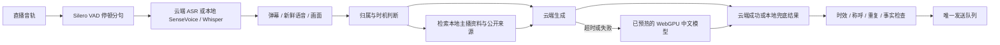

# AI 基础链路与中文端侧使用说明

核对日期：2026-11-06。版本保持 0.1.3；本次是 dev 集成，不创建稳定版发布。

## 快速开始

Chrome 扩展中打开“AI → 本地与性能”，使用独立的“启用本地 AI（云端优先，本地兜底）”开关，保存后生效；点击 **一键启用本地 AI** 可同时保存并准备文字与已允许的语音模型。保留已有云端服务、密钥、模型组合、音视频来源和本地选型，不勾选“仅使用本地回复模型”。云端与本地可同时启用：云端正常时直接使用云端，失败、超时或额度耗尽才尝试已就绪的本地模型。本地语音测速失败不会阻塞云端感知。关闭本地 AI 后停止使用本地回复与识别，解除仅本地回复限制，保留云端配置。

本地推理无需模型密钥、Python 路径或模型目录；文字与视觉复用浏览器 Qwen3.5，语音自动选型优先已安装的 SenseVoice，没有组件时使用浏览器 Whisper。一键启用不安装本机服务，自动准备已允许的浏览器模型；画面和语音仍先使用云端，失败才本地。需要纯本地语音时，可手动选择“本地中文语音感知 + 现有回复模型”。本地语音与本地音画组合会在拉流前等待本地语音测速。启用和准备不会自动启动已暂停的场控或发送测试消息。详见[浏览器本地兜底与视觉记忆](features/local-model-inference.zh-CN.md)。

“本地与性能”显示后台进度：已知文件大小时显示当前文件的下载字节与百分比，预热、测速和安装依赖等阶段显示文字，不虚构总进度。刷新或关闭直播页不取消准备；重载扩展后按保存的任务恢复，复用已完成缓存，再重新加载与预热。中断的单个文件可能重新下载，不保证字节续传。浏览器需要保持运行且扩展已启用；关闭浏览器期间不执行浏览器模型任务。

首次下载需联网和足够存储，文字模型要求可用 WebGPU。保存设置表示保留使用意图，只有实际准备和自检通过的模型才能用于回复；失败会显示原因，可手动重试。语音失败时保留语音设置供后续重试，已经就绪的本地文字仍可使用。同一模型的并发准备合并；准备完成不会覆盖期间编辑的新草稿。停止采集不会在模型稍后准备完成时重新拉流；点击“释放内存”会撤销准备与自动恢复，缓存权重保留。

可选本机组件首次运行 `npm run native:install` 接入安装代理，之后安装在独立进程中继续，关闭终端、刷新网页或重载扩展均不取消；在 SenseVoice 安装说明中可点击“后台安装 / 重试本机组件”。浏览器扩展不能凭空安装原生程序，因此首次接入仍需这一条命令。详见[本机安装与恢复](guides/native-perception.zh-CN.md#一次安装)。

手动勾选“仅使用本地回复模型”才隐藏云端回复密钥表单，原有高级选项仍可调整。纯本地模型不能替代可选搜索服务，联网搜索继续受自己的开关、权限与额度控制。本地语音只转写音轨；默认浏览器视觉可在云端失败时补充画面观察。独立的“本地音画”组合仍是手动配置本机服务的高级选项。

## 已落地的链路



- 默认自动设置云端时限 8000ms、整次上限 16000ms，关闭自动设置后可手动配置。云端请求完成前不启动本地推理；云端故障或超时后，本地只使用剩余总预算。正在查证的任务继续使用两分钟查询预算，不用未核实短答代替。实际回复不触发首次下载，已启用的本地模型由准备流程提前加载；始终只有一个回复出口。
- Cockatiel 按接口与模型管理熔断：连续两次可恢复错误后打开30秒，随后允许恢复探测；取消不计入服务故障。认证、权限、计费等错误保留原有诊断。HTTP 402 或明确的余额/额度耗尽暂停该提供方5分钟，立即尝试已准备的本地模型，随后允许恢复探测。工具自己的云端每小时上限耗尽也能继续用本地独立额度。
- 停止、切主播、修改AI配置、资料删除或失效会阻止旧结果使用；明确 @ 场控可以取消生成中的普通插话。任务级时限也会中止底层HTTP或本地Worker，不再只丢弃 Promise 的结果。
- 普通语音闲聊不等待画面；含“这两个、看看、手里”等视觉指代时保留最多3秒的对齐等待。音画时间、说话人未核实等边界继续保留。自然感来自理解、时机、少重复与允许沉默，不声明自己是真人，不编造经历。
- 面板显示最近100次完成的提供方与耗时、样本P95；这是本页观测，不是承诺的服务SLA，也不包含直播平台最终送达时间。

## 开源组件选择

| 能力 | 本次复用 | 选择依据与边界 |
| --- | --- | --- |
| 浏览器中文回复与视觉 | [Transformers.js 4.3.2](https://github.com/huggingface/transformers.js) + [Qwen3.5 4B ONNX OPT](https://huggingface.co/onnx-community/Qwen3.5-4B-ONNX-OPT) | WebGPU q4f16；按资源从4B、2B、0.8B逐级实测，保留Qwen2.5文字兼容候选，全部固定revision；通过中文、意图、视觉和延迟检查才就绪，不代替云端研究能力 |
| 中文本地ASR优先项 | [sherpa-onnx 2.0.1](https://github.com/k2-fsa/sherpa-onnx) + [SenseVoiceSmall](https://github.com/FunAudioLLM/SenseVoice) int8 | 已有ONNX识别器，2个CPU线程、常驻加载，实测RTF门槛；分段识别，不能称为原生流式ASR |
| 浏览器ASR备选 | [多语言 Whisper tiny ONNX](https://huggingface.co/onnx-community/whisper-tiny) | 显式 Chinese / transcribe，WASM独立Worker；不选英文专用模型；准备和实际识别均有耗时限制 |
| 停顿分句 | [vad-web 0.0.31](https://github.com/ricky0123/vad) + [Silero VAD v5](https://github.com/snakers4/silero-vad) | 复用直播音轨，不请求麦克风；450ms停顿、长句约8秒切段；加载失败退回定时分段 |
| 中文资料检索 | 既有 MiniSearch + Intl.Segmenter | BM25相关片段，来源与采集时间保留；复用现有检索器，不再另造检索框架 |
| 服务故障恢复 | [Cockatiel 4.0.0](https://github.com/connor4312/cockatiel) | 成熟熔断组件；应用只负责截止、云端失败后的本地兜底和当前任务归属 |

补充核对了[阿里 FunASR](https://github.com/modelscope/FunASR) 的 Paraformer 流式/非流式、FSMN-VAD、SenseVoice 与 Fun-ASR-Nano。Nano 有现成CPU Transformers与GPU服务路径，Paraformer有现成流式部署，适合后续更高准确率或持续增量识别的服务提供方。本次选已在 sherpa-onnx 跑通的 SenseVoice int8，避免将未验证的模型转换、浏览器算子兼容或自建推理引擎放进实时链路；没有把这些候选都宣称为已接入。

WebLLM 同样可用，但需要独立编译模型库、WebGPU与另一套模型管理。本次 Transformers.js 已覆盖文字与浏览器ASR，使用一套运行时。Chrome内置Prompt API不作为中文能力保证。

执行JS、Worker、AudioWorklet和WASM全部随扩展打包；下载只包含固定版本模型数据、配置与词表。ONNX Runtime会依设备/浏览器选择不同WASM入口，构建保留其完整执行资产，回归检查 asyncify 与 jsep，避免仅有JS却运行失败。许可证与第三方声明写入产物 THIRD_PARTY_LICENSES.txt。模型协议独立于运行时代码协议；SenseVoice 权重不随扩展分发；可选本地安装器从官方固定模型包下载并校验，模型协议仍独立适用。

## 启用与性能门槛

1. 使用 Chrome 扩展版，打开“AI 设置 → 本地与性能”点击“一键启用本地 AI”。首次准备文字模型会下载较大的权重，请等准备完成再用于直播；需要手动选型或重试时，使用本页的模型选择和准备按钮。
2. 自动检测会实际创建GPU设备，并读取浏览器提供的内存、线程数、GPU缓冲区/FP16和存储额度；未知字段不猜测。默认先尝试资源允许的Qwen3.5 4B、2B、0.8B，再试兼容文字模型；手选失败不更换。模型只有在中文事实、意图JSON、视觉位置和速度检查通过后才就绪。文字测速首token≤1500ms、生成≥10 token/s、24 token≤3500ms；实际意图回答≤6500ms，视觉≤8000ms。硬件检测不下载权重，启用后自动准备或手动准备才加载。Qwen3.5输入最多4096 token、旧文字模型1024 token；短答最多72 token，意图JSON最多256 token、600字符，最终弹幕仍受原长度约束。
3. 中文语音默认自动选择：检测到已安装的 SenseVoice 依赖与模型文件后优先准备它，失败或未过测速则尝试浏览器 Whisper；也能手选方案。模型准备状态独立于保存的开关；取消在途Worker会释放其资源，需重新准备，已缓存权重可复用。浏览器或扩展重启后不假设内存里的模型仍然可用。
4. 云端语音识别优先；云端失败或超时后，仅在本地 AI 和中文识别开关均已启用且模型就绪时使用本地兜底。需要完全本地识别时选择“本地中文语音感知 + 现有回复模型”，无需云端语音密钥。底层仍使用用户选择的直播音轨；原生拉流选项在此模式映射为浏览器直接拉流。没有读取音轨权限或流解码失败时明确报错。
5. 默认启用端侧与自动调优选项；已有明确保存的开关继续保留。保存并启用本地 AI 后自动准备文字/视觉与已允许的语音模型。仅用户手动选择时启用“仅本地回复”；本地每小时默认1200次，与云端回复额度分开；停止、每人冷却及唯一发送队列约束继续有效。文字与视觉共用一个Worker和推理槽，忙时不累计画面；ASR独立运行。取消后重新预热，显式释放停止恢复，缓存保留。

### 安装 SenseVoice

SenseVoice 是可选的原生中文语音加速方案；不开启它也可直接使用浏览器本地模型。在项目目录运行：

```sh
npm run native:install
```

安装器自动发现唯一已启用的助手扩展，准备独立 Python 3.12、FFmpeg、锁定依赖，下载官方约163MB的 SenseVoice int8 模型包，校验 SHA-256，再执行真实解码与中文推理自检。无需 sudo、系统 Python、FFmpeg 或手工模型路径。macOS/Linux x64、arm64 自动引导 uv；首次需访问 GitHub、Python 分发站点及包索引。注册支持 Chrome，Chromium/Edge 可加 `--browser=chromium` 或 `--browser=edge`；Windows 原生自动注册尚不支持，浏览器本地模式仍可用。

未能唯一发现扩展时，使用直播感知页显示的、已填入当前扩展 ID 的命令。需要自选运行时或已有离线模型时，仍支持 `--python=...`、`--ffmpeg=...`、`--asr-model-dir=/绝对路径`；只使用云端 Omni 可加 `--without-asr` 跳过本地语音权重。`npm run native:doctor` 可重新自检，不解析直播流或调用付费接口。

固定模型包：[sherpa-onnx-sense-voice-zh-en-ja-ko-yue-int8-2024-07-17](https://github.com/k2-fsa/sherpa-onnx/releases/download/asr-models/sherpa-onnx-sense-voice-zh-en-ja-ko-yue-int8-2024-07-17.tar.bz2)，163002883字节，SHA-256 `7d1efa2138a65b0b488df37f8b89e3d91a60676e416f515b952358d83dfd347e`。下载中断可重跑；半文件不会作为成功安装，已有可用注册在新安装失败时保留。相同源码和配置复用已有安装与缓存，版本更新使用独立目录，保留旧目录供仍在运行的宿主使用。

准备时使用模型包中文样例预热和测速，2个CPU线程，仅识别≤2秒且RTF≤0.6时用于实时语音；速度不足时自动模式尝试浏览器方案。样例通过不等于直播音乐、方言、多说话人场景的准确率验收。

## 上下文来源、预测与联网

“AI 设置 → 知识与搜索 → 全局上下文来源”可分别控制观众样本、本场收入与历史账本、PK/展馆/段位、统计预测与PK推演、原生房间信号、所选公开资料和采集完整性。关闭开关会从实际模型载荷中移除对应字段；“查看已保存配置的上下文覆盖”展示当前可用样本、缺口、过期与关闭来源。采集自身仍由各功能页开关控制。

新增团播成员、连麦用户、可见座位/榜单、榜单更新、商品分类等原生结构化信号；只保留有界投影，隐藏字段保持未知，不将未知分值单位解释成人民币。上下文依相关性和预算选取，云端保留丰富资料，端侧按所选模型精简到1024或4096 token；按实际 tokenizer 删除完整可选记录，保留问题、汇总事实和搜索后回答所需的全部来源正文。问题与搜索依据本身超预算时明确失败，不裁掉依据后继续作答。PK分差由代码计算，不依赖小模型心算。

已整合dev最新预测归档：满足样本/时效条件的未来5分钟钻石、下月收入情景、在线人数和PK概率以有限数值投影进入上下文，标注模型版本、时间、单位与依据。关闭预测来源会一并移除这些字段及原有PK推演；端侧超预算时整块省略并说明。观众个人概率与完整档案不因此发送给回复模型。预测和情景不能当作观测事实或保证结果，详见[预测模块说明](features/anchor-prediction.zh-CN.md)。

原有博查/Tavily/SearXNG搜索可继续设置。云端和端侧共用语义路由，天气、新闻等需要查证的问题无需出现“联网、搜索”字样；缺必要城市先澄清，普通聊天直接回答。搜索最多等待30秒，查询全流程最多两分钟，要求有效来源编号；搜索关闭、无结果或失败会说明无法确认。联网问答不提前返回未核实的端侧短答，查询前云端失败时才由已准备的端侧接手。长查询独立保留待回复状态，超过五秒提示进度，完成后自动回复，刷新中断会留下明确反馈。云端模型额度耗尽不等于搜索服务额度或互联网仍可用，两者分别受配置与服务状态约束。

## 公开账号与作品采集

“AI → 知识与搜索 → 抖音公开账号与作品资料”提供抖音原生搜索、公开链接采集、取消、查看和清空。先在原生搜索结果确认目标，再填写 `https://www.douyin.com/user/…`、`/video/…` 或 `/note/…`。不按同名结果自动认人。

采集会建立自己拥有的临时后台标签页，读取抖音自身请求的公开主页、作品列表、作品详情与页面已加载的结构化数据，最多12秒、单响应1MB、单来源30条。完成或失败关闭该临时页；不会关闭用户已有标签页。不复制Spider的签名器、不导出Cookie、不绕过登录验证、不使用关闭TLS验证或无界分页。

保留公开昵称/简介、公开账号标识、页面认证说明、作品描述/话题/配乐标题、发布时间、页面可见计数和出处；作者sec_uid必须与目标主页匹配，作品ID保持字符串；缺失计数为null而非0，私密/删除条目排除。多来源同一作品去重。按主播隔离、最多300条、24小时过期，每次只取最多4个相关片段；正文与模型输出都不能自行改写该资料。清空或到期后在途及排队的旧上下文回复失效。重新采集某个来源前先撤下其旧证据，页面变为不可见或刷新失败时不继续沿用旧资料。

可列出本房已观测到且带有效sec_uid的公开主页，选择后采集或加入自动更新列表。只有明确选择的来源才会更新；默认每来源60分钟、每小时6次、最多10个来源，自动请求至少间隔60秒；可设置15–1440分钟、每小时1–30次。调用计数属于本页实例，页面重载后重新计数；同来源已有新鲜记录会抑制重复刷新。自动更新在当前页面存活且开关启用时继续运行，AI暂停并不关闭资料更新。切主播、关闭采集或移除自动来源会取消旧任务；导航/关闭页面停止调度。

作品描述不代表已观看作品视频或识别全部图文；主题不直接等于个人爱好，公开同场互动也不等于私人关系。页面挑战、权限变化、结构改版和作者ID缺失都会导致资料不可用。当前没有官方开发者scope或服务端密钥，因此没有宣称官方账号/搜索API已开通，也没有开展全观众批量档案、私密信息或跨平台身份关联。用户提供的[DouYin_Spider](https://github.com/cv-cat/DouYin_Spider)仅用于核对接口形态；其快照未发现LICENSE，不复制产品实现。

## 本轮自动配置实测

在独立 Chrome151 / WebGPU 实例中，浏览器报告16GB内存、10线程与shader-f16。1.5B q4加载出现`std::bad_alloc`；1.5B q4f16虽然首token约559ms、约37.8 token/s，却在结构化问题上输出异常。补充中文事实自检后它被拒绝，自动候选路径继续使用0.5B；没有再自行转换模型或研发新推理引擎。

最终0.5B自检通过，最终整合后测速首token约232ms、50.7 token/s、24 token共705ms；断网使用实际应用提示，输入200/180分及代码算得的分差，回答“目前领先20分。”。早先未提供计算摘要时0.5B也曾答错分差，因此增加代码计算与测试；这些探针证明基本可用性，不能当作通用中文准确率、生产P95或所有设备保证。模型选择先是候选推荐，只有准备完成且自检/速度全部通过才可用。较大模型支持不是效果承诺。见[本轮实测记录](reviews/ai-auto-context-benchmarks-2026-11-03.json)。

## 实测与验收边界

本次已在独立 Chrome 151 测试实例验证 MV3 offscreen、Worker、WebGPU q4加载、中文生成、断网生成、释放后断网复用缓存，以及Silero本地WASM加载与释放。中文上下文+24 token测试首token约214ms、生成约60 token/s、整次约612ms；这是本机单次预热样例，非生产P95或所有设备保证。

SenseVoice真实中文模型包样例约5.6秒，在ARM本机2线程CPU的运行观测约87–409ms，RTF约0.016–0.073，模型准备约2.1秒。样例仅证明推理链路和性能，不作为中文准确率评测；直播音乐、方言、混响、多人重叠和说话人归属仍需用户直播回放验收。浏览器Whisper仅完成集成与预算测试，未在该轮执行完整模型准确率对比。精确的单次结果保存在[实测证据](reviews/ai-foundation-benchmarks-2026-11-03.json)。

自动化回归覆盖超时实际取消、云端优先/失败后兜底、熔断隔离、旧请求不能解锁新请求、停顿分段、来源/作者/计数边界、去重、失效、删除、原生页跳转与资源关闭、UI选择到实际上下文的完整链路。未执行2/8小时真实直播稳定性、服务商端到端延迟基准、登录账号真实页面采集验收或自然感人工盲评。crapper、dryer、mutator在环境中不可用，未将其他检查记作这三项通过。

术语：ready=该运行时已加载并通过门槛；RTF=识别耗时/音频时长；sec_uid=抖音公开主页标识，aweme_id=作品标识，UID/open_id/open_uid不是可互换字段；公开来源采样=页面当时可读取的一部分内容，不能当作完整账号历史。

## 本地中文音画与成本

在“连接与模型”选择“本地中文音画感知 + 现有回复模型”。本机视觉默认使用 Ollama 的 `qwen2.5vl:3b`：安装 Ollama 后运行 `ollama pull qwen2.5vl:3b`，保持 `ollama serve` 运行；默认接口是 `http://127.0.0.1:11434/v1/chat/completions`。也可填写兼容图片输入的本机服务与模型，仅接受本机回环地址，不能将此组合误连到云端。扩展需在“AI 服务访问权限”授权本机服务。首次加载和图像编码可能较慢；视觉是间隔采样，不能称为连续视频。建议先用默认12秒间隔，根据实际设备调整。

语音在“本地与性能”启用本地 AI、中文语音，安装或更新 SenseVoice 组件并准备。SenseVoice 使用 int8 中文模型、静音裁剪和1/2/4线程真实语音预热测速，选择实际最快配置；浏览器 Whisper 使用真实中文短句自检，不以静音测速证明识别质量。SenseVoice 一次调度抖动不永久禁用模型，连续三次超出实时预算才停用并提示。设备仍不达标时保留 `slow`，不会伪造就绪；自动模式依次尝试本机和浏览器后端，手选后端保留。

本地语音和本机视觉不消耗云端感知调用数。静态画面在有效期内抑制重复推理，不伪造新的观测时间；本地视觉只发送最新一帧并限制160个输出 token，以降低图像编码和生成耗时，忙时跳过且不积压。云端识别仍按原小时额度，本机视觉另限每小时1200次。文本回复保持原有云端优先/本地兜底选择，只有勾选“仅使用本地回复模型”才纯本地回复。搜索、云端回复及手选云端感知仍可能产生费用，调用数不等于实际货币账单。

2026-11-06 本机 M5 / 24 GiB 样例：SenseVoice 同一4秒中文片段的暖推理中位数由70.69ms降为44.1ms（约37.6%）；同时运行视觉服务时复测57ms，仍通过门槛。Qwen2.5-VL 3B 对640×360红蓝矩形图的首次请求7.10秒，后续2.38/2.47秒，正确描述物品及颜色。浏览器 Whisper 对固定中文短句未通过正确性自检，保持不可用并推荐 SenseVoice；没有把失败测速当作性能通过。上述均非直播端到端或准确率保证，详见[实测记录](reviews/ai-core-benchmarks-2026-11-06.json)。

## 人物关系图谱

后台研究已接入 LangGraph.js 浏览器工具循环、IndexedDB检查点和可选持续研究。在“AI → 观众与研究”保存启用后，从新近弹幕/已识别语音发现话题，多步搜索、阅读和检索原文；原始来源可供前台快速复用。前台回复仍使用独立的现有模型与发送链路。浏览器关闭时暂停，真实模型质量评测与全天运行尚未验收。选型、完整数据流、额度和恢复边界见[浏览器 Agent Harness](development/browser-agent-harness.zh-CN.md)。

图谱直接由已持久保存的弹幕、语音、运营知识、公开资料和协议互动建立可重建索引，不再复制一份可冲突的可变关系数据库。原始资料按直播间和主播保存，后台查询可跨房间和主播连接稳定账号，源资料跨重启保留；请求最多选取相关的两跳关系和有限原话，避免把全部历史发送给模型。

在“知识库 → 人物关系图谱”输入名字或两个人物，点击“查看关系与证据”。查询在本机运行，不调用模型或联网，使用当前手工草稿。添加知识示例：

```text
人物：阿明；别名：明哥、阿明哥；身份：主播。
阿明是小雨的师傅。
小雨和小李是朋友。
```

核对后启用并保存。支持师傅/师父、徒弟、朋友、同事、搭档、队友、同门、兄弟姐妹、父母、粉丝、助理与经纪人等明确陈述，以及“不是/不再是”的否认；支持“我是阿明徒弟”“阿明是我师父”“阿明的朋友是我”等明确口语自述，只有能确定实际发言账号时才替换“我”。问句、条件句和模糊传闻不自动成为事实；不能理解的自然表达仍保留原话供普通检索，不能宣称任意表达已结构化。别名只由运营核实资料绑定，稳定账号分人；重名会报告多个候选，不自动合并。只从画面、声音或共现不能认证人物身份和关系。

状态口径：`verified` 是运营核实资料；`unverified` 是弹幕、公开页面或语音中的未核实陈述；`observed` 是采集到的历史 PK、已连接连麦、@提及或公开评论回复；`conflicted` 是同一关系存在肯定与否认。重复弹幕不提高可信度，多跳路径不推断朋友或亲属。模型应据原话说明关系依据，冲突时说明尚不确定。

关闭 AI 记忆停止历史图谱进入问答；观众来源开关控制观众资料，公开账号来源开关控制主页资料。遗忘观众、清空感知记忆、停用/删除/过期知识后，对应关系即时移除；旧页面存档合并也不能复活已删除证据。图谱跟随直播记忆导出，手工背景知识跟随配置导出。仅覆盖实际采集的资料，不等于平台完整社交网络。

跨房间只按稳定 UID 或 secUID 识别账号。两种标识必须在同一次平台观测中一起出现、且对应关系无冲突，才能连接；不同范围的同名提及保持独立候选。每条关系保留房间、主播、原话、来源及时间。生成过程中删除或改变相关证据会使本次回答失效，重新提问才使用新资料。后台研究任务执行时也重新读取图谱。

公开资料沿用“观众与研究”的采集许可、自动更新列表、重点对象筛选及共享小时额度；自动研究仍需启用，不能按昵称私自选人。一次任务最多访问一个主页和两部已核对作者的作品，顺序读取原页面实际加载的评论/回复及作品弹幕，合计最多90条；不调用签名接口绕过验证，也不把计数当成已读取全部评论。回复边仅表示公开互动，评论中的身份或关系自述仍待核实。

选择“本地中文语音感知”或“本地中文音画感知”后，公开作品也尝试约4秒音轨和一帧画面；使用本机 SenseVoice 和回环视觉服务，不自动切到云端，不新增云端感知费用。作品后台语音需要自动或 SenseVoice 后端，通过真实自检才识别；媒体地址必须匹配该作品原页面加载的详情，无法确认的 blob 播放器、画布跨域限制、没有音轨或模型未就绪都保留缺口。转写不认证说话人，画面不创建人物身份或私人关系。作品、评论、弹幕和采样识别文本作为有日期的历史资料最多保留180天、3000条，简介和计数仍只作24小时内的页面观测；清空/移除来源及刷新失效继续控制其检索。

已进入完整公开视频后台任务的关键帧分析，需要更新本机组件并使用支持卸载确认的 Ollama 回环服务，地址使用 `/v1/chat/completions`，仍需浏览器授权该本机服务。每帧在本机完成分析并卸载视觉模型后才继续；取消、关闭连接或直播语音抢占时，先等待在途识别结束和卸载确认，再让下一个本地模型运行。组件意外退出留下的任务资源由下一次本地模型准备先行清理；服务不可用或卸载无法确认时保留等待状态，可恢复原服务后重试。其他兼容视觉接口继续沿用原有前台识别方式，后台任务不会假定它们支持 Ollama 卸载协议。
