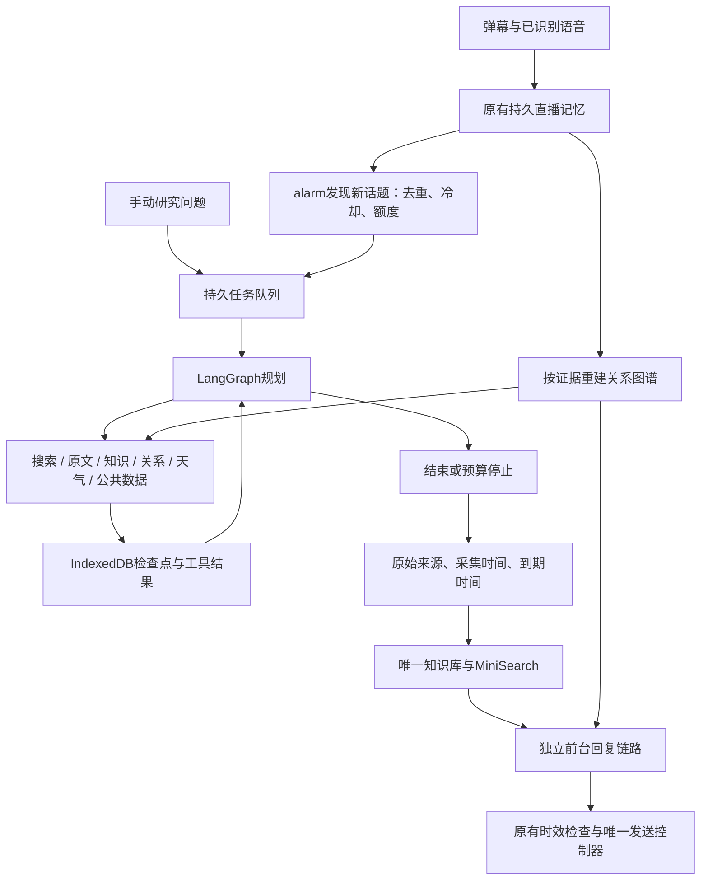

# 浏览器持久 Agent Harness 与持续研究

核对日期：2026-11-07。本次将后台单轮研究替换为真实 LangGraph.js 工具循环，接通持久恢复、自动发现研究任务和前台原文复用。它是直播业务的受限 Agent 运行底座；没有接入通用终端、任意代码执行或独立公屏发送器。

## 开源选型

核对官方 README、包入口和 npm 元数据，实际浏览器打包后选择如下。原始调研文件保存在本次 `output/agent-harness-2026-11-06/research/`；GitHub API 限流时使用官方 raw 文件及 npm。

| 项目 | 核对结果与采用情况 |
| --- | --- |
| [LangGraph.js](https://github.com/langchain-ai/langgraphjs) | **已接入** 1.7.1 的 `@langchain/langgraph/web`，配合 core 1.3.5、checkpoint 1.2.2；使用真实 StateGraph、条件边、同步持久屏障和原生 pending writes 恢复 |
| [Deep Agents JS](https://github.com/langchain-ai/deepagentsjs) | 有 `deepagents/browser` 入口；完整文件系统、中间件与子任务能力超出当前工具边界。本次直接复用其底层 LangGraph，没有把 Deep Agents 整包接入 |
| [shuorenhua](https://github.com/MrGeDiao/shuorenhua) | **已改编接入** 2.6.1，固定 `9b91ed9464b944258c5031993c5e7d5d4e9637a8`；提炼保真编辑原则为短回复规范，云端/端侧/查证/修订/研究共用，MIT声明随包分发，不加载整份skill到模型 |
| [Vercel AI SDK](https://github.com/vercel/ai) | 成熟模型/工具传输抽象；现有服务已有搜索、SSE、权限与模型路由，本次不再并列维护另一套传输 |
| [pi-mono](https://github.com/badlogic/pi-mono) | 核对 pi-agent 循环及编码 Agent；终端、文件与进程工具不能直接变成 MV3 领域能力，未接入 |
| [Nanobrowser](https://github.com/nanobrowser/nanobrowser) | 浏览器自动化实现可参考；本工具已有抖音临时页、作者核对及取消控制，保留一个页面采集所有者，未复制其自动化层 |
| [Graphiti](https://github.com/getzep/graphiti) / [LightRAG](https://github.com/HKUDS/LightRAG) | 成熟服务端图检索方向，需额外服务/数据库与运维；未部署。当前图谱继续从已有原始证据重建，MiniSearch 做本地片段检索，不宣称已实现任意关系抽取或全量 GraphRAG |

新增运行时代码随扩展打包，不在运行时下载执行 JS。第三方许可证进入 `THIRD_PARTY_LICENSES.txt`。LangGraph 会增加包体；独立未压缩研究入口探针约3.9MB，不能称为零成本替换。

## 数据与执行路径

`src/ai/research-graph.js` 负责状态转移；模型每轮输出一种经 Zod 验证的动作，观察工具结果后继续。动作只包括 `search`、`read`、`inspect`、`catalog`、`knowledge`、`relationships`、`weather`、`public-data`、`finish`。模型不能指定 JavaScript 函数，不能读取未提供/未搜索到的链接。重复请求去重，错误作为观测返回下一轮；来源编号必须实际存在。编号检查不能证明每句回答都被原文支持，语义质量需真实模型评测。

`AgentHarness` 拥有排队、取消、可选超时和房间隔离，LangGraph拥有任务内部步骤。每房间/主播串行，全局最多2个在途任务，未完成队列无默认数量上限。`research-settings.js`统一模型轮数、搜索/读取/来源数、小时调用/搜索额度、请求/任务时限与输出token预算：默认0不限，用户正整数才限制。普通/深入档共用这些设置；等级仅决定调度和披露内容。手动单任务额度跨小时恢复仍累计，已消耗的预留不退回。

`BrowserCheckpointSaver`用Dexie保存完整图状态和原生pending writes；完成工具节点有持久屏障后才继续规划。`langgraph-v1`中断后继续恢复，不设默认恢复次数上限；旧非可恢复任务仍保留中断状态。未落盘请求可能重复并再次计费，不保证网络副作用恰好一次。未完成任务、关联检查点和单任务额度不按一天/100条清除，loop去重水位持续保留；已完成历史可有界清理。密钥只在请求闭包中读取，不进入任务与图状态。

恢复绑定已保存模型设置、主播、知识遗忘版本与相关关系证据。设置变化、AI关闭、证据到期/删除/改变使旧结果失效；在途请求实际收到取消信号。来源保留原到期时间，重新入库不会延长旧证据寿命。

## 渐进披露、每轮压缩与自然回复

每轮规划前，LangGraph的`compact`节点用MiniSearch按问题及最新工具查询检索证据，工作集上限32000个JSON字符，最多12个带出处/偏移的原文片段、分页来源目录、最近3步执行摘要和有界最新工具结果。固定目标和必要事实装不下时明确失败；这是单次上下文容量，不是任务轮数预算，也不冒充模型实际token计数。端侧继续用实际tokenizer控制输入容量。

模型可用`inspect(source, offset)`展开6000字符原文窗口，`catalog(offset)`分页浏览全部来源，或`read(source)`按编号读网页。每来源正文最多48000字符，超出标为截断；未读部分不能补造。完整有界原文和工具观测保留在检查点，工作集仅为投影，不修改证据。长原文入库按12000字符分块、每10来源一批；工具摘要不作为事实。关系结果过大时整块省略并要求缩小查询，不拆出缺实体的关系边。

shuorenhua的编辑原则由 `src/ai/reply-style.js` 唯一维护：删无独有内容的客套、预告和重复，保留责任主体、数字、条件、范围、否定、可能性、完成状态、比较及来源归属。规则用于生成时自检，既有必要的答案修订也复用，不新增每条回复的二次润色调用。不做机械替词或“AI含量”评分，不以自然口吻冒充真人。短模型的固定上下文仍受原有硬预算约束；搜索专用说明按阶段披露。

## 持续研究和前台响应

在 **AI → 观众与研究 → 后台研究 Agent** 启用“持续研究新近对话（Chrome 扩展）”，保存设置。需同时启用 AI 与持续记忆，并配置可用的后台回复接口、本机保存的密钥及所需域名权限；联网搜索另需启用和配置。

持续研究和研究后人物整理默认开启，研究间隔、小时任务数与执行预算均0。启用并保存AI后，资料保存和任务完成立即唤醒loop，30秒alarm兜底；同房间串行，完成后接续下一批，原始资料时间保留。积压资料不受五分钟/最近片段窗口截断；普通资料去重持续保留，身份不明的感知不默认归给主播。近30天活跃且存在唯一稳定主页的人物仍可每日复查，受观众/账号/采集开关和用户手动额度约束。无新资料且无人到期复查时等待。稳定任务ID覆盖提交成功但去重状态未落盘的崩溃窗口。

浏览器保持运行时，关闭直播页后已排队的任务仍可继续；失去新采集后不再产生新话题；已有近期人物仍可在30天范围内按额度复查公开资料。浏览器关闭期间暂停；MV3调度可延后，不承诺全天实时运行。油猴和演示版只支持依赖页面存活的手动研究。后台目前走已保存的 HTTP 模型接口，不会自动转到前台 WebGPU 兜底。

后台得到的**原文**自动进入既有知识库（受记忆及联网知识开关控制），MiniSearch按前台问题选最多3个网址的候选，每网址最多3个相关片段，携带原始来源与有效期；全局仍受8片段、6000原文字符限制。前台在证据足够时可一次模型调用直接回答；不等待后台所有研究完成，也不保证任意问题一次调用或固定延迟。模型结论和私人身份推断不自动变成已核实事实。

前台需要新查证时选择research等工具意图，交给后台研究模型执行，等待时释放前台互动槽，后台证据返回后再快速组织回复；默认没有120秒研究等待上限。设置仅有回复与后台两种模型，profile任务沿用research，无独立人物覆盖。测试页使用独立后台研究过程，AI总开关关闭也可显式测试，不向真实任务、知识或人物投影写入；受控固定资料评测仍隔离真实研究。

抖音主页/作品读工具复用已有账号采集许可、稳定账号核对和共享小时预算。只采集页面实际加载的公开资料；同名保持不同候选，未加载内容保持未知。已有知识图谱和关系图谱覆盖原文、明确陈述和观测互动，不能等同完整社交网络。

## 按观测画像分配研究深度

画像是已有 `AudienceMemory` 的查询投影，不建立第二个可变人物数据库。每个稳定 UID/secUID 持续保存原始互动和逐字段带时间的等级观测；同名不合并。`audience-profile.js` 统一定义汇总、优先级和执行预算，前台、自动任务、公开账号筛选复用此口径。

- 礼物使用过去30天本房已采集记录，同一连击取累计最大件数；已知单价形成金额下限，未知价格保留件数与缺口，绝不补价或换算成财富。全部近期记录参与汇总，回复只取至多3条相关明细。
- 荣誉等级、本房粉丝等级仅用24小时内的实际观测；新事件未携带等级时不抹掉旧值，合并存档按各字段自己的时间取新值。其他房间粉丝等级不参与。
- 主播的稳定 UID 与当前主播一致时进入深入档；观众荣誉等级≥40、本房粉丝等级≥15、已知礼物下限≥1000钻或观测礼物件数≥100，任一满足也进入深入档。这些是当前调度阈值，不是经过模型学习的价值或消费意愿评分。
- 自动任务先照顾主播及较高优先级，每三轮给普通候选机会，同档优先近期较少服务的账号，再按最早待处理资料推进。轮次与去重持续保存，资料不因等待超过五分钟或100条窗口被遗漏；预算与时限仅在用户设正数时生效。
- 客户端只提交身份键，宿主读取当前存档决定深度、相关原话和来源；提交时绑定遗忘版本。排队、执行、恢复和入库均核对版本，遗忘后再观测同一账号也不承接旧任务。

仅对无冲突的同次稳定账号配对补充抖音主页；相关公开资料沿用账号采集开关和共享额度。已有同人主页原文在24小时及原到期时间内优先复用，要求重新查证时不使用缓存。依旧只采集页面实际加载的公开资料；多轮研究增加查证机会，不等于绕过平台限制或爬取完整历史。

个人研究原文带 `subject` 和 `subjectEpoch` 存入既有知识库，身份范围参与内容摘要去重。该范围表示这次研究服务的账号，不自动证明网页作者身份。前台只检索当前观众及通用来源；遗忘、关闭观众上下文或记忆后不可复用个人资料。通用图谱和原生FTS不会把这些个人来源作为无归属的通用证据；原生审计档案保留范围元数据，个人实时检索由持有遗忘标记的浏览器负责。既有账号作品和明确互动仍通过原图谱的来源、实体和关系边界使用。

画像披露不超过2200个JSON字符，只含必要汇总和当前问题的少量原话、核实补充、公开片段；长原文保留在存档。每轮研究工作集≤32000字符。前台不重复传画像及支持汇总，端侧仅在存在相关证据时加入短语气说明，容量不足时保留问题和事实。等级和支持只影响调度和语气，不改变事实标准、不播报“高价值”标签、不推断职业、财富或人格；自然表达规则继续共用。

检索使用MiniSearch的来源分散选择：最多3个不同网址的候选，再补不重复的缓存候选。同一视频的音轨与画面可组成一个候选、一个引用，独立片段保留sourceId、时间、范围及待核实条件；不同限定不压成单一描述。复合引用最多3段，旧单片段引用兼容；回答前逐段重读，任何一段删除、到期或移出当前主体范围，整个旧候选失效。端侧保留完整的有界候选与偏移，token预算不足时省略整项，不能截成缺少后半证据的候选。来源之间的条件、冲突与时间保留，不把多源自动当成一致。新增Promptfoo场景检查高等级不猜职业、支持记录不改变自述确定性、普通观众仍得到直接有用回答；受控测试同时验证真实记忆和Engine路径，不把脚本生成的答案当真实模型成绩。

候选在模型生成期间失效时，`corpus:`引用不能作为联网搜索词。共用客户端在正常后续额度、截止时间与取消约束下，最多重新判断一次意图，移除旧候选与答案，再按原有时间、天气、公共数据、搜索或澄清流程执行。旧UUID缓存仍可用其原语义查询重查。搜索意图参数拒绝内部引用；重新选择已失效知识则给出资料变化说明。知识答案交付前再次读取原文，比对候选、正文与来源范围；修订期间删除、过期或归属变化也不能靠合法引用编号交付旧结论。有效知识仍只需一次模型生成；端侧沿用同一流程和独立本地额度。

## 验证与尚未完成的质量验收

`npm run eval:harness` 检查多步工具轨迹、来源引用、非法动作、循环预算、跨重启检查点、并发额度、取消、配置变化、证据删除、任务去重，以及“对话→后台研究→原文库→前台回复”的真实应用调用路径。模型/搜索响应使用受控夹具，检查实现行为，不测模型知识水平。

`npm run eval:agent` 使用固定版本 Promptfoo 和真实模型；目前共64个场景，11个后台研究场景，包括新增加的多跳、原文阅读、冲突、提示注入、未知、空结果、同名身份、长原文末尾条件和自然短答的事实保真。虚构事实夹具避免靠预训练猜答案，多跳和阅读场景同时核对实际工具轨迹。本机未提供 `QWEN_API_KEY`、`QWEN_WORKSPACE_ID`，**未执行真实模型质量评分**；没有“比旧版准确率更高”或“终极AI”的实测结论。

真实 Chrome Worker + IndexedDB 已验证搜索完成后终止Worker、新Worker恢复且不重复搜索；使用合成模型/搜索，不能当成真实模型延迟，也不是安装版MV3后台回收的完整实播验收。真实工作台验证桌面/窄屏、长结果、同时展开、反复折叠、键盘及鼠标缩放、有界正文滚动、草稿保留、动态任务刷新和控制台无错误。最终测试数字与限制见[验证记录](../reviews/browser-agent-harness-2026-11-07.json)及[行动日志](action-log.zh-CN.md)。

仍需在实际配置下完成模型评测、公开账号端到端、长时间直播和人工盲评；crapper、dryer、mutator在本环境不可用，未执行其检查。

## 人物档案投影

`person-dossier.js`从关系图谱的同一来源构建可重建档案，不新增持久写入者。明确的本人陈述和运营人物字段进入facets，原始陈述/礼物/互动进入events，原账号弹幕可作speechSamples；所有字段带来源、时间、归属说明和原记录编号。第三方subject语料仅作为leads，不把研究subject当作者，不从这些材料自动认证人际关系。

图谱查询按问题披露最多4条不同事件、2条说话样本、2条待查线索、8条明确字段；普通查询前3个相关人物可带档案，每个最多4000 JSON字符，浏览档案最多6500。字段预算按完整条目裁减；事件保留原文范围和原长度，通过recordId按需读取完整有界原文。原始存档不被截断摘要替换。无边人物也能在总览选择；全网图仍受80节点及120关系上限约束。

人物档案使用已有UID/secUID双射和来源范围；主体语料要求当前观众仍存在且遗忘版本匹配。有效期与30天礼物窗口进入缓存有效性签名。生成期间档案变化会使回答作废，礼物窗口单纯时钟移动不被误判成事实变化。云端、端侧和研究共用该证据边界；没有真实模型评分时不声称消除了所有幻觉。

本轮最终自动化与实机范围见[人物档案验证记录](../reviews/person-dossier-2026-11-07.json)；原始日志、合成夹具、截图和修复前失败观测保存在本机output目录。

## 与 AI 对话补充人物

知识库的“与AI补充人物”沿用原知识编辑弹窗及 `ai.memory.entries`，不会维护第二份图数据库。填写名称、可选的已核对 UID/secUID 和补充原话后，当前配置的兼容模型返回完整当前字段、明确关系、独立的有限心理/互动解读及一般知识。Zod 校验每项依据的轮次与连续原话；更正后的当前住址与家乡各只有一个值，旧说法仍留在对话历史。MiniSearch 根据问题选择人物字段，避免大量喜好挤掉相关经历。

整理结果先进入弹窗，点击“确定”进入现有设置草稿，再“保存设置”持久化。已有条目的“继续补充人物”复用同一 ID 和原话历史；取消会中止请求，迟到结果或请求中修改的输入不能覆写新资料。每轮最多4000字，最多16轮、原话总计12000字；结构资料与正文共同计入原知识库20000字总额。仅本地模式需使用本机兼容接口，本功能不自动切换到浏览器端侧模型。

人物整理保持 `unverified`，无账号时创建独立资料人物，不按昵称绑定当前主播/观众。原知识库保存、导入及后台跨房图谱查询共用该条目，停用/到期/删除同步移除关系；普通云端与端侧回复也保留待核实来源。心理解读与事实分栏，只能是带原话依据和局限的温和假设，不用于诊断或操控；一般心理知识不能认证个人心理状态。

普通搜索命中历史缓存后也在答案交付前重读 canonical 原文，覆盖生成与修订阶段；删除、过期、移出主体范围、正文或覆盖变化均不能交付旧结论。缓存自身的较长寿命不会覆盖原文的短有效期。此次完整 JavaScript 1910项通过，真实浏览器对话、五种尺寸、长原话、展开/收起、连续指针/键盘缩放及焦点检查通过。模型响应均为受控夹具，未据此宣称真实模型抽取准确率或心理分析有效性。
