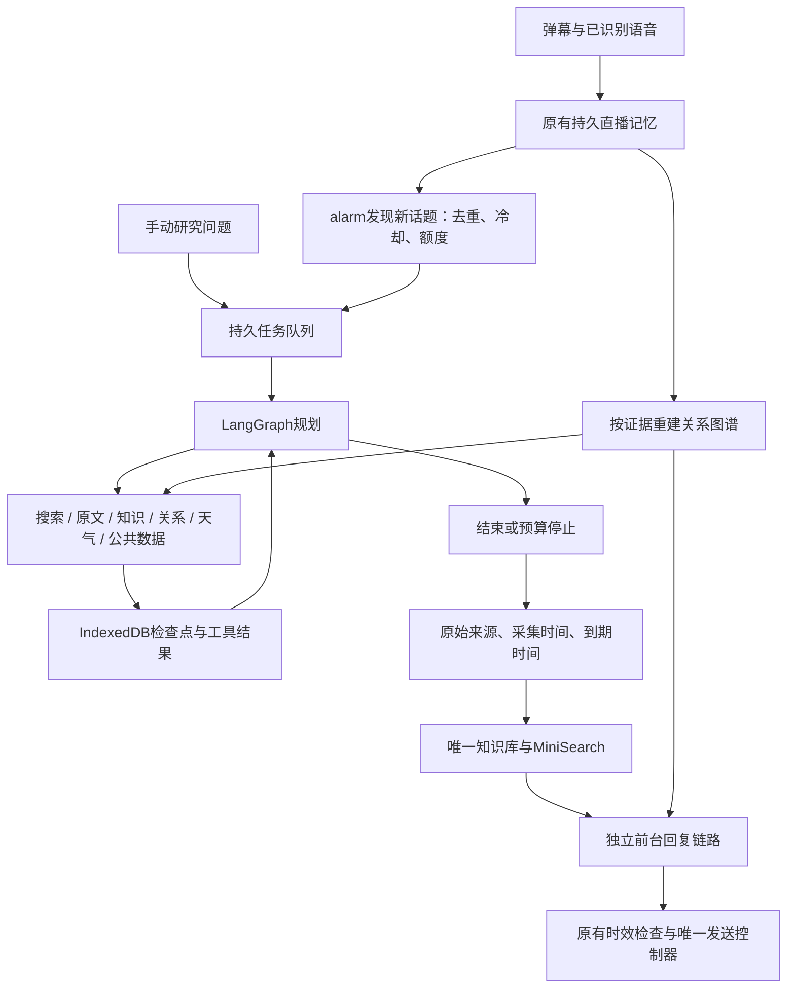

# 浏览器持久 Agent Harness 与持续研究

核对日期：2026-11-07。本次将后台单轮研究替换为真实 LangGraph.js 工具循环，接通持久恢复、自动发现研究任务和前台原文复用。它是直播业务的受限 Agent 运行底座；没有接入通用终端、任意代码执行或独立公屏发送器。

## 开源选型

核对官方 README、包入口和 npm 元数据，实际浏览器打包后选择如下。原始调研文件保存在本次 `output/agent-harness-2026-11-06/research/`；GitHub API 限流时使用官方 raw 文件及 npm。

| 项目 | 核对结果与采用情况 |
| --- | --- |
| [LangGraph.js](https://github.com/langchain-ai/langgraphjs) | **已接入** 1.7.1 的 `@langchain/langgraph/web`，配合 core 1.3.5、checkpoint 1.2.2；使用真实 StateGraph、条件边、同步持久屏障和原生 pending writes 恢复 |
| [Deep Agents JS](https://github.com/langchain-ai/deepagentsjs) | 有 `deepagents/browser` 入口；完整文件系统、中间件与子任务能力超出当前工具边界。本次直接复用其底层 LangGraph，没有把 Deep Agents 整包接入 |
| [shuorenhua](https://github.com/MrGeDiao/shuorenhua) | **已改编接入** 2.6.1，固定 `9b91ed9464b944258c5031993c5e7d5d4e9637a8`；提炼保真编辑原则为短回复规范，云端/端侧/查证/修订/研究共用，MIT声明随包分发，不加载整份skill到模型 |
| [Vercel AI SDK](https://github.com/vercel/ai) | 成熟模型/工具传输抽象；现有服务已有搜索、SSE、权限与模型路由，本次不再并列维护另一套传输 |
| [pi-mono](https://github.com/badlogic/pi-mono) | 核对 pi-agent 循环及编码 Agent；终端、文件与进程工具不能直接变成 MV3 领域能力，未接入 |
| [Nanobrowser](https://github.com/nanobrowser/nanobrowser) | 浏览器自动化实现可参考；本工具已有抖音临时页、作者核对及取消控制，保留一个页面采集所有者，未复制其自动化层 |
| [Graphiti](https://github.com/getzep/graphiti) / [LightRAG](https://github.com/HKUDS/LightRAG) | 成熟服务端图检索方向，需额外服务/数据库与运维；未部署。当前图谱继续从已有原始证据重建，MiniSearch 做本地片段检索，不宣称已实现任意关系抽取或全量 GraphRAG |

新增运行时代码随扩展打包，不在运行时下载执行 JS。第三方许可证进入 `THIRD_PARTY_LICENSES.txt`。LangGraph 会增加包体；独立未压缩研究入口探针约3.9MB，不能称为零成本替换。

## 数据与执行路径

`src/ai/research-graph.js` 负责状态转移；模型每轮输出一种经 Zod 验证的动作，观察工具结果后继续。动作只包括 `search`、`read`、`inspect`、`knowledge`、`relationships`、`weather`、`public-data`、`finish`。模型不能指定 JavaScript 函数，不能读取未提供/未搜索到的链接。重复请求去重，错误作为观测返回下一轮；来源编号必须实际存在。编号检查不能证明每句回答都被原文支持，语义质量需真实模型评测。

`AgentHarness` 继续拥有排队、取消、超时和房间隔离，LangGraph 拥有任务内部步骤。每个房间/主播串行，全局最多2个在途任务，待处理队列最多8个。每任务最多4次模型预留、3次搜索预留、3次已记录原文读取、8个来源，单次执行时限180秒；手动/自动研究共享每范围每小时20次模型及20次搜索额度。任务总调用预算跨小时恢复仍累计；失败或取消的预留不退回，避免重试突破上限。

`BrowserCheckpointSaver` 用 Dexie 保存完整图状态和原生 pending writes；完成的工具节点有持久屏障后才继续规划。新任务标记 `langgraph-v1`，中断最多自动恢复2次；旧版任务保留中断状态。未落盘的在途请求可能重复并再次计费，不保证网络副作用恰好一次。任务和恢复窗口一天，检查点及过期额度按该窗口清理。密钥只在请求闭包中读取，不进入任务与图状态。

恢复绑定已保存模型设置、主播、知识遗忘版本与相关关系证据。设置变化、AI关闭、证据到期/删除/改变使旧结果失效；在途请求实际收到取消信号。来源保留原到期时间，重新入库不会延长旧证据寿命。

## 渐进披露、每轮压缩与自然回复

每轮规划前，LangGraph的 `compact` 节点用现有MiniSearch按问题及最新工具查询检索证据，把可变工作集压到**6500个JSON字符以内**。只发送来源目录、最多3个带出处和偏移的原文片段、最近3步执行摘要及有界最新工具结果；不重复携带整页正文、全部历史和另一份相同来源。后台数据载荷总预算10000字符，固定目标和必要事实装不下时明确失败；这是字符预算，不冒充各模型的实际token计数。端侧继续用实际tokenizer控制其输入预算。

模型可用 `inspect(source, offset)` 展开已保存原文的最多1600字符窗口，也可 `read(source)` 按来源编号读网页。长正文每来源最多保存6000字符，超出部分标为截断；模型没有读到的部分不能补造。完整的有界原文和工具观测仍在检查点中，模型工作集只是投影，不写回修改证据。逐轮压缩在本机执行，无额外模型调用；工具摘要只说明执行过什么，不是新事实。关系结果过大时整块省略并要求缩小查询，不拆出缺实体的关系边。

shuorenhua的编辑原则由 `src/ai/reply-style.js` 唯一维护：删无独有内容的客套、预告和重复，保留责任主体、数字、条件、范围、否定、可能性、完成状态、比较及来源归属。规则用于生成时自检，既有必要的答案修订也复用，不新增每条回复的二次润色调用。不做机械替词或“AI含量”评分，不以自然口吻冒充真人。短模型的固定上下文仍受原有硬预算约束；搜索专用说明按阶段披露。

## 持续研究和前台响应

在 **AI → 观众与研究 → 后台研究 Agent** 启用“持续研究新近对话（Chrome 扩展）”，保存设置。需同时启用 AI 与持续记忆，并配置可用的后台回复接口、本机保存的密钥及所需域名权限；联网搜索另需启用和配置。

默认关闭，启用后默认间隔180秒、每小时3个自动任务，可调60–3600秒、1–10个任务。alarm每分钟检查一次，选取最近5分钟有内容的观众发言或已完成语音文本；同一内容24小时去重。没有新采样就不调用模型，不是空转的无限推理循环。稳定任务ID覆盖提交成功但去重状态尚未落盘的崩溃窗口。

浏览器保持运行时，关闭直播页后已排队的任务仍可继续；失去新采集后不再产生新话题。浏览器关闭期间暂停；MV3调度可延后，不承诺全天实时运行。油猴和演示版只支持依赖页面存活的手动研究。后台目前走已保存的 HTTP 模型接口，不会自动转到前台 WebGPU 兜底。

后台得到的**原文**自动进入既有知识库（受记忆及联网知识开关控制），MiniSearch按前台问题选最多3个相关片段，携带原始来源与有效期。前台在证据足够时可一次模型调用直接回答；不等待后台所有研究完成，也不保证任意问题一次调用或固定延迟。模型结论和私人身份推断不自动变成已核实事实。

抖音主页/作品读工具复用已有账号采集许可、稳定账号核对和共享小时预算。只采集页面实际加载的公开资料；同名保持不同候选，未加载内容保持未知。已有知识图谱和关系图谱覆盖原文、明确陈述和观测互动，不能等同完整社交网络。

## 验证与尚未完成的质量验收

`npm run eval:harness` 检查多步工具轨迹、来源引用、非法动作、循环预算、跨重启检查点、并发额度、取消、配置变化、证据删除、任务去重，以及“对话→后台研究→原文库→前台回复”的真实应用调用路径。模型/搜索响应使用受控夹具，检查实现行为，不测模型知识水平。

`npm run eval:agent` 使用固定版本 Promptfoo 和真实模型；目前共61个场景，11个后台研究场景，包括新增加的多跳、原文阅读、冲突、提示注入、未知、空结果、同名身份、长原文末尾条件和自然短答的事实保真。虚构事实夹具避免靠预训练猜答案，多跳和阅读场景同时核对实际工具轨迹。本机未提供 `QWEN_API_KEY`、`QWEN_WORKSPACE_ID`，**未执行真实模型质量评分**；没有“比旧版准确率更高”或“终极AI”的实测结论。

真实 Chrome Worker + IndexedDB 已验证搜索完成后终止Worker、新Worker恢复且不重复搜索；使用合成模型/搜索，不能当成真实模型延迟，也不是安装版MV3后台回收的完整实播验收。真实工作台验证桌面/窄屏、长结果、同时展开、反复折叠、键盘及鼠标缩放、有界正文滚动、草稿保留、动态任务刷新和控制台无错误。最终测试数字与限制见[验证记录](../reviews/browser-agent-harness-2026-11-07.json)及[行动日志](action-log.zh-CN.md)。

仍需在实际配置下完成模型评测、公开账号端到端、长时间直播和人工盲评；crapper、dryer、mutator在本环境不可用，未执行其检查。
