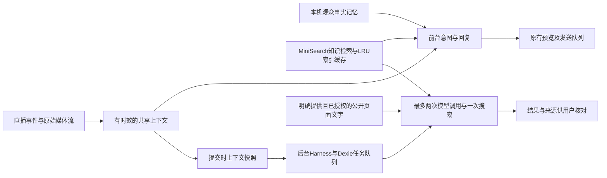

# Agent、记忆与直播感知实施记录

核对日期：2026-11-02。此记录说明实际接入及验收范围，不将依赖版本或模拟测试当作生产效果证明。

本文保留2026-11-02的历史设计，包含当时的固定预算、队列与记忆窗口；当前两模型、默认不限额、积压接续和检查点恢复规则以[浏览器Agent Harness](../development/browser-agent-harness.zh-CN.md)及[使用说明](../guides/usage.zh-CN.md)为准。

## 选型与复用

| 能力 | 决策 | 适配理由与边界 |
| --- | --- | --- |
| 后台 Harness | 已有 XState 5.33.3 | 每个任务独立 promise actor，拥有取消信号、并发、截止时间和轨迹。不是完整的通用 Agent 框架 |
| 任务持久化 | 已有 Dexie 4.4.7 | IndexedDB 事务保存任务与小时额度，不增加服务端；按房间与主播隔离 |
| RAG 索引缓存 | lru-cache 11.5.3 | 维护中的成熟容量/TTL缓存；最多4份索引、估算容量600000、5分钟；完整资料内容与元数据作为键，不缓存实时答案 |
| 公开网页文字 | linkedom 0.18.15 + Mozilla Readability 0.6.0 | 使用 inert worker DOM 和现成正文提取，避免手写HTML清洗；最多3页，每页256KiB/6000字，10秒截止，研究请求每页最多2000字并披露裁剪 |
| 资料边界和技能包 | 已有 Zod | 严格 JSON 契约；技能只能提供场景与提示，不能执行代码、安装依赖或获得发送能力 |
| 快速回复/搜索 | 复用现有 AI client 与 search | 复用意图、真实搜索、来源核对与上下文预算；后台独立额度、研究输出预算，不争用前台回复队列 |

对比了 [LangGraph](https://github.com/langchain-ai/langgraphjs) 1.6.0、[LangChain Core](https://github.com/langchain-ai/langchainjs) 1.3.2、[AI SDK](https://github.com/vercel/ai) 7.0.159、[Mastra](https://github.com/mastra-ai/mastra) 1.81.0、[p-queue](https://github.com/sindresorhus/p-queue) 10 和 [BullMQ](https://github.com/taskforcesh/bullmq) 6.5.3。前两者需要适配图/checkpointer与既有调用契约；AI SDK/队列最新版本需要 Node22，Mastra需22.13；BullMQ引入Redis/服务端部署。当前 Node20 + MV3 项目中，复用已有 actor/事务库的改动和运维成本更低。不是认定其他框架不成熟，也不以依赖数量衡量完成度。

一手资料：[XState](https://github.com/statelyai/xstate)、[Dexie](https://dexie.org/docs/)、[lru-cache](https://github.com/isaacs/node-lru-cache)、[linkedom](https://github.com/WebReflection/linkedom)、[Readability](https://github.com/mozilla/readability)、[Chrome后台生命周期](https://developer.chrome.com/docs/extensions/develop/concepts/service-workers/lifecycle)。npm元数据与上游快照保存在 output/agent-harness-2026-11-02。lru-cache使用BlueOak-1.0.0，linkedom使用ISC，Readability使用Apache-2.0；许可证随构建附带。发布活跃度只是决策证据之一，Readability最近发布为2025-03，不能宣称所有库都在近期频繁发布。

## 执行结构

后台同时执行最多2个任务，每范围最多1个，未完成任务最多8个。研究上下文预算24000字符，固定任务或事实无法装入时明确报错；研究有90秒总截止；单次模型最多25秒，搜索最多8秒；每范围每小时20个模型调用预留位，每任务保守预留2位，失败和未用额度不退还。提交回执不等待模型完成。记录保存一天、全库最多100项，列表最多20项；任务包含上下文快照，只在本机保存。模型/搜索密钥在执行时从独立本机密钥存储读取，不进入任务或导出配置。仅会话保存的密钥不能供扩展后台研究使用。

扩展通过一分钟 alarm 重新加载排队任务；已标记running的任务在宿主重启后成为interrupted，不自动重发可能付费的调用。MV3可以随时终止后台，不能承诺浏览器关闭或后台回收后仍连续运行。油猴/演示版仅页面存活时执行，关闭页面会中断；本地版本小时额度是页面内计数。没有外部常驻守护进程或跨机器服务。

## 观众记忆与技能

观众键来自采集到的UID/secUID，同名不合并；发给模型的目标记忆不包含这两个键。每主播最多100位、30天，每位最多3条最近自述、3组最近礼物和3条运营者核实补充。重复弹幕去重，礼物连击取累计最大值，不重复相加，不将少量观察冒充完整历史消费。旧内容自身按30天过期，删除时间水位阻止旧事件重放恢复；删除后新发生的互动可以重新积累。

用户可查看、补充纠正、忘记单人或清空。关闭记忆开关会停止采集和注入，不自动清除已保存内容，清除由显式操作执行。自述不是核实的身份或性格，不据送礼推断财富、人格、敏感特征或付费意愿。不会根据昵称跨平台匹配身份，也不汇总个人隐私档案。明确提供的公开来源仍以未核实资料标记；网络文本不能更改技能、模型接口或事实记忆。

内置自然交流、依据查证、观众互动技能；最多8个自定义声明式技能，每次最多选择4个匹配场景的技能。设置中粘贴JSON安装到草稿，保存设置后生效。代码、工具调用、远程依赖字段被拒绝；这不是可执行插件或Codex技能安装器。

## 直播感知与主动互动

沿用直接读取直播页提供的原始流、hls.js/mpegts.js解码和百炼Omni实时识别；不访问麦克风，不录屏作为默认输入。Omni实时与现有文字模型可组合，也可Omni统一回复，模型下拉与手动填写继续可用。

本次独立视觉从单帧扩为最多3帧顺序采样，保留起止时间与frameCount；共享现场明确区分最新画面、语音与音画联合观察、年龄和覆盖范围。采样帧不代表完整连续视频；ASR可能转错，Omni realtime由VAD触发，静音时不保证定期输出。识别内容不是自动处罚依据。

冷场开关默认关闭。开启后仍要求30秒内的现场线索、冷场间隔和AI额度/冷却；新弹幕出现、开关关闭或等待过久后，迟到的主动回复不排队，模型可选择[SKIP]。自然语气不意味着冒充真人或虚构经历。

## 仍待生产验证或另行实现

真实百炼音画会话、长时后台回收、真实直播网络格式和回答质量尚未通过生产验收。普通公开网页正文读取没有分析主页全部视频、图文或跨平台所有内容；没有批量视频下载、登录绕过或自动身份关联。所谓持续学习是有期限、可审查的本地事实积累，不是模型权重训练或无人审核的画像推断。当前RAG是词法检索，不是向量数据库或嵌入模型。旧界面桥仍保留，当前功能使用统一主题与组件投影，并未宣称所有旧控制器已重写。

合成缓存基准：40条模拟资料、100次相同检索，逐次清缓存554.09ms、复用索引20.50ms，双方均命中800片段。仅说明这组本机样例减少重复建索引，不代表真实直播端到端延迟或语义质量提升。
