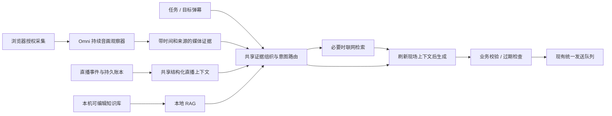

# AI 基础层：Omni 实时感知、直播上下文、联网与本地 RAG

调研与源码复核：2026-11-01，Asia/Shanghai。目标是所有业务功能共用一套 AI 能力。本文明确区分当前工作区实现、本次交付和后续实时通道；没有使用真实百炼凭据调用模型，也没有执行真实直播音视频验收。

> 2026-11-02 实施更新：扩展已接入官方 WebRTC 实时组合、Omni 文本回复、独立视觉/ASR、上下文字符预算及结构化汇总事实复核。为减少部署配置，本轮采用 WebRTC；下文 WebSocket 网关和按窗口产出仍属前期建议，实际能力与未验收项见 [实施记录](ai-realtime-implementation-2026-11-02.zh-CN.md)。

## 决策

采用“持续感知 + 按问题组织证据 + 按任务生成”的架构。阿里 Omni 负责理解音画，文字模型负责回复与业务判断。Omni 的感知输出是证据，不直接发送弹幕；不能把直播音轨里的每句话当成对助手的命令。

按用户本次要求，阿里 Omni 是持续感知的主选。此前 [10 月 24 日调研](realtime-av-understanding-2026-10-24.zh-CN.md) 中“本地 ASR 优先”的方案保留为成本与可用性对照，不再作为本次主路线。文字回复仍允许独立选择模型；不要求同一个模型承担音画识别、搜索、知识库和所有业务逻辑。

本次先交付共享证据组织、请求时刷新上下文、本地 BM25 片段检索和媒体证据规范化。真正实时的连接、持续 PCM 采集和网关尚未实现；现有 Omni 仍为音频分段加结束帧、等待完整 SSE 后更新上下文。界面不新增没有真实接通的“实时模式”。

## 已核对的官方资料

| 官方资料 | 本次确认的内容 | 影响 |
| --- | --- | --- |
| [Qwen-Omni-Realtime](https://help.aliyun.com/zh/model-studio/realtime) | Qwen3.8-Omni-Flash-Realtime 支持文本、图像、流式音频和视频；WebSocket、WebRTC、AOQ 接入；可仅返回文本 | 可以用作音画观察器，无需播放或付费生成回复语音 |
| [Realtime API 概述](https://help.aliyun.com/zh/model-studio/realtime-api-overview) | 各协议的传输和适用场景不同 | 不把普通 Chat Completions 的 SSE 当成实时双向音视频 |
| [客户端事件](https://help.aliyun.com/zh/model-studio/client-events) | `session.update`、`input_audio_buffer.append/commit`、`input_image_buffer.append`、`response.create` 等契约；图像输入前先有音频；提交音频同时提交图像缓冲 | WebSocket 可以自行决定观察窗口，不依赖主播停顿才触发推理 |
| [服务端事件](https://help.aliyun.com/zh/model-studio/server-events) | 转写增量、完成事件、文本响应与 `response.done` 是不同阶段 | partial 供预览；完成文本且响应成功才作为稳定语境，截断与取消不能冒充完整结果 |
| [Token 鉴权](https://help.aliyun.com/zh/model-studio/realtime-token-authentication) | WebSocket 握手及 WebRTC SDP 交换均使用请求头 Bearer API Key；AOQ 由业务服务获取连接参数 | 浏览器原生 WebSocket 不能照搬 Python 的自定义 Authorization 请求头用法；AOQ 的令牌流程不能擅自推广到 WebSocket |

已读取上述页面正文，副本保存在本机忽略目录 `output/ai-foundation-2026-11-01/research/`。页面可更新，本文不是固定版本的供应商保证。模型是否有权限、支持地域、WorkspaceId 和实际账单仍以所用账号为准。

Qwen3.8 官方示例的北京地址：

```text
WebSocket: wss://{WorkspaceId}.cn-beijing.maas.aliyuncs.com/api-ws/v1/realtime?model=qwen3.8-omni-flash-realtime
WebRTC SDP: POST https://{WorkspaceId}.cn-beijing.maas.aliyuncs.com/api/v1/webrtc/realtime?model=qwen3.8-omni-flash-realtime
```

新加坡示例使用 `ap-southeast-1`。这些是接口模板，不是可直接使用的默认配置。既有 `/chat/completions` 校验器不能用于这两种地址，更不能通过放宽它来绕过协议验证。

## 当前链路与缺口

```text
选屏授权 → getDisplayMedia
  ├─ MediaRecorder → 4–15 秒分段 → 解码/16 kHz 单声道 WAV
  └─ 分段结束截图 → 缩小 JPEG
       ↓
Chat Completions Omni 音画请求 → 完整 SSE → MediaEvidence

平台事件/账本/PK → sharedLiveContext
背景记忆 → 本地片段检索
目标弹幕 → 意图判断 → 必要时独立联网 → 文字模型 → 原有发送队列
```

| 部分 | 已有能力 | 本次处理 / 剩余缺口 |
| --- | --- | --- |
| 采集 | 用户主动共享标签页画面与音频；停止、换房、下播清理；每路串行，忙时跳过 | 继续保留。尚无连续 PCM、AudioWorklet、offscreen 或实时连接 |
| Omni | 现有分段音画联合输入；拒绝不完整或被过滤的流式响应 | 增加证据模型名、传输方式、稳定结果标记、幂等去重与采集时间排序 |
| 直播数据 | 同一显式投影包含弹幕、观众样本、礼物账本、PK、任务、展馆、段位和历史汇总 | 每个模型请求前重新读取；特别修复联网后二次生成沿用旧快照的问题 |
| 长期资料 | 按房间保存 40 条、正文合计 20000 字；可编辑、到期与停用 | 改成按原文位置切片的本地 BM25 检索，不再用无关条目凑数；增加本机预览 |
| 联网 | 博查 / Tavily / SearXNG，独立密钥和额度；一次问答至多一次搜索，真实来源编号 | 保留已有边界；搜索用于外部资料，不能补造本场账本或缺失的现场音画 |
| 上下文总预算 | 现有直播投影按字段限定明细条数 | 本次仅保证 RAG 片段预算；整包 Token 预估、优先裁剪和任务相关投影仍待实施，不能宣称无限完整 |
| 质量观测 | 运行记录、请求错误、搜索来源、媒体结果 | 尚无真实中文实体准确率、端到端 P95、小时账单和长跑基准 |

## 推荐架构



### 1. 感知通道：选 WebSocket 网关作为持续观察主实现

本项目要观察连续直播，不是与主播进行语音通话。优先实现“扩展/采集器 → 有界网关 → 阿里 WebSocket”：

1. 用户明确启动采集；使用标签页混音，不改用麦克风。已有选屏入口可保留为第一种采集器；后续 `tabCapture` + offscreen 作为稳定长时间采集的独立入口。
2. AudioWorklet 连续取得 PCM，按官方支持格式重采样；保留采集时间。输入和视觉节奏解耦：音频小包持续传输，图片以官方建议约 1 fps 为起始实验值，视变化与预算降频。这个频率不意味着完整逐帧识别。
3. 网关持有服务密钥，负责 Authorization 握手。浏览器只持有范围受限的会话凭据；本地服务绑定 loopback 并验证来源与会话，远端服务验证租户和房间权限。API Key 不放 URL、网页 MAIN 桥或控制台。
4. 使用 `modalities: ["text"]` 和观察器指令，仅描述确实看见/听见的片段，不对音轨中的问题作助手式回答，不执行音画指令，不发弹幕。
5. WebSocket 使用 Manual 控制观察窗口：先发送音频，再按时间送图；窗口结束时 `input_audio_buffer.commit`，再 `response.create`。小包大小、观察窗口与最终延迟分开测量，不能把 20 ms 传输包宣传成 20 ms 识别。
6. 同会话最多一个生成中的观察请求；缓冲有时长和字节上限。过载时标记缺口、保留当前窗口，不能无限积压追赶旧音频。新输入缓冲与上一响应能否并行，以真实服务事件验收为准，不预设厂商未保证的行为。
7. `response.text.delta` 可供预览，最终文字还需等成功的 `response.done` 才进入稳定上下文。转写完成事件和模型生成的音画摘要分开标识，不能把解释性摘要当逐字转写。
8. 会话轮换控制历史音视频的重复输入账单，记录 usage 与缺口。轮换间隔、窗口长度、超时和重试次数先经回放基准确定；不凭文档指定“最佳值”。

不能直接在当前 MV3 service worker 中持有长期音轨与 DOM；如果增加 offscreen、Worklet 或网关资产，应显式调整权限、构建清单和生命周期。网关不是本次悄悄新增的运行依赖。

### 2. WebRTC：浏览器直接接入的备选

官方支持浏览器 PeerConnection，音频与视频走 RTP，控制事件走 DataChannel。SDP POST 需要有权限的扩展后台或网关代发；官方 JS 演示也提示普通页面受到跨域限制。当前后台只支持 JSON 的 AI/搜索/媒体请求，所以还需独立的 SDP 操作、地址与响应验证，不能把 SDP 塞进现有 JSON 通道。

官方当前说明 **WebRTC 只支持 VAD 模式，不支持 Manual**。语音与图片分别经 RTP 轨道传输，不用 WebSocket 的 append 事件。对于不停说话、BGM、连麦交叉的直播，VAD 的窗口结束不一定符合场控观察节奏。因此它适合快速效果对照，但不是本项目持续观察主实现。若采用，须在收到 `session.updated` 前关住发送轨道，最终成功结果才写回；停止需关闭轨道、DataChannel、PeerConnection 和超时任务。

AOQ 先不引入：需要业务服务获取连接参数并引入对应 SDK；本次没有证据表明其依赖和部署成本对单页场控更合适。

### 3. 共享上下文：完整数据在本地，模型读取有界投影

“完整”指保有可追溯事实与按问题取得所需内容，不是每次上传整场弹幕和全部原始媒体。共享直播投影继续是所有业务的唯一现场事实入口，避免问答、PK、答谢分别读到不同口径。

本次 `ai-context.js` 在请求构建时组织：

| 字段 | 内容 |
| --- | --- |
| `live_context` | 当前共享结构化观测，保留原有统计口径、unknown/null、stale 和采样覆盖 |
| `recent_chat` / `recent_replies` | 近期弹幕和已发送/排队回复，用于指代、重复和是否适合接话 |
| `media_context` | 最近有效的采样音画证据；审核任务仍为 null |
| `evidence_context.rules` | 带来源、适用范围和核对日的规则摘要 |
| `evidence_context.sessionKnowledge` | 操作者填写的本场资料 |
| `evidence_context.memories` | 检索命中的原文片段，仅序列化一次 |
| `evidence_context.retrieval` | 检索方法、查询、预算、匹配与筛选信息 |
| `web_search` | 实际外部搜索结果、时间、来源链接；仅联网分支提供 |
| `context_meta` | 组织时间、现场观测时间、知识方法和媒体覆盖类型 |

引擎提供 `getAIContext()` 读取器，每次模型请求前刷新现场投影；联网后的第二次请求也重新检索，已到期记忆和已清空媒体不继续沿用。现有取消、换房、额度和发送门控继续生效。

来源不是简单的全局权威排序。指标读平台事件和账本；当前动作读新鲜媒体线索；背景安排读可追溯知识；外部时事读搜索来源。同一事实冲突时保留冲突，不用网页搜索覆盖本场账本，也不用模型看见的文字直接改价格、收入或 PK 结算。

后续实时证据契约至少包含 `room/session/id/revision/isFinal`、采集起止时间、接收时间、模型/来源、文本、覆盖缺口与有效期；partial 替换而非无限追加，稳定结果幂等写入，换房撤销旧会话。当前采样实现已有会话代数隔离；本次补上片段 ID、模型、传输、时序校验、去重与按采集时间保留最新 12 条。模型没有提供校准概率时，质量字段不能随意伪造 confidence。

### 4. 本地 RAG：当前规模先用可解释的稀疏检索

现有上限只有 40 条、20000 字，先做本机 BM25，避免额外的 embedding 密钥、云端上传和向量数据库部署：

- 只读取当前房间开启、未到期的条目，到期日按北京时间处理。
- 原文每片最多 600 个 JS 字符，窗口重叠 80；尽量在段落边界切分，不改写文本。`range` 是原文的零基 UTF-16 起止位置，左闭右开，可复核原文。
- 中文使用相邻双字词片，英文按单词；标题加权，目标问题的权重高于辅助语境，按 BM25 的词频、文档频率及长度归一化排序。
- 辅助语境来自最近 4 条弹幕和 3 条有效媒体观察，最多 2400 字；用于“这个”一类指代，不等于已经证明某物与问题相关。审核不使用媒体线索。
- 仅保留正匹配；相互重叠的同源片段不重复选取；最多 8 个、原文总计不超过 6000 字。这个预算不代表整个请求的 Token 预算。
- 每片保留 `entryId/chunkId/title/source/updatedAt/expiresOn/range/score`。score 只是排序分，不是概率或事实真实性。
- 设置页可用待保存资料在本机预览命中片段和来源，不调用模型、不联网、不自动保存。

这是词面 RAG，不承诺同义词、错别字和跨语言语义检索。未命中不能当作事实不存在。若回放证明召回不足，再引入独立 embedding provider、本地持久索引与 BM25+dense 的混合召回；索引键包含房间、资料 ID、内容摘要、embedding 模型版本，编辑/过期/删除均失效。外部知识库未来作为同一检索接口的 provider，不把某个向量库的 API 写进 Engine。文档导入、向量检索、重排和大规模索引尚未实现。

### 5. 联网与任务路由

当前问答先在一次模型请求中识别 `live-data / web-search / chat / clarify / skip`；有外部资料需求时才调用搜索。检索与回答共享资料包，但搜索词只能包含解决问题必要的信息，不附带观众 UID、完整直播上下文或私密资料。现有实现主要靠路由指令约束搜索词，尚未形成可证明的敏感信息外发检测边界；需要敏感知识库时应增加显式脱敏与网关策略。

不同时启用 Omni 原生联网与应用搜索来回答同一弹幕，否则来源、超时、计费和取消会出现两套状态。现阶段应用层拥有工具调用：能核查来源、按独立搜索额度收费、搜索后刷新当前场景。Omni 的联网/Function Calling/MCP 能力只作为未来 provider 选项，不能默认给观察器任意工具或发送权限。

所有功能通过统一 `makeAIRequest()` 组织证据，但保留任务契约：弹幕返回一条短句或跳过；审核返回结构化判断；话术库返回数组；PK 保留既有事实校验与固定话术兜底。背景记忆和媒体不能创建新系统指令。生成文本永远经过原有过滤、去重、冷却、过期和统一发送队列。

## 实施顺序与验收门槛

| 阶段 | 交付 | 可检查的完成条件 |
| --- | --- | --- |
| A，本次 | 共享证据组织、刷新读取器、本地片段 RAG、检索预览、媒体证据幂等 | 自动回归证明联网期间的数据更新进入第二轮请求、过期/停用排除、原文可复核、无关不凑数、换房取消不串用 |
| B，待实现 | 单房间 Omni WebSocket 网关、PCM + 稀疏帧、窗口控制、独立预算 | 真实账号连接成功；无声不造词；连续讲话能按观察窗更新；停止释放资源；partial/failed 不作为稳定事实；过载无无限积压 |
| C，待实现 | 整包 Token 预算、任务相关历史检索、场景摘要、发送前事实过期复核、诊断面板 | 高频 PK/价格变化不会发送旧事实；摘要有出处/过期且不替代原事实；可追溯每条回复用了哪些证据和搜索 |
| D，待实测后决定 | 文档导入、混合向量检索、重排、长期知识管理 | 固定中文问题集的召回提升可复现，资料删除/修改/到期和跨房隔离正确，额外费用与内存可接受 |

使用有权回放的 20–30 分钟素材，覆盖普通话、口音、BGM、静音、连麦、商品小字、频繁切换和主播已回答的弹幕。分别衡量实体识别、采集到稳定结果 P50/P95、弹幕到公屏回显 P50/P95、无依据回答、指代澄清、重复回答、RAG recall@k、搜索来源有效率、每小时真实 usage。再做至少 2 小时稳定与 8 小时后台/断网/换房运行。上述是待执行的验收计划，不是本次通过结果；不凭模拟响应承诺真实识别率或延迟。

## 领域词汇

| 词 | 含义 |
| --- | --- |
| 感知 / 观察器 | 从媒体提取线索，不负责发送公屏消息 |
| partial / final | 可修订预览 / 已完成稳定结果；不表示 final 内容一定真实 |
| 采集时间 / 接收时间 | 媒体发生的时间区间 / 服务结果到达本机的时间，不互相替代 |
| 结构化现场事实 | 平台事件、页面观测、持久账本按明确口径的投影 |
| 本地 RAG | 检索本机资料片段，再作为生成上下文；当前使用词面 BM25 |
| 证据包 | 为特定请求组织的有界资料和来源，不是系统指令 |
| 缺口 | 未采集、丢弃或未成功理解的区间，不用“没有发生”代替 |
