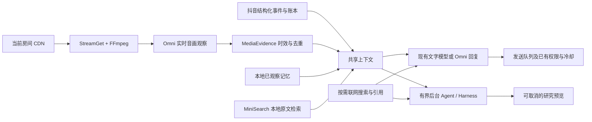

# 真实直播 AI 验收与架构核对（2026-11-02）

验收房间：[361690799431](https://live.douyin.com/361690799431?anchor_id=3804784440654216)。现场账号使用现有配置和密钥；测试按钮与后台研究只生成预览。没有点击公屏测试发送、管理处罚或购买礼物。直播页中途出现另行保存设置、恢复自动场控的操作和真实回显，因此不能将整段验收描述为“完全没有发送任何消息”；这些回显也不作为本次主动发送验收的证据。

## 现场结果

| 能力 | 验证方式与结果 | 边界 |
| --- | --- | --- |
| 原生音画感知 | 当前房间经 StreamGet 解析 CDN，FFmpeg 解码，通过百炼 Omni 实时连接连续返回至少 5 条完成观察；页面显示过动作、设备和语音话题，停止时累计显示 18,876 token | 本地原生模式，没有使用麦克风或共享屏幕。约每 8 秒请求观察，不是逐字零延迟转写；本次没有人工逐字标注准确率 |
| Omni 感知 + DeepSeek 回复 | 真实后台研究引用了提交时音画观察，并区分视觉动作、听到的话题；带在线人数与礼物估算口径 | 研究使用提交时快照，不能当作任务完成时的实时画面。模型描述仍可能误识别 |
| 纯 Omni 回复 | 临时切换组合，调用当前推荐 Omni 回复模型，看到“AI 连接测试通过。测试内容不会发送到公屏。”；之后恢复 Omni + 文字模型草稿 | 只验证回复服务可用，没有改存用户模型组合 |
| 联网搜索 | 博查连接返回 3 条来源；真实后台问题经过联网并输出引用 | 《大长今》年份答案为 2003；额外月份来自非官方招商文档，未获官方复核，不能把整个答案标成事实准确性通过 |
| 本地 RAG | 用户原有资料到期日为 2026-11-01，11 月 2 日不再命中；临时有效陶瓷资料命中 1 个原文片段，停用后 0 命中 | 未延长用户资料有效期；临时资料已移除，没有保存 |
| 观众记忆 | 页面显示新近已观察的观众及时间；记忆内容少的记录显示“无记录” | 不能通过 Mantine 自定义选择器未展开时的原生 option 数量推断记忆库为空。按人去重、恢复、隔离、删除与纠正由回归测试验证；未删除真实观众资料 |
| 技能 | 临时声明式技能安装到草稿可见，随后移除并清空输入 | 未保存临时技能；非法代码拒绝由集成测试验证 |
| 后台执行与取消 | 提交立即进入执行态，前台可导航；一项任务很快完成，第二项联网任务在执行中取消，刷新后保持“已取消”且无答案 | 取消不能撤回服务商已经开始计费的调用；迟到结果抑制由 Harness 回归测试验证 |

礼物、欢迎、机器人、PK、话术生成、主动接话、内容检测的上下文路由通过自动化测试核对。现场没有为触发测试而送礼、制造 PK 或处罚观众，不能将这些场景全部列为真实动作端到端验收。其他模型地域与账号权限组合、本次未发生的断网和长时额度耗尽也不属于现场通过范围。

## 本次修复

1. **观众删除水位按人隔离。** 原实现忘记一人会推进全局水位，误挡其他观众尚在交接的真实互动。单人删除现在使用随快照恢复的独立水位，清空仍使用全局水位。删除水位与 30 秒事件接收窗口共同约束回放，过期水位清理，数量受限；旧版快照继续可读。没有放宽来源、身份和接收时效检查。
2. **后台提交等待回执时防重。** 点击后立即禁用提交按钮，成功或失败后恢复；不锁定其他前台操作，不等待完整模型执行。
3. **任务刷新按请求次序更新。** 较旧列表迟到不再覆盖较新状态，避免已完成或已取消任务看似又回到执行中。
4. **知识资料就地提示状态。** 到期、停用或可检索直接显示在原条目处，修改即时更新；到期日复用上海时区规则，未改变用户资料。
5. **只读 AI 上下文诊断。** AI 设置 → 高级设置 → 检查 AI 上下文。显示已保存配置、有效弹幕数、知识有效/到期/停用数、观众记忆开关与数量、媒体是否已完成观察及已知采集缺口。没有调用模型、保存配置或公屏发送；不输出密钥、人物正文、弹幕或媒体正文。未保存的草稿与运行配置明确分开。界面按项分行，并占满可用宽度。

## 架构核对

维持现有分层：采集负责证据，MediaEvidence 负责媒体生命周期，上下文组装负责时效与预算，MiniSearch 负责本地原文检索，XState Harness 负责后台状态与取消，现有队列独占公屏发送。后台研究不能接管发送器或自行改写事实记忆。场控任务在实际调用前刷新共享上下文，后台研究则明确使用提交快照。

持久记忆是有界的观察与经操作者核实的补充，不等同于模型训练；不按同昵称跨平台合并身份，也不把有限送礼样本推断为财富、人格或付费承诺。

本次已知采集缺口显示 **1,529（事件或帧）**，属于既有累计记录；抽查时待交接 0、隔离 0，协议帧仍持续增加。不能据此宣称历史缺口已修复，或将本机账本当作平台完整账单。页面在线人数与协议在线人数更新时间不同，回答需要保留各自口径。

## 验证与证据

采用失败用例 → 最小修复 → 回归验证。红灯覆盖单人删除误伤、双击提交、旧任务列表覆盖、知识到期提示、缺失诊断与诊断挤成一段。原生集成测试另核对启动、已接入但尚无观察、完成观察、停止拒绝迟到结果这四种状态。

工作区 1,068 / 1,068、仅任务增量隔离副本 1,008 / 1,008、安装环境原生测试 11 / 11 通过；`npm ci`、两套构建与语法检查完成。详细结果见[行动日志](../development/action-log.zh-CN.md)。`crapper`、`dryer`、`mutator` 均不可用，未执行这些检查，其他测试不替代其结果。

本地证据位于忽略提交的 `output/ai-live-acceptance-2026-11-02/`：失败用例输出、构建/检查/测试输出、实际 Omni 画面、纯 Omni 回复连接和新诊断界面截图。没有导出密钥或保存原始直播音视频。既有未提交改动保留，任务差异另在干净基线副本中验证。

本次生成扩展新构建；真实直播页已有设置操作与草稿，未强制刷新该页覆盖编辑状态。新界面在独立本地页面核对，当前已打开的直播页需正常重载扩展及刷新页面后使用新代码。
