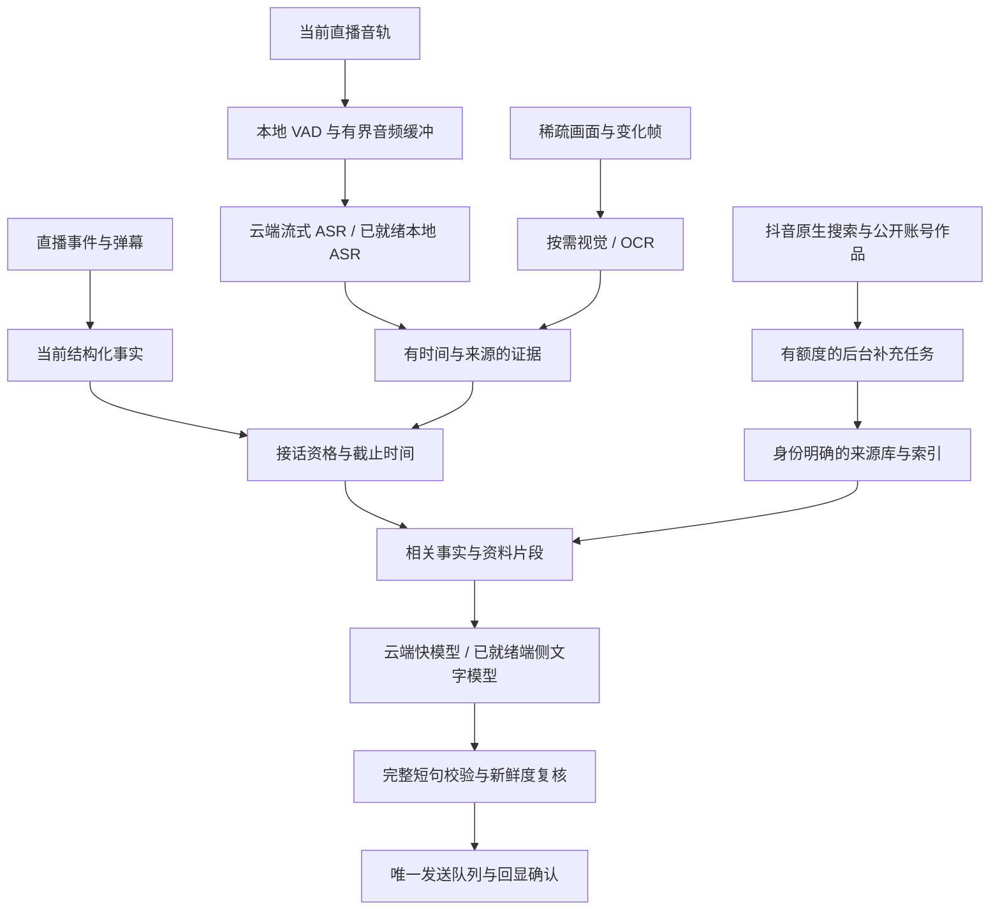

# AI 管线、中文端侧兜底与抖音账号上下文调研

日期：2026-11-03。范围：当前工作区源码、既有验收记录、开源项目源码/许可、浏览器官方文档、抖音开放平台及用户指定的 DouYin_Spider。本文交付调研、接口映射和分期实施契约；下文新增架构和性能目标均未实施，也未用真实账号验证新接口或下载模型做性能测试。

## 1. 结论与优先级

建议保留现有引擎和统一发送队列，增强三个独立层：实时感知与回复调度、按能力降级的模型路由、带来源的账号/作品资料层。不要先把所有工作塞进一个大 Agent，也不要把更多资料检索串到每次弹幕回复前。

1. **先缩短等待并能量出延迟。** 当前原生媒体约 8 秒提交一次窗口，单次文字模型最多等待 25 秒，联网问答总截止 42 秒；共用 `aiBusy`，慢查询会占用其他前台生成机会。它们比换一个聊天 SDK 更直接地影响接话体验。
2. **先验证中文 ASR 和小模型端侧兜底。** 浏览器优先比较 sherpa-onnx 的中英流式模型与 Transformers.js Whisper；文字兜底验证 WebLLM 的中文小模型。本机组件可另行使用 sherpa-onnx、FunASR/Qwen3-ASR、llama.cpp。不能把本机进程称为浏览器模型，也不能把代码开源称为模型权重无限制。
3. **账号和作品检索走后台，按需取相关证据。** 优先读取当前直播已观察事件、明确绑定的公开主页/作品、取得权限的抖音原生搜索。用户给出的 Spider 很适合定位网页接口与响应形状，但不是已验证的生产服务。
4. **自然感主要由选对时机、理解归属和具体表达决定。** 不默认“每句都接”，不靠随机延时、表情或不断夸奖制造真人感。系统保持场控身份，可以自然聊天，不虚构自己是真人、购买经历或私人关系。“所有发言都像真人且永远正确”不能由提示词保证，需要回放和人工质量评估。

## 2. 当前实现：已经有什么，缺什么

以下定位以本轮检查的工作区为准；工作区包含任务开始前及调研期间其他工作的未提交改动，不等于某个干净发布版。

| 能力 | 当前代码证据 | 判断 |
| --- | --- | --- |
| 组合配置 | `src/services/ai-pipeline.js`：`resolveReplyConfig / resolveMediaConfig` | 已有文字、Omni 感知+文字、纯 Omni、独立视觉/ASR；预设是配置投影，**没有跨 provider 故障转移** |
| 原生感知 | `native/host.py:130`、`native/protocol.py:61` | StreamGet → FFmpeg → PCM/JPEG → 云端 Omni WebSocket；1 FPS、画面限制在 640×480 范围；约 8 秒窗口且前次响应未结束时延后。原生只表示采集/解码在本机，理解仍依赖云端 |
| 浏览器感知 | `src/browser/live-media.js`、`src/browser/omni-realtime.js` | 有直连流/共享媒体、分段和 WebRTC。分段默认音频 8 秒、视觉 12 秒；WebRTC 受服务端 VAD 触发，静音有画面不代表必然产出观察 |
| 媒体证据 | `src/services/media.js:108`、`src/ai/live-moment.js` | 有完成态、时间区间、来源、去重、最多 48 条以及音画重叠判断；没有可靠的声纹身份绑定。`speaker:unverified` 不能靠模型口头判断升级为身份已确认 |
| 回复与联网 | `src/services/ai.js:155` | 普通观众弹幕在一次请求内完成意图和直接回答；只有 web-search 才走搜索和第二次模型。不能误写成所有聊天都要两次模型 |
| 超时与并发 | `src/core/engine.js:915`、`:1147` | 前台生成共用 `aiBusy`；明确对话队列最多 20 条、45 秒过期；普通背景弹幕保留最新一条。已有有界队列，但没有按互动截止时间抢占慢任务 |
| 流式文字 | `extension/background.js:284`、`src/services/search.js`、`completion-stream.js` | 普通请求 `stream:false`；Omni 虽用 SSE，后台仍先 `response.text()` 收完整包，之后解析。**兼容 SSE 不等于前台已经收到实时增量** |
| 本地知识检索 | `src/services/knowledge.js`、`retrieval.js` | MiniSearch/BM25 原文片段、有效期、停用、预算与缓存失效已做；没有 embedding 混合召回、重排或批量作品索引 |
| 观众记忆 | `src/ai/audience-memory.js:3` | 每主播最多 100 位、30 天、每人近期 3 条发言/3 组礼物及备注；按 ID 隔离，**没有自动读取主页、全部作品、喜好或关系图谱** |
| 后台资料阅读 | `src/ai/agent.js`、`public-sources.js` | 最多 3 个明确链接，匿名获取公开文字，有大小/时间/域名授权边界；不运行页面脚本，不理解链接里的视频/音频，不遍历关联作品。因此抖音动态页面可能不可读 |
| 发言质量 | `src/ai/conversation-policy.js`、`turn-taking.js` | 已有口语、反讨好、非客服表达、对话归属、语音触发、安静/自然/每句档位；这些是策略与自动化契约，尚非真实质量得分 |
| 发送可靠性 | `src/core/engine.js:865` 及发送队列 | 已有上下文/事实版本、换房失效、过滤、重复及回显确认；只让统一队列拥有公屏发送权，后续模型不得绕过 |

现有 `freshObservations()` 允许距片段结束 30 秒内的观察，普通聊天候选可等 45 秒；适合保留上下文不等于仍适合“接刚才那句话”。另外 `awaitingVisual()` 可为语音等待约 3 秒的视觉补充。优化应区分是否确实需要视觉消歧，不能让纯语音常识回答也固定等画面。

11 月 2 日记录已有真实 Omni 观察与模型/搜索连接验证，仍没有逐字标注、多设备 P95 延迟、2/8 小时稳定性结果。本轮 196 项 AI 相关自动测试通过，不把它升级为上述实测结论。

## 3. 建议管线：实时快路径与后台资料分开

### 3.1 低延迟改造

- 增加同一 `traceId` 的分段测量：页面收到事件、媒体片段起止/本机解码到达、ASR final、等待调度、检索、模型首字/完整句、入队、点击、真实回显。`performance.now()` 测进程内耗时，墙钟保存来源时间；跨本机/原生进程记录时钟映射。无法获得主播真实说话时间时，不冒称测出了采集前/CDN延迟。
- **普通聊天继续一次模型完成选择与回答。** 已知现场数据查询可规划一个确定性的本地渲染路径；语义不明确才交模型，不用越来越长的关键词表替代意图理解。检索命中不等于应当回答。
- 语音用 VAD 检测语段、流式 ASR 保留 partial，只有 final 或明确冻结的稳定片段允许触发发送。初始实验可测试 300–600 ms 端点等待、2–4 秒最大处理片段，并保留重叠/上下文，防止截断长句。VAD 只判断有人说话，不判断是不是主播，也不保证一句话结束。
- 对纯文字/语音可回答的问题不等待新画面；“这两个哪个好看”才取时间相符的画面。小字、价格按区域裁剪做 OCR/高分辨率复核，不用一张 640×480 稀疏帧承诺全场可见。
- 分开实时对话与后台检索任务的取消令牌、额度和队列；同一个对话范围保持一个生成所有者，后台可独立执行。不要简单让多个任务共享 `aiBusy=false` 或同时发送。云端慢搜索不应一直占着语音接话名额。
- 为新鲜主播接话设置短截止，过时就跳过；明确观众资料问答可以较长，但也不能 42 秒后强行接已经换掉的话题。取消应真正中止传输和本地生成，而非只丢弃 Promise 结果。
- 如改流式传输，后台以有界消息传增量、完成态和取消。面板可展示增量；**公屏仍等完整短句与终态校验**，不把 token 一段段发送。流式本身不会降低所有任务的完整句耗时。
- prompt 先按任务投影，再保留必要事实；当前 48,000 字符是上限，不是每次填满的目标。模板保持稳定以便服务商可能的前缀缓存，但不把缓存收益当保证，不缓存会变的价格/PK/发言结论。

建议首轮暖机目标如下，均为待验证的产品指标：

| 场景 | 起点 → 终点 | 初始目标 |
| --- | --- | --- |
| 直接文本互动 | 本机收到目标弹幕 → 完整候选可入队 | P50 ≤1.5 秒，P95 ≤3 秒 |
| 主播语音 | 本机解码音轨中目标话语结束 → 完整候选可入队 | P50 ≤2 秒，P95 ≤4 秒；另报来源流延迟 |
| 已准备好端侧文字兜底 | 调度开始 → 完整合格候选 | P95 ≤5 秒，超时静默；按设备独立验收 |
| 公屏交付 | 本机事件 → 平台真实回显 | 单独报排队、控件/网络与回显 P50/P95，不能用“点击成功”代替 |
| 冷启动 | 无缓存/缓存未加载 → 模型 ready | 独立报告下载、加载、编译与首轮生成；不混入暖机成绩 |

### 3.2 能力降级，而不是只有换一个 LLM

| 故障 | 降级动作 | 保留的边界 |
| --- | --- | --- |
| 云文字 5xx/超时/限流 | 在同一交互剩余预算内换已就绪备用文字 provider 或端侧模型 | 单任务最多一次备用尝试，结果先到且合格才采用；迟到结果不能双发 |
| Key/权限/余额故障 | 标记该连接不可用；可转已配置的独立备用 | 不反复重试失效凭据，不偷偷改用户保存的主模型 |
| 云 ASR 不可用 | 使用已就绪本地 ASR | 没有音轨/解码失败时，本地 ASR 也无输入；只退文字事件能力 |
| 云视觉不可用 | 使用当前可核查文字事实、局部 OCR，或只回复不依赖画面的内容 | OCR 不等于理解动作；视觉缺失就不回答依赖画面的问题 |
| 搜索失败 | 使用未过期资料回答能证实的部分，必要时简短说明未知或跳过 | 不声称查过、不拿模型知识补当日新闻/主播隐私 |
| GPU 丢失/OOM/缓存丢失 | 释放会话，按探测结果用轻量 WASM、规则或静默 | 不默认强行把 WebLLM 同一模型切 CPU；别的运行时需另有已验证适配 |
| 所有生成不可用 | 欢迎/答谢等既有规则兜底；普通对话可静默 | 不把固定“说得对”当万能回复，更不编造现场事实 |

路由记录 `capability/provider/model/reason/elapsed/errorClass`；配置控制预算，provider 状态使用 closed/open/half-open 熔断和带上限退避，恢复探测不发公屏。网络完全断开时，另一个云商不是离线兜底。端侧仅在权重、运行时和 tokenizer 全部下载且预热成功后才算 ready；不要等云调用超时才首次下载数百 MB。

## 4. 开源方案筛选

本轮实际读取以下仓库 README 和可取得的 LICENSE，表中许可指代码；权重、转换产物、依赖须单独核对。GitHub 元数据接口 403 限流，已改读官方 raw 源文件；未核验 star 数、最新发布 tag、维护 SLA 或给出虚假的版本排名。快照与 SHA-256 留在 `output/ai-pipeline-research-2026-11-03/`。

| 项目 | 适合增强的位置 | 本项目建议与限制 | 代码许可 |
| --- | --- | --- | --- |
| [WebLLM](https://github.com/mlc-ai/web-llm) | 浏览器内 WebGPU 文字生成、JSON 与流式 | 第一候选文字兜底；有扩展示例，选运行时已有兼容产物的中文模型。不能把任意 HF 权重直接交给它；设备 WebGPU、模型缓存、加载和后台重启都要验收 | Apache-2.0 |
| [Transformers.js](https://github.com/huggingface/transformers.js) | WASM/WebGPU ASR、embedding、分类及部分视觉 | 第一候选轻量能力层；可验证多语 Whisper tiny/base（不要用仅英语 `.en`）、中文/多语 embedding。支持的模型架构、ONNX 导出、算子和量化组合逐项验证 | Apache-2.0 |
| [ONNX Runtime](https://github.com/microsoft/onnxruntime) | Transformers.js/VAD 底层执行 | 统一 WASM/WebGPU 依赖，避免每个包带不同版本运行时；小模型可 WASM，WebGPU 覆盖不能仅凭 API 存在判断 | MIT |
| [sherpa-onnx](https://github.com/k2-fsa/sherpa-onnx) | 中文本地流式 ASR、VAD，浏览器与原生 | 优先比较其官方 WASM 中英 Zipformer/Paraformer 流式示例；也有 VAD+SenseVoice 非流式示例。按具体模型选择，不能把项目“支持 streaming”推广到所有模型 | Apache-2.0 |
| [Silero VAD](https://github.com/snakers4/silero-vad) / [浏览器封装 vad](https://github.com/ricky0123/vad) | 本地话音检测、端点与无声时跳过 | 优先的小投入；接已有直播音轨/PCM，而非默认申请麦克风。BGM/歌词仍可能被识别为人声；需要另做接话和说话人判断 | MIT / ISC |
| [whisper.cpp](https://github.com/ggml-org/whisper.cpp) | 原生 ASR，也有 WASM 示例 | 用现有 native host 接入比把整套 Python 搬进扩展合理；“每 0.5 秒重新转写窗口”的示例不是所有设备都能低延迟的证明 | MIT |
| [FunASR](https://github.com/modelscope/FunASR) / [SenseVoice](https://github.com/FunAudioLLM/SenseVoice) | 本机中文识别、标点、热词等候选 | 原生组件候选；SenseVoice 常用为分段识别，不把伪流式当原生流式。其官方权重使用单独模型协议，不能仅依据 MIT 代码决定产品分发 | MIT，模型协议另查 |
| [Qwen3-ASR](https://github.com/QwenLM/Qwen3-ASR) | 原生/自建中文及方言 ASR | 官方 0.6B/1.7B 和流式推理值得评测；主要工具为 Python/transformers/vLLM，README 的服务器吞吐数字不能转成扩展单用户延迟；未证明浏览器兼容 | Apache-2.0，具体权重另查 |
| [llama.cpp](https://github.com/ggml-org/llama.cpp) | 本机 GGUF 文字推理、兼容聊天服务 | 可利用现有 localhost Chat Completions 边界；是可选本机兜底，不增加默认安装负担。只监听 loopback、验证调用来源/认证，不能将其变成网页任意调用的开放代理 | MIT |
| [Qwen3](https://github.com/QwenLM/Qwen3)、[Qwen3-VL](https://github.com/QwenLM/Qwen3-VL) | 中文小型文字模型、原生/服务端视觉候选 | Qwen3 0.6B/1.7B 可作短句/路由候选，关闭 thinking 并验证模板；VL 优先作为自建视觉，不默认与直播视频同时在浏览器运行。0.6B/1.7B 文字模型卡为 Apache-2.0，逐个模型核对 | Qwen3 此次未取到仓库 LICENSE；指定文字模型卡已核对。VL 代码 Apache-2.0 |
| [Pipecat](https://github.com/pipecat-ai/pipecat) / [LiveKit Agents](https://github.com/livekit/agents) | 未来独立实时服务的 VAD/ASR/取消/调度 | 可以参考分段、打断与链路度量；现在只有读直播+发短弹幕，整套接入会增加服务和运维，不是本轮最小必要依赖 | BSD-2-Clause / Apache-2.0 |

模型资源需要分层看待：

- 0.6B/1.7B 模型的理想纯 4-bit 参数体积下界约 300/850 MB（十进制），不是实际下载或 GPU 内存；量化元数据、未量化层、KV cache、工作缓冲与编译产物还会增加。先用短上下文、一个本地生成所有者，测中文质量后再决定大小。
- whisper.cpp README 的 tiny/base 权重约 75/142 MiB、原生内存约 273/388 MB，是该项目列出的参考，不是浏览器测量，也不保证中文口音、热词或直播 BGM 质量。
- embedding 可先试 [multilingual-e5-small](https://huggingface.co/intfloat/multilingual-e5-small) 类中文多语候选，模型卡为 MIT；部署前验证具体 ONNX 转换与 query/passage 前缀。与已有 BM25 做混合召回，先用有界向量数组+Dexie，未证明规模需要时不引入额外向量服务器。embedding 相似度不是事实可信度。

### 4.1 Chrome 原生 AI 与 Web Speech 的真实条件

[Prompt API 官方文档](https://developer.chrome.com/docs/ai/prompt-api)本轮页面更新日为 2026-10-21：扩展支持版本与网页不同（文档表列扩展 Chrome 138、网页 Chrome 148）；支持语言列为 `en/ja/es/de/fr`，**没有中文**。不要依赖它作为中文主兜底，更不要经中译英再译中增加延迟和语义损失。Gemini Nano 属于浏览器内置模型能力，不把它列成可以任意打包的开源权重。

同文档列出约束：特定桌面系统、至少 22 GB 可用磁盘，GPU 严格大于 4 GB VRAM，或 CPU 路径至少 16 GB RAM/4 核；音频输入需要 GPU，首次模型需下载；API 当前不能在 Web Worker 使用。运行时应按实际语言/模态调用 `LanguageModel.availability()`，不能只检测全局变量。该项目最低 Chrome 120 也不意味着上述能力可用。

[MDN Web Speech 文档](https://developer.mozilla.org/en-US/docs/Web/API/Web_Speech_API/Using_the_Web_Speech_API)有 `processLocally`、语言包 `available/install`：浏览器支持、中文包、直接消费所选直播音轨的能力需要分别实机验证。传统 `SpeechRecognition` 可能依赖在线服务；没有证明能离线处理直播音轨前，不能用它替代本地 ASR。

### 4.2 扩展内运行条件

推荐先在扩展自有文档中验证 Worker 推理宿主，原生组件维持单独 provider；不要假设 content script、MV3 service worker、offscreen 文档和普通页面的可用 API 相同。WebLLM 确有 service-worker/extension 示例，但其文档也明确 service worker 会被回收，不能靠心跳承诺永驻。

当前 manifest 没有 offscreen 权限及显式 WASM CSP。采用 offscreen 前，应证明其用途对应合法 reason、该上下文确实有可用 GPU，且了解每扩展/配置文件的实例限制；它不是万能的保活开关。依据 [MV3 CSP](https://developer.chrome.com/docs/extensions/reference/manifest/content-security-policy)，按需添加 `'wasm-unsafe-eval'`，运行 JS/WASM 与 Worker 随包发布；不复制开源示例里的 CDN `<script>`。权重作为数据有版本、哈希、大小、空间预算和离线缓存，符合扩展发布规则的具体打包方式还需验证。

跨标签页用单一推理宿主管理内存，任务携带房间/主播/会话范围，不能因复用权重而共享对话或账号资料。测试直播播放、音频解码、OCR、ASR、embedding、LLM 同时运行的争用；任务调度优先感知和明确对话，embedding/作品分析在后台让出资源。完整断网时已有缓存只能回答其覆盖的内容。

## 5. 抖音原生搜索、主页与作品资料

### 5.1 已核实的官方原生能力

| 官方文档 | 本轮核实内容 | 接入前提/边界 |
| --- | --- | --- |
| [获取用户公开信息](https://developer.open-douyin.com/docs/resource/zh-CN/dop/develop/openapi/account-permission/get-account-open-info) | `POST /oauth/userinfo/`、scope `user_info`，需 `access_token` 与 `open_id`；公开昵称、头像等 | 这是授权体系中的接口，不是拿直播 UID 就能查任意观众的全部资料 |
| [抖音获取授权码](https://developer.open-douyin.com/docs/resource/zh-CN/dop/develop/openapi/account-permission/douyin-get-permission-code) | 现行 OAuth 文档入口 | 具体应用类型、权限申请、账号授权和 token 刷新需要产品接入验证；`client_secret` 放受控服务，不能打包进扩展 |
| [抖音视频搜索](https://developer.open-douyin.com/docs/resource/zh-CN/dop/develop/openapi/douyin-search-capability/aweme-dy-video-search) | `GET /dy_open_api/v1/search/video/`，scope `aweme.dy.video_search`；`client_token` 生成的 access-token；关键词、分页、时间/排序等 | 有能力申请、quota、设备标识等约束；翻页保留 `search_id/cursor/has_more`。检索结果不是全量账号作品目录 |
| [抖音图文搜索](https://developer.open-douyin.com/docs/resource/zh-CN/dop/develop/openapi/douyin-search-capability/aweme-experience-search) | `GET /dy_open_api/v1/search/experience/`，scope `aweme.experience.search`；count 最大 10，`content_type` 区分视频/图文 | 文档提示 `uid` 用 `open_uid` 替代；不能混用直播 UID、sec_uid、OAuth open_id/open_uid。未用本项目应用实际开通或调用 |

接口文档可能返回 HTTP 200 但正文/权限失败，接入必须校验业务状态。调研中若文档路径只返回站点壳，不计为“接口核实成功”；最终搜索文档是经官方侧栏展开定位的，不以搜索摘要或旧链接代替。

### 5.2 用户指定 DouYin_Spider 的具体价值

仓库：[cv-cat/DouYin_Spider](https://github.com/cv-cat/DouYin_Spider)。本轮读取 `master` 源码归档，随后用 `git ls-remote` 确认提交 `d151f9c2980abc304c1ae4918c2272675cd9e4c2`，重新读取[固定提交的接口文件](https://github.com/cv-cat/DouYin_Spider/blob/d151f9c2980abc304c1ae4918c2272675cd9e4c2/dy_apis/douyin_api.py)，核对与归档字节完全一致。关键 `dy_apis/douyin_api.py` SHA-256：`0e862e1d3ffc72740a355115785ae8138c164c79def9fe489cdf77eb225b1bdc`。未执行其 Python/JS、安装其依赖或导入用户 Cookie；固定源码版本不等于运行验证。

| 需要的能力 | 源码函数及位置 | 网页路径参考 | 对本项目的用途 |
| --- | --- | --- | --- |
| 公开主页 | `get_user_info:424` | `/aweme/v1/web/user/profile/other/` | 核对稳定身份、公开简介和统计快照；按可见性返回 |
| 用户作品分页 | `get_user_work_info:158` | `/aweme/v1/web/aweme/post/` | `sec_user_id/max_cursor/has_more` 形状参考；获取最近相关作品，不能默认无限翻页 |
| 单条视频/图文详情 | `get_work_info:235`、`parse_aweme_id:102` | `/aweme/v1/web/aweme/detail/` | 作品 ID、作者、描述、时间、图集/视频、统计；支持 video/note/slides/modal_id 链接的输入形状参考 |
| 综合/图文搜索 | `search_general_work:462` | `/aweme/v1/web/general/search/single/` | 关键词、时间、内容类型和搜索上下文；其测试证明过滤需传具体条件而非只打已筛选标记 |
| 用户搜索 | `search_user:582` | `/aweme/v1/web/discover/search/` | 发现候选账号；昵称相同不能自动合并 |
| 直播搜索 | `search_live:661` | `/aweme/v1/web/live/search/` | 查公开直播候选；没有开播结果不代表账号不存在 |
| 视频搜索 | `search_video_work:2656` | `/aweme/v1/web/search/item/` | 公开作品候选，返回应去重并保留 rank/query/检索时间 |
| 评论及回复 | `get_work_out_comment:281`、`get_work_inner_comment:344` | `/aweme/v1/web/comment/list/`、`/comment/list/reply/` | 与具体问题有关时按页取公开原文；评论者说法不升级为作者事实 |
| 关注/粉丝 | `get_user_follower_list:1343`、`get_user_following_list:1415` | `/aweme/v1/web/user/follower/list/`、`/following/list/` | 仅作为在权限/可见范围内的有向平台关系；不据此推断私交、爱好或真实身份 |
| 主播公开同场关系 | `get_live_room_enter:1701`、`get_live_linkmic_list:1710`、`get_live_pk_context:1737` | 参见对应函数的直播 room/linkmic/PK 请求 | 优先复用项目已有 PK/连麦事件，保留“何时、同房/对战哪次”，不扩展成未经证实的社交关系 |

采用方式应是**接口与字段参考，独立适配已有边界**，不是整仓搬入扩展：

- 归档中未找到 LICENSE 文件，README 的“开源/学习研究”说明不等于明确的软件再分发许可。没有充分许可依据时，不复制其实现、签名程序、设备档案或协议生成产物进产品；接口事实可独立核对和实现。
- README 和源码明确依赖登录 Cookie/UIFID、签名、设备参数且会遇到风控；接口存在不等于匿名可调用，也不代表可读私密账号。平台挑战/权限拒绝要停下并记录，不设计绕过登录、验证码或私密可见性的逻辑。
- 其多个读取函数使用 `verify=False`，部分“all”封装用 `while True` 翻页；不能把这些作为本工具的可靠性设计。需要保留 TLS 校验，限制页数/响应大小/时间，检测 cursor 不前进与重复页，允许取消，部分结果明确标记 incomplete。
- 本项目直播页只默认授权 `live.douyin.com`，主站 `www.douyin.com` 是另一 origin。浏览器登录态不是跨域后台 fetch 自动拥有的能力；不要把主站 Cookie 送进 LLM、研究服务或通用 MAIN 桥。默认不新增 cookies 权限；可先支持用户选择的主站页面提取公开可见资料，后台 HTTP provider 需单独验证许可、权限和凭据隔离。
- 不把私信、通知、收藏、推荐流和发作品等 API 归入公开账号知识工具。只读资料 provider 不拥有评论、关注、私信、公屏发送或处罚工具。

### 5.3 “更多信息”需要可检索的证据结构

建议新增独立的公开账号资料层，而不是把 `AudienceMemory` 的字符串数组扩大成无界档案。角色分开：观众记忆记录本房互动；账号资料记录公开来源；只有当前任务用得到时再合并投影给模型。

| 对象 | 最少字段与约束 |
| --- | --- |
| AccountRef | `platform`、有类型的 `uid/secUid/openId/openUid`、来源和身份绑定状态。OAuth 标识包含应用命名空间；字符串保存大整数，不用 JS number；无可靠映射不合并，不用昵称/头像跨平台找真人 |
| Source | `sourceId/url/authorAccount/publishedAt/fetchedAt/contentHash/accessScope/provider/coverage`，附失败和缺失范围；作品 ID 与作者 ID 必须吻合 |
| Work | `workId/type/author/description/topics/publishedAt/statisticsSnapshot`；文本、图片、音轨分别记录。标题检索命中不等于看过完整视频 |
| MediaPassage | ASR 原话、OCR 区域、画面描述分别有作品 ID、时间/帧范围和生成模型；切片有界、可重复索引，不把背景歌词当作者自述 |
| Claim | `subject/predicate/value/evidenceIds/observedAt/expiresAt/status`；区分公开自述、平台计数、模型归纳、人工确认、争议/过期。未经校准的模型置信度不能当真实性概率 |
| PublicInteraction | 两个账号、明确互动类型、场次/作品/评论来源、时间；只有按时间窗口统计多次公开互动才能描述“本机观察期间经常同场”，不写成亲属、私下朋友或商业关系 |

只保留与互动用途相关的公开非敏感信息。可记录“某日公开说喜欢陶瓷”，不能据作品主题断言其固定人格、财富、健康、宗教、政治立场或私密关系；不建设跨平台去匿名化/私密生活调查档案。公开信息更多也不意味着每次公屏回复应展示“我知道你以前做过什么”。

优先级与边界：

1. 主播明确资料、当前商品/本场事实、观众本场主动表达，优先于后台发现；自述也保留原话与时间，不自动当成已核实的现实履历。
2. 对选定的主播/账号做相关作品补充，而非每个进房观众都启动全量爬取。首轮可设每任务 2 页/最多 20 条元数据、最多 3 条相关作品深度分析、最多一跳公开关系；这些是初始资源上限，可按压测调整。
3. 元数据先入库，只有任务相关作品才做 ASR/OCR/视觉。长视频切片处理，保留总时长、已分析时间段与未覆盖范围，绝不“取 30 秒”后声称看完视频。
4. 作者稳定 ID、作品 ID 和原始链接用于核对；同一转载/同源搜索摘要去重后不能算多份独立佐证。平台公开字段、自述、他人评论矛盾时保留不同说法，不让摘要把它们抹平。
5. 当前任务检索 BM25+dense，可小规模先用 RRF 合并；只有评测证明需要才上重排。发送时重新取本场事实和资料有效期，引用账号资料不能覆盖实时商品/PK数据。
6. 缓存按账号 ID/作品 ID/内容哈希/模型版本构建；资料删除、设私密、纠正、授权撤销要使 claim、摘要、索引一并失效。删除记忆不能在下一次后台刷新中悄悄恢复。

### 5.4 建议最小只读工具契约

下一轮可按以下顺序交付，每个都使用独立适配器和有界数据入口：

| 工具 | 输入 | 输出/验收边界 |
| --- | --- | --- |
| `resolveAccount` | 用户选择的抖音主页 URL 或已有稳定账号引用 | 明确账号 ID、公开来源及绑定状态；拒绝同名自动并档与其他域名冒充 |
| `readAccountProfile` | 已解析账号 | 可见主页快照、字段缺失原因、来源与读取时间；不把失败/隐私限制变成零作品/零粉丝 |
| `listPublicWorks` | 已解析账号、有界 cursor/page limit | 去重作品、nextCursor/hasMore/coverage；作者不符不写入，重复页退出 |
| `readPublicWork` | 有效作品引用 | 原文、统计快照、媒体类型；业务错误码/空 200/挑战页为失败，不生成虚假正常记录 |
| `searchDouyinContent` | 必要 query、视频/图文、时间范围 | 取得权限的官方原生搜索优先；返回候选及来源，不将候选同名账号当唯一身份 |
| `retrieveAccountEvidence` | 当前问题、当前主播/目标账号范围 | 有限原文片段与冲突/过期说明；不回传 Cookie、token、原始全档案 |

先做官方 provider 与用户选择页面的读取；网页非公开 API provider 在真实可用性与权限边界验证后再加。不要把模型输出任意 URL 直接变成带 Cookie 的请求，也不要把 Spider 的所有方法自动注册成工具。当前 `agent` 没有这些工具，本文不宣称已经接通。

## 6. 互动质量：将“真人感”变成可检查的行为

现有反讨好与自然聊天规则应保留，下一轮先减少系统提示中的重复约束并用回放证明行为不退化。不能因为提示词长就盲删事实边界，也不要再在同一请求前串一个“人设 Agent”和后串一个“润色 Agent”。

需要评估四件事：谁在对谁说话；此刻值不值得插话；能根据什么回答；一句话是否贴着现场。区分多人连麦、PK 对手、歌词、录播和主播发问；说话人分离只提供 speaker cluster，不证明谁是主播。连续帧/声画证据不足就保留未知，不能让普通小模型猜身份。

例如以下仅为带条件的行为示例，不是固定话术：

| 场景 | 希望的行为 | 应压低的行为 |
| --- | --- | --- |
| 主播明确问公屏两种已看清的配色 | “我偏蓝色，跟这个底色更搭。”，只在画面支持时说 | “主播选什么都绝美！”或每个动作都夸 |
| 主播说先让连麦者回答 | 等待；接话截止过了也不补发 | 抢答并让模型自称会更懂主播 |
| 观众刚说下班很累，且在和场控对话 | “忙一天了，先歇口气。” | 搜索其职业、分析性格、转成产品推销 |
| 观众纠正模型“我不喜欢这个” | 接受纠正、撤销旧偏好或标成过期 | 因公开旧作品继续坚持其“真正爱好” |
| 问主播昨天公开作品讲什么 | 检索对应作者/日期作品；说明实际分析范围后简答 | 仅看标题却说自己看完，或现查超时后仍强行补话 |

首次构建 100–200 条有权使用、去标识的回放样本，覆盖普通话/口音/BGM/歌词/多人、笑话/反问/否定、同名账号、已回答、话题切换、资料冲突与过期。至少两位评审盲评“贴合现场、自然、不奉承、不抢话”，分歧复核；模型自评只能辅助。统计：需要回复时的漏回、不该回复时的插话、具体无依据断言、错人归属、重复、拒绝纠正、端侧相对云端质量差距。故意沉默不能在延迟统计里算成超快成功。

## 7. 分期交付与验收

| 顺序 | 最小交付 | 必须证明的结果 |
| --- | --- | --- |
| P0 | 分段 trace、对话截止/真实取消、实时与后台隔离、依赖画面时才等待 | 慢搜索不阻塞新鲜直接互动；过期/换房/取消没有双发；回放得出当前实际 P50/P95，保留原发言频率与统一发送权 |
| P1 | 本地 VAD + 一种中文 ASR 对照实验，provider 能力/健康路由 | 同一音轨回放，与现有 8 秒窗口比较中文 CER、关键词实体与 final 延迟；云故障/无声/BGM/无音轨正确降级 |
| P2 | 一种 WebLLM 中文小模型，资源与 ready 管理、最多一次兜底 | 真断网下冷/暖启动、GPU丢失、取消、跨房/多页隔离；合格短句率与 P95；无缓存时不谎报离线可用 |
| P3 | 账号证据 schema、用户选择主页/作品的只读读取、官方视频/图文搜索适配 | 同名不混并、ID不失真、业务错误和私密状态明确、分页有界、后台不影响回复、无 Cookie/密钥进入上下文 |
| P4 | 相关作品 ASR/OCR、公开同场互动索引、混合检索 | 原文/时间可回查、转载不算独立证据、修改/删除/过期级联、retrieval recall@k 比现有 BM25 有可复现提升 |
| P5 | 自然互动盲评、2小时/8小时真实或授权回放压测 | 发言质量与机会性沉默同时达标；报告缓存/内存/温度/电量/网络恢复和实际费用；失败不无限重连或爬取 |

开发阶段按项目 TDD：先用用户调用方式固定取消、跨房、错误响应、分页重复和模型失败行为，再接适配；不要只测试“有个 endpoint 常量”。视觉/延迟/发言自然度必须用真实回放与人工标注，字符串包含测试不能代替。

## 8. 本轮验证与未完成项

- 已执行现有 AI 单元/集成相关测试：`node --test tests/unit/ai*.test.mjs tests/unit/interaction-ai.test.mjs tests/integration/ai*.test.mjs`，**196/196，通过，0 跳过**。结果是此次工作区状态的自动化验证；没有新增业务实现，因此没有新增实现镜像测试或重复整库 build。
- 已读并保存 15 个模型/运行时项目 README、可取得的许可、Chrome/MDN 官方文档、抖音公开信息/OAuth/两项搜索文档，以及用户指定仓库源码快照；记录取证失败，不把 HTTP 200 的文档壳算成成功核实。
- GitHub API 限流；部分候选文档/示例为 404，未据此提出其已具备的能力。开源项目当前最新 release、模型包精确大小、真实模型质量和资源基准均未测。
- `crapper`、`dryer`、`mutator` 命令及已启用工具目录中均不可用，未执行；上述 196 项不能替代它们的检查结果。
- 尚未交付：新增端侧模型、故障路由、账号/作品采集工具、主页授权界面、官方开放平台应用及真实账号接入。没有进行真人数据画像、批量抓取或公屏发送。
- 行动、验证与最终提交推送结果见 [行动日志](../development/action-log.zh-CN.md) 的本任务条目。开发集成到 `dev`，稳定发布仍走 CI/PR 到 `main`。
