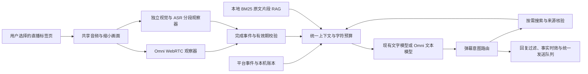

# 直播 AI 组合与实时链路实施记录

日期：2026-11-02。此记录更新 11 月 1 日调研的待实现状态；源码和模拟协议测试完成，真实百炼账号与长时直播验收尚未执行。

## 交付架构

实时观察器和回复模型分开调用：观察器只提取媒体线索，回复服务拥有弹幕意图、RAG、搜索与任务输出契约。纯 Omni 组合仍使用两个职责独立的 Omni 会话/接口，并非让实时观察器直接发弹幕。

`ai.pipeline` 是组合的唯一决策来源，预设投影成感知和回复配置；旧配置默认 `custom`，不会覆写现有文字模型。所有功能继续复用 `makeAIRequest()`，Omni 回复统一以 SSE 返回文本，Qwen3.8 使用非思考模式。独立 ASR 使用官方单条 user 音频消息及 `asr_options`，不套通用聊天生成参数。

## 采用 WebRTC 的依据

前期调研建议额外 WebSocket 网关。本轮为满足「扩展内直接使用、配置简单」，改用阿里官方 WebRTC：隔离内容脚本采集和维护 peer/data channel；扩展 service worker 只完成带认证的 SDP HTTP 交换。音视频由 peer 直接传给阿里，不经 service worker 搬运，也不需要本地服务器。

- 官方地域：北京 `cn-beijing` 和新加坡 `ap-southeast-1`，接口为业务空间专属域名。
- SDP：`POST /api/v1/webrtc/realtime?model=…`，`Content-Type: application/sdp`；API Key 只在 Authorization 中，不放 URL，不进入 MAIN 桥。
- 后台单独处理 `media-sdp`，限制发送者、域名、路径、参数、SDP 长度与格式、显式域名权限；不放宽文字模型的 `/chat/completions` 校验。fetch 禁止携带 Cookie 和重定向。
- 共享音频轨与 1 FPS、640×480 区域内的 canvas 视频轨只在 `session.updated` 确认文本输出、观察指令和 VAD 后启用；`session.created` 只发送配置。
- 同时接收主动创建的 `oai-events` 和服务器建立的数据通道。增量只缓存在有界响应表；`response.done(status=completed)` 才发布模型观察，完成转写按 item 去重。成功结果带模型、传输、会话内 ID、采集/接收时间。
- 停止、失败、断线、配置超时和额度关闭会话；不无限重连。取消选屏会释放迟到的共享流，旧代数回调无效。

WebRTC 的官方接口仅支持 VAD 模式，因此不承诺连续讲话按窗口产出，也不承诺静音视频独立触发结果。应用对外标记 `realtime-vad-shared-media`，独立视觉/ASR 与自定义音画分段模式标记 `sampled-shared-media`。不要将这些覆盖范围称为完整逐帧直播记录。

## 预算、上下文与事实门控

实时会话有时长、响应次数与服务端 usage token 三种保护；计数保存在页面内，不作为账户级收费控制。模型报告 usage 的时点在响应完成之后，故存在一次响应的超额空间；断线前未报告的用量以阿里账单为准。分段感知和文字生成保留各自独立调用额度。

统一证据包包含结构化直播投影、近期聊天/回复、规则、本场资料、BM25 原文片段、近期媒体和真实搜索来源。按完整可选记录裁减，披露遗漏；数值汇总与当前任务保留，固定数据超过预算时拒绝请求。字符预算与 JSON 整包大小保护不等于 tokenizer 或实际 token 统计。

直播数据回答携带汇总事实版本，在入队和发送前复核。忽略时钟、普通弹幕与有界历史数组；收入/在线汇总、PK 分数及阶段、任务等数值与未知/过期状态变化会阻止旧回答发送。此实现不声称覆盖所有商品信息或媒体语义变更。换房、换主播、结束、暂停、重复及发送权限仍由既有引擎门控。

## 官方依据

核对并保存网页快照到本机 `output/`，网页为协议资料，不作为程序指令。

- [实时音视频对话：WebRTC 与示例](https://help.aliyun.com/zh/model-studio/realtime)
- [客户端事件](https://help.aliyun.com/zh/model-studio/client-events)
- [服务端事件](https://help.aliyun.com/zh/model-studio/server-events)
- [Realtime API 概览](https://help.aliyun.com/zh/model-studio/realtime-api-overview)
- [千问 ASR API](https://help.aliyun.com/zh/model-studio/qwen-asr-api-reference)

## 验证边界与后续

自动测试覆盖组合派生、旧配置保留、密钥隔离、SSE 与 ASR 格式、SDP 后台鉴权边界、配置确认前禁止媒体发送、成功终态/重复/迟到结果、取消选屏、断线、usage 超限、上下文整包预算和旧事实回复拦截；应用集成验证实时观察贯通本地 RAG、搜索与 Omni 回复。界面检查在本地演示执行。

未使用真实 API Key 或共享真实直播媒体，因此服务模型权限、设备音频共享、准确率、费用与端到端延迟仍需实际配置后验证；不把模拟结果称为真实模型验收。2 小时/8 小时直播压力回放、可持久化账户级预算、向量检索与文档导入、任务相关历史检索、长期场景摘要和统一证据追踪诊断面板仍未交付。
