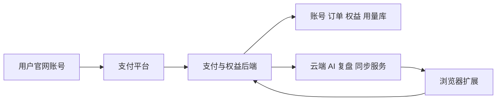

# 订阅商业化、支付授权与 AI 辅助破解防护调研

调研日期：2026-10-25。对象：本仓库当前的 Manifest V3 扩展。主要用户按中国大陆的“大哥”、普通观众及场控考虑，兼顾海外用户。

本轮完成代码与官方资料调研、技能安装和架构建议，没有实施收费改造，也没有进行渗透测试或真实支付联调。文中的账号、支付、云端服务均为拟议建设内容，不能理解为已经存在。

## 1. 推荐决策

推荐“本地实时工具 + 云端订阅服务”的混合架构。采集、图表、基础规则和平台操作留在浏览器；把确实能持续产生价值的跨设备历史、复盘、个性化 AI、协作和持续维护服务做成订阅产品。

防护目标应设为：攻击者即使拿到全部客户端源码、借助 AI 修改客户端，也无法免费获得我们的云端计算、私有数据和他人账号的服务。任何纯本地功能都存在被复制或重写的剩余风险。

用户希望由我们根据产品价值作出判断，尚未单独承诺接受全部核心能力上云。因此混合架构是本报告的推荐方案；具体迁移哪些功能、允许多长故障宽限，仍是实施前的产品决策。

## 2. 从当前代码得到的结论

| 已确认的现状 | 代码证据 | 对商业化的影响 |
| --- | --- | --- |
| 扩展使用 Manifest V3，分别运行 MAIN 和 ISOLATED 脚本 | `extension/manifest.json:2`、`:13`、`:14` | 两种环境中的代码都交付到用户电脑，隔离世界并不意味着代码对安装者保密 |
| 本地打包规则、PK、游戏、统计、AI 请求构造和 UI | `scripts/build.mjs:48`、`:67`、`:72`、`:73` | 单独增加本地会员判断，无法建立可靠的服务端付费边界 |
| 同时生成完整的独立油猴脚本 | `scripts/build.mjs:55`；`.github/workflows/release.yml` 的 Package release assets | 商业版的新付费能力应明确与社区版产物分开，避免另一份产物直接提供同一能力 |
| AI 请求与提示词在本地构造，后台请求用户配置的接口 | `src/services/ai.js:10`、`:43`；`extension/background.js:235` | 现有模式是用户自带接口/密钥；不能靠修改客户端就把自带密钥的调用变成可靠的订阅服务 |
| 页面通过原页面客户端执行直播间操作 | `src/browser/request-sender.js:95`、`:111` | 抖音并不会替我们验证商业会员；自己的服务器不能阻止修改版直接执行本地平台操作 |
| 当前明确采用 MIT 许可 | `LICENSE:5`；`README.md` 许可部分；`scripts/build.mjs:37` | 如历史版本已按 MIT 交付，取得副本者有相应复制、修改和分发权利，不能把全部合法分支都称为盗版 |
| 已有来源校验、输入约束、存储隔离与发送前上下文复查 | `extension/content.js:12`；`extension/background.js:9`、`:139`；`src/browser/request-sender.js:95` | 这些措施保护正常运行和数据边界，不能防止安装者修改自己的副本 |

在本轮检查的运行入口和依赖中，未发现自有商业账号、支付、订阅或授权服务。后端方案需要新建，不能只修改几个客户端开关。

## 3. AI 逆向能做什么，什么才是有效边界

AI 会降低理解脚本、定位会员判断、重写请求和仿制功能的成本。架构应直接假设客户端完全可读、可修改，接口格式也会被发现。

理解客户端和伪造服务端授权是不同能力。正确使用成熟密码算法、保护服务端私钥、逐请求检查权限，可以阻止攻击者仅靠阅读客户端就签发有效权限。但客户端若自己决定是否执行本地功能，对方仍能移除这个决定。

| 做法 | 能解决什么 | 防护限制 |
| --- | --- | --- |
| 压缩代码、移除开发信息 | 降低体积，减少无意泄露 | 无法阻止分析与修改 |
| 重度混淆、加密 JS、运行时解密 | 增加部分阅读成本 | 解密后的代码或调用结果仍可观测；Chrome 商店禁止用于隐藏功能的混淆 |
| WASM、本地原生程序 | 在适合的计算场景提升性能，增加部分分析成本 | 仍由用户控制执行环境；增加安装和维护成本，不构成授权根基 |
| 本地公钥验签的许可证 | 防止为未修改客户端伪造官方许可证 | 攻击者可以修改客户端，跳过验签 |
| 定期联网检查会员、客户端心跳 | 管理正常客户端的到期和并发体验 | 对纯本地功能可被补丁绕过；后端只能强制限制自己的服务 |
| 服务端逐请求授权、计量、返回真实结果 | 控制自己的计算、存储和私有数据的访问 | 不能阻止合法用户复制已经取得的结果，也不能消除独立仿制 |
| 安装密钥、令牌轮换、并发租约 | 降低简单复制令牌和大规模账号共享 | 浏览器安装标识并非可信硬件身份；代理转卖和被控设备仍需监测 |

不要把 CORS、扩展 ID、Origin、隐藏 API 地址、客户端包哈希或客户端自报的版本当成付费身份认证。它们可用于正常集成、分发或辅助风控。

浏览器端的非导出 CryptoKey 可以提高直接导出密钥的难度，但不等于硬件证明；控制浏览器进程的攻击者仍可能调用密钥。签名令牌一般也不等于加密令牌，不应装入敏感业务资料。

参考：[Chrome 代码可读性政策](https://developer.chrome.com/docs/webstore/program-policies/code-readability)、[OAuth 安全最佳实践 RFC 9700](https://www.rfc-editor.org/rfc/rfc9700.html)。

## 4. 围绕“大哥”用户安排付费价值

该用户群通常会切换关注的直播间，不宜默认按一个主播永久锁死。建议先销售“自己的产品账号 + 可登记设备数 + 云端并发使用数 + 明确 AI 用量”。

| 能力 | 推荐位置 | 收费价值与边界 |
| --- | --- | --- |
| 直播事件观察、实时 PK 显示、基础图表 | 本地 | 低延迟；属于容易被复制的客户端价值 |
| 基础欢迎/感谢/定时规则、游戏和发送 | 本地 | 对正常客户可纳入套餐，但不能承诺专业逆向下不可绕过 |
| 跨设备配置和用户自己的历史记录 | 云端可选同步 | 持续可用和数据积累构成价值；只同步用户明确选择的数据 |
| 直播历史对比、复盘、提醒、关注列表管理 | 云端计算 + 本地展示 | 是否值得订阅需用真实用户验证；数据覆盖和采集缺口必须清楚展示 |
| 个性化 AI 回复、复盘和后续音视频理解 | 云端 | 从输入、上下文处理到推理结果在后端执行；提供稳定质量和用量管理 |
| 多人协作、共享资料、长期版本维护 | 云端服务及运营 | 服务交付可持续，竞争者需承担相应维护成本 |

以上为产品候选项，不代表当前已经实现，也不代表已验证用户愿意付费。不要只把本地提示词搬到服务器，再转发公共模型 API，就宣称建立了独有壁垒；别人仍能使用自己的模型重做类似功能。

“大哥”身份不等于主播或管理员权限。普通观众可以购买观察、互动和辅助功能；禁言、封禁等操作仍受抖音实际账号权限限制。商业订阅不能增加平台权限。

目前账本和 PK 数据来自页面观测，应延续项目对缺失、估算和时效的说明；不能将它们宣传成平台完整流水、确定收益或必胜预测，也不应据此推断用户财富与消费意愿。

## 5. 售卖与支付路径

建议使用官网承接套餐、登录、支付、订单、退款和设备管理，扩展负责安装后使用。正式分发优先评估 Chrome Web Store 和 Edge Add-ons；官网提供安装指引及官方商店链接。

Chrome Web Store 原支付及授权体系已经弃用，需要自己接入支付并管理权益。Chrome 在 Windows/macOS 的普通外部分发也有平台限制，不能假设官网放一个 CRX 就能让普通用户顺畅安装。当前“下载 ZIP、开启开发者模式”的方式可用于小规模测试，正式售卖需要评估安装与更新成本。

参考：[Google 官方支付弃用说明源码](https://github.com/GoogleChrome/developer.chrome.com/blob/main/site/en/docs/webstore/cws-payments-deprecation/index.md)、[Chrome 外部安装限制](https://developer.chrome.com/docs/extensions/how-to/distribute/install-extensions)。

| 场景 | 建议路径 | 条件与取舍 |
| --- | --- | --- |
| 大陆 PC 用户首次购买月/年权益 | 官网登录后，微信 Native 扫码；支付宝评估电脑网站支付 | 由后台生成订单；不能用静态个人收款码加截图自动发货 |
| 暂无可用商户主体 | 先验证产品需求，再办理合适主体或评估合规服务商进件 | 微信普通商户 Native 准入列有个体工商户、企业等主体，并要求认证应用及商户号绑定；不能保证个人直接开通 |
| 真正的连续自动续费 | 开通对应官方订阅/代扣产品后接入 | 一次扫码支付不会自动获得以后扣款的权利；必须有有效签约、取消入口和状态同步 |
| AI 服务类订阅 | 可评估支付宝 Agent 支付的 AI 连续订阅 | 官方文档已提供订阅与周期续费能力；本扩展是否符合行业、主体和产品准入需实际申请确认 |
| 海外银行卡 | 具备支持地区的合格主体后评估 Stripe Checkout + Billing | 中国大陆目前不在 Stripe 标准支付开户地区列表；不能只因为客户在海外就假设可以开户 |

第一阶段建议采用“用户主动购买月度/年度权益，到期续费”，避免把连续扣款资格申请作为开始售卖的前提。若已具备适合的订阅产品资格，再接入自动续费。

支付宝 AI 订阅的“个体订阅”指面向个人客户的订阅类型，不能解读为自然人商家无需审核即可开户。官方文档显示支持订阅创建、扫码/跳转确认和续费状态通知，具体准入与费率仍以商家控制台和签约结果为准。

参考：[微信 Native 接入准备](https://pay.weixin.qq.com/doc/v3/merchant/4015614538)、[支付宝电脑网站支付文档](https://opendocs.alipay.com/open/270/105899)、[支付宝 AI 个体订阅](https://aipay.alipay.com/docs/subscribe/integration-guide/individual.html)、[Stripe 支持地区](https://stripe.com/global)。支付宝电脑网站支付页本轮未能提取正文，实施时仍须登录控制台核对对应最新接口和资质；本报告未据此提供接口代码。

### 用户购买与使用

1. 用户从官方渠道安装扩展，点击“登录/开通会员”。
2. 在官网登录自己的产品账号；登录方式先选一种可稳定服务目标用户的验证码方式，第三方扫码登录按实际资质增加。
3. 选择月/年套餐，后端按套餐标识生成订单与收银台；价格由后端决定。
4. 用户扫码付款，后台验证支付平台通知或查单结果，更新该订单所属账号的权益。
5. 扩展重新查询自己的权益，开始使用套餐中的云端服务；用户无须粘贴商家的 AI API 密钥。
6. 账号页允许查看到期日、用量、订单和设备；支持退出旧设备、续费、取消自动续费和申请退款。

购买账号与付款人不必是同一个人。先登录后建单，权益绑定建单账号；不要仅凭付款 OpenID 就重新绑定账号，也不要默认将抖音账号当成自己的商业登录账号。

### 支付后端的必要处理

- 用官方 SDK/文档实现请求签名、平台回调验签；微信 APIv3 回调还需解密。商户私钥、APIv3 密钥和 AI 服务密钥仅留后端。
- 核对订单、商户/应用、币种、应付金额及支付状态；内部金额使用整数最小货币单位，按每家产品的单位规则转换。
- 支付通知先可靠持久化或入队，再确认接收并异步处理。以平台交易号、事件号与本地订单建立唯一约束，事务内执行权益变更，防止重复发货。
- 处理回调重复、乱序和遗漏，安排主动查单与对账。网页“支付成功”跳转只用于界面反馈，不能作为发货证据。
- 为退款、争议、续费失败、到期取消建立明确的权益规则。取消自动续费通常保留已付费周期，退款按约定调整服务；不能误删用户本地账本。
- 自动续费事件使用平台确认的计费周期和状态，避免每次收到通知就简单再加一个月；消费权益和签约关系分别存储。

依据：[微信 Native 支付成功回调通知](https://pay.weixin.qq.com/doc/v3/merchant/4012791882)、[支付宝 AI 订阅通知与状态说明](https://aipay.alipay.com/docs/subscribe/integration-guide/individual.html)。

## 6. 授权架构

以下是推荐的新建结构，不是现有仓库的运行图：

后端可以先做一个模块清晰的单体服务，配关系数据库；并发和队列按需要使用数据库事务或缓存设施。无需为初期售卖引入大量微服务。

最小数据模型包括：用户、支付订单、支付事件、订阅/权益、设备安装、登录会话、并发租约、服务用量与管理审计。退款不能只改订单而忘记调整相关权益。

授权实现重点：

1. 浏览器扩展是公开客户端，不持有“所有用户共用的秘密”。采用成熟登录流程；网页登录回传使用短期、一次性授权码和状态绑定，适用时使用 PKCE，避免长效令牌放 URL。
2. 短期访问令牌与可撤销会话绑定；刷新令牌轮换并检测异常重用。5–15 分钟访问令牌可以作为初始参数示例，最终按体验和撤销时限决定。
3. 每次访问收费 API，由后端检查账号、当前权益、会话撤销、租约与实际用量；客户端传来的套餐名、到期日、余额都不可信。JWT 验签并不替代资源归属和计费授权。
4. 配置初始套餐，例如“可登记两台浏览器、同时一个云端使用会话、可切换直播间”；这是待验证的产品假设，不是强制推荐的最终限额。
5. 并发租约在后端原子创建和续期，过期回收；不能只数在线 TCP 连接或依赖 service worker 常驻。令牌有效期与租约有效期配合，明确撤销最长延迟。
6. 可以在后续引入安装密钥与请求持有证明，降低复制 bearer token 即可使用的风险；它不能证明客户端未被修改。
7. 设备换绑提供自助操作与合理冷却。IP、网络和地理位置只作风险信号，避免误伤 VPN、移动网络或共用出口。

如果并发限制只在服务器发放一张“允许本地执行”的票据，修改版仍能不取票直接执行本地逻辑。并发租约的可靠约束对象始终是后端实际提供的服务。

## 7. 密钥、隐私和故障体验

HTTPS 负责传输安全，后端权限检查负责谁能访问，服务端密钥管理负责密钥不随客户端泄露，服务端计算负责关键实现不交付。不要用“代码加密”混淆这几件事。

商业登录令牌、支付凭据和商家 AI 密钥不应进入 MAIN 世界或页面 `postMessage`。商业网络请求放扩展后台的固定接口层，页面消息只携带必要业务输入；服务端不接受客户端任意指定上游 URL、模型或最大输出而不约束成本。

保护用户数据时，对昵称、UID、礼物记录和弹幕采用最小上传、明确用途和保留期、租户隔离、删除/导出能力。抖音 Cookie 和登录会话留在本地。不能为了证明用户的抖音身份就要求上交 Cookie；未获得可靠验证的 UID 不能当作服务器确认的归属。

云端故障时，本地实时工具保持可用；云端功能明确提示不可用、有限重试和取消。用户自己的本地账本继续可读和导出。已确认付费可设计有界体验宽限，但要披露该宽限对修改版客户端无法强制到期，不能让宽限无限提供免费的云端算力。

云端模型输出和网页内容均视为不可信输入。模型只能返回受约束的文本或数据，授权、扣费、退款、管理员操作必须走确定性后端代码。公屏发送与平台管理动作继续保留本地权限复核和结果未知处理。

## 8. 发布、许可与投入顺序

1. **先验证愿意付费的价值。** 面向“大哥”收集实际使用任务，区分需要及时本地操作的功能，以及确实需要长期云服务的功能；用小规模付费试用验证持续使用和续费意愿。
2. **明确社区版与商业版边界。** MIT 允许商业销售，也允许符合许可条件的复制和分发。对已交付版本的既有权利，不能靠改当前 LICENSE 收回。未来新增代码的闭源安排以实际版权和贡献者授权为前提，第三方许可与通知继续保留。
3. **建设一个完整收费闭环。** 账号、主动购买月/年权益、支付回调、权益、设备/会话、一个真实云端收费能力、管理后台、退款与对账。
4. **验证抗滥用。** 所有收费服务统一校验，限制 AI 预算、并发和输入大小，记录可追踪审计，测试撤销与退款后的行为。
5. **再做便利性与规模。** 评估官方商店、自动更新、连续订阅、更多支付方式和更细风控。

商店版允许账号同步、获取数据和服务器计算结果，但不能从服务器下载 JS/WASM 来执行，或把所谓“配置”变成承载隐藏业务逻辑的解释器。正常功能开关和结构化结果与远程代码应有清楚边界。见 [Manifest V3 政策](https://developer.chrome.com/docs/webstore/program-policies/mv3-requirements)。

## 9. 商业版验收标准

以下是后续实现必须验证的行为，本轮没有把它们标成已通过：

- 删除客户端全部会员检查后，仍无法调用没有付费权益的云端能力。
- 将界面状态改成付费、伪造支付成功页面或修改本机时间，不能改变后端权益和余额。
- 未支付、金额不符、错误商户、签名错误、重复/乱序通知，不会错误发货或多次续期。
- 两台客户端同时申请最后一个云端并发名额时，后端限额仍成立；被撤销的旧会话在规定时限内失效。
- 重放已消耗请求、并发耗尽最后一点 AI 余额，不会重复扣费、超额消费或无限获取结果；区分传输重试与新的服务请求。
- A 用户无法读取 B 用户的历史、报告、订单或修改 B 的设备；测试同样覆盖导出和删除接口。
- 日志、构建包、源码映射和错误上报不包含商户私钥、商家 AI 密钥或完整刷新令牌。
- 直播弹幕中的恶意指令不能修改套餐、付款状态、接口路由或自动触发危险平台操作。
- 云服务断开不会损坏本地账本、造成发送结果未知时自动重发，或阻止用户导出自己的数据。

验收要允许“本地功能可以被重写”这个结果。真正要证明的是：攻击者控制客户端后，仍不能越过服务端控制的商业资源边界。

## 10. 本轮使用的技能和官方资料

新安装并阅读：

- [OpenAI security-threat-model](https://github.com/openai/skills/tree/main/skills/.curated/security-threat-model)：按代码证据整理资产、信任边界、滥用路径和剩余风险，单独报告见同目录的 `douyin-live-operations-assistant-threat-model.md`。
- [微信支付 wechatpay-payment-integration](https://github.com/wechatpay-apiv3/wechatpay-skills/tree/main/wechatpay-payment-integration)：同步官方知识库，按产品选型与支付通知资料进行调研；官方文档也直接提供该技能的[安装入口](https://pay.weixin.qq.com/doc/v3/merchant/4019638116)。

同时使用现有 `security-best-practices` 与 `chrome-extensions` 技能。技能用于组织分析和核对资料，不是防破解组件，也不会自动给扩展增加保护。

微信资料对应本地知识库标题及原始链接：

- [APIv3/普通商户/支付产品/Native支付/产品介绍](https://pay.weixin.qq.com/doc/v3/merchant/4012791874)
- [APIv3/普通商户/支付产品/Native支付/开发接入准备](https://pay.weixin.qq.com/doc/v3/merchant/4015614538)
- [APIv3/普通商户/支付产品/Native支付/API列表/支付成功回调通知](https://pay.weixin.qq.com/doc/v3/merchant/4012791882)

其他核心依据为前文各段所列 Chrome、IETF、支付宝和 Stripe 官方资料。本轮核对当前资料，未承诺商户审核结果、平台长期规则或固定费率。
