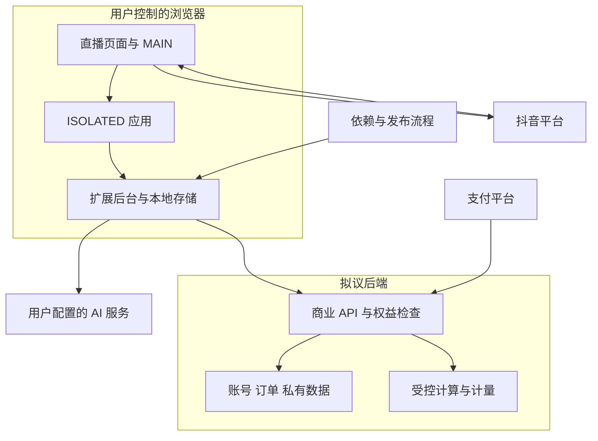

# 抖音直播运营助手：订阅商业化威胁模型

> 2026-10-30 更新：本文保留审查当时的实现证据；公开 postMessage 桥已被按 documentId 绑定的 scripting 调用取代。当前边界与验证限制见 [修复报告](../reviews/architecture-fixes-2026-10-30.zh-CN.md)。MAIN 仍与网页共享环境。

日期：2026-10-25。按 `security-threat-model` 工作流形成。当前代码与拟议商业后端分别标记；这是架构威胁分析，未执行渗透测试。

## Executive summary

最高风险是将客户端会员判断误当成收费边界：现有规则、请求和分析逻辑交付在本地，AI 可帮助攻击者修改或重写，抖音也不验证本产品会员。推荐混合架构，将实时工具留本地，将持续收费的计算、存储与服务放后端，以逐请求授权、计量和租户隔离控制访问。MIT 历史版本的合法复用与盗用商业服务须区别处理；新增后端的支付通知、令牌、用量和私钥成为重点保护对象。

## Scope and assumptions

- 当前范围：`extension/`、`src/services/ai.js`、`src/browser/request-sender.js`、主要本地功能、`scripts/build.mjs`、`LICENSE`、`.github/workflows/release.yml`。
- 拟议范围：新建账号、支付回调、权益、会话/设备、云端计算与同步服务。当前仓库尚未发现这些商业服务实现，相关风险均为条件性设计风险。
- 用户确认：以大陆用户为主，购买者可能是“大哥”或普通观众，并不一定是主播；同时保留海外售卖可能。
- 用户要求：重点考虑 AI 辅助逆向。假设对方完整控制自己的浏览器与客户端。
- 已向用户询问核心能力上云的接受程度；用户要求我们按产品价值判断。采用混合架构作为建议，具体迁移范围和故障宽限尚未确认。
- 本轮不覆盖抖音服务端安全、实际商户开户审核、第三方模型基础设施、完整 UI/XSS 审计或依赖漏洞扫描；没有接触真实订单或生产密钥。

仍影响排序的问题：收费价值是否主要留在本地；历史版本实际分发范围和贡献者权属；可申请的收款主体；云端数据保留范围与用户规模。

## System model

### Primary components

当前是 JavaScript 浏览器扩展，构建使用 Node.js 与 esbuild（`package.json`、`scripts/build.mjs`）。MAIN 入口观察直播页并复用页面客户端；ISOLATED 入口接收事件和运行应用；service worker 提供持久存储、AI 网络请求和采集协调（`extension/manifest.json`、`extension/page.js:54`、`extension/content.js:57`、`extension/background.js`）。

AI 请求内容由本地构造并交给已授权接口；礼物和历史数据主要保存在浏览器（`src/services/ai.js:10`、`extension/background.js:235`、`docs/development/architecture.zh-CN.md`）。构建和发布流程同时输出扩展与油猴脚本（`scripts/build.mjs:55`、`.github/workflows/release.yml`）。

### Data flows and trust boundaries

- 抖音页面 → MAIN 脚本：网页连接、DOM 与当前账号上下文；同一页面环境。页面数据及昵称、弹幕是非可信输入，不能作为商业身份或付款证据（`extension/page.js:54`、`src/browser/request-sender.js:95`）。
- MAIN → ISOLATED：直播事件、状态和操作结果，通过 `postMessage` 交接；有窗口、origin、房间、类型和长度约束。相同页面脚本仍能模仿消息，来源标签不是密码学认证（`extension/content.js:12`）。
- ISOLATED/扩展页面 → service worker：通过扩展消息请求存储和 AI；后台验证发送来源、房间与请求形状，存储设置 trusted contexts。安装者控制整个包时仍可修改这些检查（`extension/background.js:9`、`:139`、`:235`）。
- 后台 → 外部 AI 服务：请求包含用户配置的模型、提示和身份头；接口校验 HTTPS、本地例外、域名授权与请求长度。当前不是我们的商业云接口（`src/services/ai.js:3`、`extension/background.js:235`）。
- MAIN → 抖音请求客户端：公屏或管理操作，复核房间、账号、时效、文本和管理员身份，平台最终执行权限检查；与本产品订阅授权独立（`src/browser/request-sender.js:95`）。
- 依赖/开发源码 → 构建 → 发布附件：依赖安装、构建脚本和 CI 产物信任边界；工作流有版本、main 提交、测试和语法检查，仍须保护发布权限（`.github/workflows/release.yml`）。
- 扩展 → 拟议商业 API：HTTPS 携带产品登录令牌、任务与同步数据；建议逐请求校验权益、会话、归属、并发和配额。当前未实现。
- 支付平台 → 拟议支付后端 → 权益库：验证签名/业务字段，可靠记录支付事件、去重和状态转换；当前未实现，前端付款展示不能代替此边界。

#### Diagram

图中“拟议后端”区域尚未实现。

## Assets and security objectives

| Asset | Why it matters | Security objective (C/I/A) |
| --- | --- | --- |
| 本地脚本与算法 | 当前交付给安装者；无法承诺保密 | I/A；不以客户端保密作为前提 |
| 本地配置、账本、发送状态 | 丢失或错误恢复会损害用户数据与互动 | C/I/A |
| 用户自带 AI 密钥 | 被盗可能导致用户承担计算费用 | C/I |
| 拟议商业会话与刷新令牌 | 被复制会允许冒用已付费账号 | C/I |
| 拟议支付事件、订单、权益 | 错误转换导致未付款获得服务或正常用户失权 | I/A |
| 拟议商户私钥与商家 AI 密钥 | 泄露可能导致伪造商户请求或盗刷模型预算，实际影响取决于权限 | C/I |
| 拟议私有报告、历史与计算预算 | 越权读写、爬取和滥用造成隐私或成本损失 | C/I/A |
| 发布渠道与制品 | 被替换的升级包可污染大量安装 | I/A |

## Attacker model

### Capabilities

读取完整扩展和公开历史代码，使用 AI 解释/仿制；控制自己的浏览器、存储、时钟和代理，修改后重打包；注册普通账号或购买一个合法账号，观察该账号的请求和结果；尝试复制会话、账号共享、代理转卖和高并发调用；若能影响弹幕或页面输入，可通过真实事件影响 AI 任务输入。

### Non-capabilities

不默认能突破正确部署的现代密码算法、直接取得后端私钥、写入支付平台数据库、取得其他用户本机或登录抖音后台。能够观察一个账号的流量不等于获得全部租户数据。AI 提高分析和攻击自动化效率，不自动获得上述能力。

## Entry points and attack surfaces

| Surface | How reached | Trust boundary | Notes | Evidence (repo path / symbol) |
| --- | --- | --- | --- | --- |
| 页面事件及桥接 | 打开直播页，接收事件或同页面消息 | 页面到扩展 | 不接受商业凭据或支付事实 | `extension/page.js:11`、`extension/content.js:12` |
| 后台消息处理 | 内容脚本和扩展页面 | 内容到特权后台 | 有来源和输入约束；不是针对包所有者的 DRM | `extension/background.js:139` |
| AI 构造和请求 | 配置及直播任务 | 本地到外部服务 | 当前提示词和请求构造交付本地 | `src/services/ai.js:10`、`extension/background.js:235` |
| 平台操作 | 页面请求客户端 | 本地到抖音 | 会员权限无法替代抖音权限 | `src/browser/request-sender.js:95` |
| 本地存储和恢复 | 正常运行、用户清理/修改 | 运行时到持久化 | 修改本地到期时间不能影响拟议后端权益 | `extension/background.js:8`、`src/runtime/delivery.js` |
| 构建、油猴和发布附件 | 源码及 release workflow | 开发到分发 | 本地逻辑重复交付，两种版本均需纳入商业边界 | `scripts/build.mjs:55`、`.github/workflows/release.yml` |
| 拟议登录、收费和同步 API | 公开互联网 | 用户到商业后端 | 必须按资源归属和权益授权，当前未实现 | 后续新增模块；无现有路径 |
| 拟议支付通知和管理入口 | 平台通知及管理员 | 外部/管理到权益系统 | 验签、去重、审计与管理员强认证 | 后续新增模块；无现有路径 |

## Top abuse paths

1. 免费获得本地付费能力 → 获取客户端 → 用 AI 定位或重写收费判断 → 保留本地操作和算法。若只加本地门禁，完整价值仍可能被保留。
2. 免费获得拟议云服务 → 修改客户端套餐/余额或直接调用收费接口 → 若后端相信客户端声明而不查权益，产生未授权计算。该路径是未来设计风险，尚无已部署漏洞证据。
3. 转卖账号 → 合法购买 → 分发登录或代理请求 → 若只按单个令牌限速、缺乏账号级并发/预算控制，可扩大共享服务。
4. 未付款开通/重复续期 → 伪造成功页面或重放通知 → 若后端不验签、金额不匹配或未做幂等，错误发放权益。未来设计风险。
5. 盗取云端报告 → 合法低权限账号 → 枚举或替换报告、订单、设备 ID → 若后端只验证登录而不验证归属，跨账号泄露或修改。未来设计风险。
6. 耗尽 AI 预算或污染结果 → 大量事件、超大上下文或恶意文本 → 若收费后端缺乏服务端配额、模型白名单和输入隔离，扩大成本或让模型输出不当内容。
7. 分发恶意升级 → 获取发布权限或污染构建依赖 → 发布替换制品 → 获取用户数据或修改行为。需要供应链/账号被攻陷的前提，不能仅凭工作流存在就认定可利用。

## Threat model table

“未来”表示拟议后端的条件性风险；以下不是已验证漏洞清单。

| Threat ID | Threat source | Prerequisites | Threat action | Impact | Impacted assets | Existing controls (evidence) | Gaps | Recommended mitigations | Detection ideas | Likelihood | Impact severity | Priority |
| --- | --- | --- | --- | --- | --- | --- | --- | --- | --- | --- | --- | --- |
| TM-001 | 安装者及 AI 仿制者 | 取得本地包；计划对本地功能收费 | 删除判断或重写功能 | 可复制主要收费价值 | 商业收入、本地实现 | 平台权限复查 `src/browser/request-sender.js:95`；不构成商业门禁 | 本地逻辑完整交付，且现有 MIT 允许相应复用 | 按持续云服务设计付费能力；明确社区版和商业服务；接受本地复制风险 | 跟踪正版活跃与续费；不能可靠遥测不连接后端的离线副本 | high：完整交付、AI 降低成本 | high：若收费价值都在本地 | high |
| TM-002 | 未来 API 调用者 | 商业 API 上线且错误信任客户端状态 | 伪造权益或直连接口 | 未付费访问云服务 | 计算预算、私有服务 | 尚无商业后端 | 缺少服务端授权实现 | 每次请求查当前权益、会话、租约和用量；统一封装但仍校验资源级权限 | 401/403、权益与用量不一致、预算异常 | medium：取决于未来实现 | high：可规模化盗用服务 | high |
| TM-003 | 付费账号共享者 | 有一个合法账号或取得其令牌 | 复制会话、并发共享或代理 | 少量付费服务大量用户 | 会话、并发、预算 | 当前无商业会话 | 软件安装身份不可证明未被修改 | 短期令牌、刷新轮换、后端原子租约和账号级配额；按需持有证明 | 刷新重用、异常并发、服务速率；IP 仅辅助 | high：共享动机与操作门槛低 | medium：有配额可限制损失 | medium |
| TM-004 | 未来支付通知攻击者 | 支付链路上线且缺少可靠验证 | 伪造通知、改金额、重放或利用乱序 | 未付款开通、重复续期或退款后保留服务 | 支付与权益完整性 | 尚无支付代码 | 不能依赖前端成功状态 | 平台验签/必要解密、订单金额和商户校验、事件持久化、事务幂等、查单对账、退款状态机 | 验签失败、重复交易号、支付权益差异 | medium：取决于实现，接口可公开触达 | high：发货与收入完整性受损 | high |
| TM-005 | 未来低权限账号 | 多账号数据上云且存在资源归属缺口 | 跨账号读写报告、订单或设备 | 隐私泄露、账号配置被改 | 云端历史、订单与设备 | 当前本地数据未形成云多租户面 | 多租户隔离尚未实现 | 所有查询和任务强制账号归属；后台管理单独授权；不可猜 ID 仅为辅助 | 跨账号拒绝、批量查询、异常导出；审计管理改动 | medium：取决于实现 | high：可能泄露多用户私有记录 | high |
| TM-006 | 滥用者及恶意内容提交者 | 云 AI 接受输入；或模型具备过大动作权限 | 放大上下文、并发刷调用、提示注入 | 高额费用、错误回复或操作 | 计算预算、输出完整性 | 当前有输入大小与部分提示约束 `extension/background.js:238`、`src/services/ai.js:16` | 当前本地小时限制不能作为商业云配额 | 后端原子预算预留、模型/输出上限、输入边界；模型无账务/授权权力；危险动作确定性检查 | 账号成本、超限拒绝、超大请求、异常动作 | high：输入可来自开放直播间 | medium：限制模型动作与预算后可控 | medium |
| TM-007 | 发布账号或依赖攻击者 | 供应链或发布权限被攻陷 | 替换代码或升级制品 | 大量用户接收恶意版本 | 制品、用户数据、令牌 | 发布前版本、main、测试检查 `.github/workflows/release.yml` | 正常测试不证明供应链未被攻陷 | 发布账号强认证、最小权限、分离后端密钥、保护审批与发布分支、依赖/制品审查 | 发布审计、非预期权限变化、制品摘要与版本差异 | low：需要额外账号或依赖失守 | high：可信升级扩大影响 | medium |

## Criticality calibration

以下是用于后续审查的分级例子，不是在宣布已有这些漏洞。

| 级别 | 本项目适用标准 | 例子 |
| --- | --- | --- |
| critical | 无需有效账号即可大规模控制商业后端或资金/数据关键边界 | 匿名修改所有账号权益；商户高权限私钥公开且可被用于严重资金相关操作 |
| high | 可绕过关键付费边界、跨账号取数据，或复制绝大部分本地收费价值 | 匿名无限调用商家 AI；跨账号批量读报告；仅本地门禁支撑全部订阅价值 |
| medium | 需有付费/被盗会话、损失有界或可通过预算限制 | 一个账号在多设备共享但受总配额限制；小范围计算放大；需要发布账号失守的供应链风险 |
| low | 不提供受控资源访问，或仅低敏信息、可恢复体验问题 | 得知公开接口路径；看到普通功能配置名；单个会话刷新后恢复的非敏感显示错误 |

没有已确认的 critical 漏洞。TM-001 的 high 属商业架构风险；其他未来风险的等级取决于真正实现和部署情况。

## Focus paths for security review

| Path | Why it matters | Related Threat IDs |
| --- | --- | --- |
| `extension/manifest.json` | MAIN/ISOLATED、权限和未来商业域名的边界 | TM-001, TM-002 |
| `extension/page.js` | 页面输入及桥接，避免商业凭据进入页面 | TM-001, TM-006 |
| `extension/content.js` | 消息验证、业务接线与未来商业请求入口 | TM-001, TM-002, TM-006 |
| `extension/background.js` | 存储、请求来源、用户密钥与未来令牌隔离 | TM-002, TM-003, TM-006 |
| `src/services/ai.js` | 本地提示词交付与未来云 AI 迁移范围 | TM-001, TM-006 |
| `src/browser/request-sender.js` | 平台操作独立于商业会员，不应宣传付费增加平台权限 | TM-001, TM-006 |
| `src/core/engine.js` | 本地规则和频控不能被视作服务端计量 | TM-001, TM-006 |
| `src/data/gifts.js` | 历史同步后的数据隔离与完整性 | TM-005 |
| `src/runtime/delivery.js` | 云故障或续期状态变化不应导致未知发送被自动重复 | TM-006 |
| `scripts/build.mjs` | 完整油猴/扩展产物及敏感信息打包检查 | TM-001, TM-007 |
| `.github/workflows/release.yml` | 发布权限、依赖与制品可信性 | TM-007 |
| `LICENSE` | 历史 MIT 权利和商业版边界 | TM-001 |

未来新增的登录、支付、权益、租约、计量、同步、管理后台均需重新纳入审查，尤其覆盖 TM-002 至 TM-006；不能只审客户端。

## Notes on use

- 已覆盖本轮发现的页面桥接、后台消息、AI、平台请求、本地持久化及发布入口；未来支付/API 单列，不与现有组件混淆。
- 每个主要运行及发布边界均已在 TM-001 至 TM-007 中考虑，区分了正常客户端保护与对安装者的商业保护。
- 用户澄清、尚未确认的云端范围、商户主体、历史许可和数据保留均已列出。
- 报告依据代码阅读与官方文档，无未授权外部探测、无真实支付、无成功利用证明。
- 推荐实现和验收项目见同目录 `commercial-subscriptions-and-anti-tamper-2026-10-25.zh-CN.md`。实现商业后端后应更新本模型，并执行资源归属、账务幂等、会话撤销与预算并发测试。
