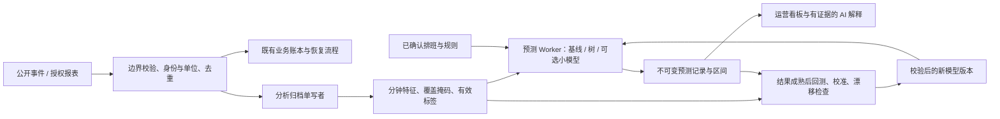

# 直播收入估算、实时预测与浏览器端建模调研

调研日期：2026-11-03（北京时间）。对象：本项目当前工作区的采集、礼物账本、PK、观众上下文与 Chrome MV3 扩展。本文是研究与实施设计，没有把预测接入产品，也没有使用真实主播或观众数据训练模型。

## 1. 结论与推荐顺序

可以把项目升级成具有持续预测和复盘能力的运营系统。最值得优先做的是：**可追溯的数据底座 → 本场礼物收入与在线人数预测 → 下月情景预测 → PK 与千票榜 → 经过校准的送礼概率与弹幕语义分析**。

推荐采用“统计/树模型负责数值，小型语言模型负责语义和解释，预测结果持续回测”的组合。模型越大不代表在本项目稀疏、缺失、重尾的数据上越准确。历史收入没有采集或可信外部标签时，只能给条件估算或情景范围；不能把推算结果写成历史实收。当前资料也不足以证明能超过抖音内部系统的预测效果。

### 按可执行性排序

这里的高、中、低是工程和数据条件判断，不是已经测得的准确率。数据门槛是建议的启动条件，最终是否上线以留出数据验证为准。

| 顺序 | 能力与用户可见结果 | 首选方法 | 所需数据 / 主要限制 | 浏览器可执行性 |
| --- | --- | --- | --- | --- |
| 0 | 区分已观测、历史估算、未来预测；显示缺失与来源 | 统一指标、覆盖区间、不可变预测记录 | 先解决掉线、连击、补差、时间口径和身份归属 | 高；纯 JS + 现有 IndexedDB |
| 1 | 本场最终礼物价值、结束前预计增量 | 分时段先验 + Gamma-Poisson / 两阶段模型 + 场次剩余时长 | 完整或可校准场次；未知下播时间用多个情景 | 高；纯 JS 即可起步 |
| 2 | 未来 1/5/15 分钟在线人数、弹幕量、礼物价值 | 同时段基线、指数平滑/局部状态空间；后续树模型 | 连续分钟序列、观测掩码、PK/活动状态 | 高；无需大模型 |
| 3 | 下一个自然月礼物价值及人民币条件估算 | 开播日历 × 时长 × 每时段收益；层级收缩与路径模拟 | 本人历史 + 未来排班；冷启动需要可信同类样本 | 中高；运算易，数据是门槛 |
| 4 | PK 胜/平/负概率、剩余票数分布 | 赛前 Elo/逻辑回归；局内带标记计数过程与模拟 | 双方比分时间线、剩余时间、倍数/道具和终局证据 | 中高；单局模型可用 JS |
| 5 | 本场千票人数、某观众过千概率、榜单席位概率 | 送礼概率 × 正金额分布；联合模拟榜单 | 完整贡献覆盖不足时，只预测“已识别观众集合” | 中；榜单截断会造成偏差 |
| 6 | 某已观察观众未来 5 分钟送礼的概率及理由 | 离散时间生存模型/逻辑回归；数据足够再用 GBDT | 稳定身份、有效曝光窗口、正负标签；不是仅有送礼者名单 | 中；先后台验证再用于运营 |
| 7 | 讨论主题、文本情绪倾向、求助/离场/送礼表达 | 中文轻量分类器/embedding + 校准分类头 | 本场口语、反讽、表情及人工标注；分析表达而非读心 | 中高；ONNX Runtime Web / Transformers.js |
| 8 | 没有采集的历史月份收入范围 | 可信账单导入、同类条件分布、敏感性分析 | 没有历史标签和可比样本时无法验证个人历史 | 低到中；应显示“条件估算” |
| 9 | 下月段位/晋级概率 | 已确认规则的状态转移 + PK 模拟；否则序数分类 | 赛季规则、重置、积分、对手和榜单总体均可能缺失 | 中低；不能按固定收入比例换算段位 |
| 10 | 下一条弹幕的主题/意图分布 | 下一事件分类、检索候选；语言模型生成假设 | 精确下一句话属于高不确定开放生成 | 主题预测可试验；原话预测不作承诺 |

第一版交付组合建议为 0–3，随后 4–7。8 应作为独立的历史估算工具，9–10 保持实验功能。不能用“天眼精确监控”描述这些统计推断；产品可以做到的是持续观察、保留证据、显示不确定性并越用越能校准。

## 2. 现有代码能提供什么

以下结论来自源码静态核对，包含当前工作区尚未提交的草稿能力，不代表这些能力都已发布。没有进行真实直播房间抓取验收。

| 位置 | 已有能力 | 对预测的意义 / 尚缺部分 |
| --- | --- | --- |
| `src/data/gifts.js`：`GiftLedger` | 连击累计去重、迟到单价补全、按场次/日期账本、逐观众礼物贡献、榜单补差；默认人民币估算率为 0.05 | 可以复用核算后的增量与场次结果；0.05 是代码默认假设，不是已核实的平台通用结算规则 |
| `src/core/gift-analytics.js` | 日/周/月/季/年汇总、贡献者、千票人数；北京时间开播日归属 | 适合作为统计入口；汇总不等于可回放的分钟训练序列 |
| `src/core/live-statistics.js`、`src/core/live-context.js` | 已采集范围说明、历史汇总、PK/段位/礼物上下文；向 AI 发送截断摘要 | 原始数值模型应读取本地完整特征；不能从 AI 的 20 条历史或 20 位贡献者摘要训练模型 |
| `src/browser/protocol.js` | 礼物、弹幕、房间人数、榜单、PK 比分/倍数/道具/终局、部分段位/粉丝资料等事件类型 | “能解码”与“每房间持续有、单位已核实、无丢失”是不同状态；`room-audience` 榜单解析最多保留 20 行 |
| `src/core/anchor-stats.js`、`src/pk/` | 按战局和主播身份归属 PK；区分未确认终局；段位、展馆等快照 | 能建立 PK 标签；需新增逐时比分与规则版本，避免把最新快照当完整历史 |
| `src/core/audience.js` | 稳定 UID/secUid、资料合并；默认 5,000 人、24 小时的资料保留 | 不等于可识别所有在线观众；无稳定标识时不能按昵称合并 |
| `src/ai/audience-memory.js` | 默认 100 人、30 天；每人仅 3 条发言和 3 条礼物组记录 | 适合对话记忆，不能当用户终身消费或可靠训练样本库；本身有遗忘机制 |
| `src/core/engine.js` | 有限聊天/回复上下文，房间最新状态和事件归一化 | 聊天上下文通常最多 100 条；不能据此还原完整历史情绪与行为序列 |
| `src/runtime/journal.js`、`extension/background.js` | checkpoint 后 ack；`event-ack`/`event-ack-many` 删除已确认事件 | 当前 journal 是恢复队列，**不是长期训练数据仓库**；必须另设分析归档 |
| `extension/durable-storage.js` | Dexie/IndexedDB、事务、后台写入顺序 | 可复用技术和单写者原则；新分析表/消息需要自己的 schema 与权限校验，不能直接往旧 key 前缀塞数据 |
| `extension/manifest.json` | MV3，最低 Chrome 120，已有 storage/unlimitedStorage 等权限 | 没有现成的模型运行配置；不能从最低版本推断所有设备支持 WebGPU/FP16；WASM 的 CSP 需显式配置 |

最先补的数据不是更长的 LLM 提示词，而是**观测窗口、分钟特征、正确的目标标签、预测时点快照和回测结果**。

## 3. 指标词汇与不可混用的口径

| 名词 | 本报告采用的定义 |
| --- | --- |
| 礼物钻石/价值单位 | 在具体房间、时间、礼物目录版本下核实的礼物面值；保留原始单位 |
| PK 票/积分 | 赛事计分；受倍数、道具、规则影响，默认不等于钻石或人民币 |
| 观测礼物价值 | 本机实际接收并核算、去重后的价值；未知单价单列 |
| 榜单补差 | 同一人、同场次、同期间、同单位的可信累计榜分与已核算值之间的差额；是核对结果，不自动证明全部房间收入已知 |
| 人民币条件估算 | 在用户提供或账单校准的结算系数、退款/费用口径下计算的金额 |
| 实际结算收入 | 主播授权账单等证据确认的结算，不从公开礼物流直接宣称 |
| 历史估算（backcast） | 对过去未观测区间的条件推断；不回填到已观测账本 |
| 当前补全（nowcast） | 已发生但部分尚未接收/核算的当期数量估算 |
| 未来预测（forecast） | 在明确 `asOf` 时刻，只使用当时可得信息预测将来 |
| 情景预测 | 以排班、活动、结算率或重要观众是否回访等人为条件为前提 |
| 预测区间 | 未来结果的分布范围；与模型参数的置信区间不同 |
| 采集覆盖 | 连通、可解码、身份/单位可信等观测信息；时间在线占比不等于礼物金额采集率 |
| 千票 | 本功能默认同场贡献阈值 1,000；必须标记阈值单位和来源，不能拿 PK 加成积分与钻石混算 |

所有时间使用 `Asia/Shanghai`；场次汇总沿用开播日归属，分钟数据仍保存真实事件时刻。预测“下月”应使用自然月：本次日期为 2026-11-03，则目标是 **2026-12-01 00:00 至 2027-01-01 00:00（北京时间）**，与未来 30 天、11 月剩余收入分别建模。

## 4. 历史收入：能推断到什么程度

### 4.1 只有段位时，问题在统计上不唯一

段位是某种竞赛状态，观众荣誉等级往往代表另外一种累积行为，两者都不是主播特定历史月份的到账明细。即使段位与礼物相关，同段位主播也可能因开播时长、分成、PK 胜率、活动加成、单个大额支持者和赛季重置而拥有完全不同的收入。

因此 `历史收入 = f(当前段位)` 一般不存在唯一答案。可训练的是 `P(历史礼物价值 | 当期段位、赛季、品类、时长、人数、PK 特征等)`；需要**历史同期特征与真实标签**。用当前段位回推几个月前，还要额外假设状态和经营习惯没有变化，这个假设不能隐去。

### 4.2 四种方案及优先级

1. **授权账单/历史报表导入**：若主播能提供后台导出，得到直接标签及分成校准；保留原始口径、月份和校验结果。只能读取当前房间公开事件的扩展，不能凭空获得后台结算。
2. **有时间范围的可信快照提供约束**：若累计榜分、展馆指标或积分的含义、期间和单位都已核实，可形成下界或区间。当前赛季总分不能自动拆成各月收入；累计总额也不能恢复送礼时刻。
3. **有标签的同类主播模型**：按品类、直播时段、时长、观众规模、PK 类型、赛季匹配，做层级贝叶斯或分位数树模型；输出同类条件分布及宽区间。须说明同类样本来源、数量、选择偏差及该主播是否超出训练分布。
4. **无标签条件下的情景计算器**：输入可能的开播天数、小时、观众曝光、送礼频率和单次价值，计算保守/基准/高波动情景。这有经营规划价值，但不是已验证的个人历史还原。

若以上证据均没有，正确输出是“缺少估算依据”，允许用户做情景推演。不能给无来源的“历史约收入 38,642 元”，也不能把互联网对其他人的估算值当真实标签。

### 4.3 建议的冷启动模型

有可比样本时可用以下层级模型，先在训练环境拟合，再下发少量后验参数到浏览器：

```text
log(每直播小时礼物价值 + ε)
  = β·已核实特征 + 品类效应 + 时段效应 + 主播效应 + 噪声

主播效应 ~ Normal(同类均值, 同类差异方差)
```

本人数据少时向同类收缩；本人数据增加后提高本人权重。没有真实同类库时，不能假称“行业模型已建立”。没有当期特征的历史月份，应显著扩大区间并显式列出假设。模型选择和历史误差需要在**被完整记录、但故意遮去早期观测**的独立主播/月份上验证；这只能检验相似缺失机制，不能证明对任意缺失历史都有效。

## 5. 礼物收入的可实现模型

### 5.1 先得到正确的观测量

```text
D_observed = Σ [当时有效礼物单价 × 去重后的新增数量] + 已核实榜单补差
人民币条件估算 = D × 该主播该期间有效结算系数 + 已确认的其他调整
```

结算系数的含义需统一，例如已包含平台/公会分成的“每钻石税前结算元数”；不要在系数已包含费用时再次扣同一笔费用。退款、税费、活动奖励、带货/广告收入若没有数据，只标记未覆盖。无法确认价格的礼物保留未知；榜单与事件数据同源，不能作为两份独立收入相加。

掉线造成的缺失也不可直接按 `已采集金额 / 在线时间比例` 放大。若恰好在 PK 最后一分钟断线，缺失金额远高于普通时段；观测可能不是随机缺失（MNAR）。先对照可信累计量核对，再按时段、活动和缺失机制做敏感性分析。

### 5.2 第一版：分时段 Gamma-Poisson + 正金额分布

对“已完整观察的某个经营状态”下，令 `N` 为送礼事件组数、`T` 为有效曝光时间，先验与更新为：

```text
λ ~ Gamma(α, β)                       # β 使用 rate 参数化
N | λ,T ~ Poisson(λT)
λ | N,T ~ Gamma(α + N, β + T)
未来 Δ 时间内事件组数的后验预测为负二项分布
```

每组只计一次真实增量事件或明确结束的礼物组，不把累计连击帧当独立送礼。`λ` 的曝光分母要固定：房间分钟，或已核实的观众分钟，不能混用。高波动时用状态分层、负二项或混合模型，而不是强行假设整场恒定泊松。

```text
未来礼物价值 = Σ(k=1…N_future) A_k
本场最终礼物价值 = 已观测价值 + 未覆盖已发生部分的估算 + 未来礼物价值
```

`A_k` 为条件正金额分布，可先用同类/本人历史经验分布，后续用 Gamma、lognormal 或分位数模型。独立同分布是起步近似；PK 倍数、重要观众回访和连击会使频率与金额相关，需要按状态分组或联合模拟。用 `exp(预测log金额)` 直接作为平均值会产生反变换偏差；应从预测分布采样或做校正。

这种方案参数少、每次更新便宜，适合数据少的浏览器工具。没有可信先验时先显示观察速率和宽情景范围，不伪造“贝叶斯精确概率”。

### 5.3 第二版：hurdle / Tweedie / 分位数 GBDT

直播收入常有大量零值和少量大额值，推荐比较：

- **两阶段（hurdle）**：先预测某窗口是否发生送礼，再预测发生时的正金额；`E[D|x] = P(D>0|x) × E[D|D>0,x]`。
- **Tweedie（1<p<2）**：复合 Poisson-Gamma，可同时容纳零值和连续正值；需要检验尾部拟合，不能仅看整体 RMSE。
- **分位数 GBDT**：直接估计 P10/P50/P90；校正分位数交叉并通过时间回测检查覆盖率。
- **Croston/TSB**：作为间歇性送礼的低成本基线；不能原样套用到 PK 状态剧变而不检验。

特征优先为已观测贡献增速、最近 1/5/15 分钟值、直播进度、星期/时段、PK 状态、有效在线人数、观测掩码、重要贡献者集中度。总量大额尾部单独报告；截断大额值能降低误差表面波动，却可能抹去真正影响收入的事件。

### 5.4 本场结束与下月预测

未确定下播时间时，至少提供“按计划下播”“按历史时长”“再播 30/60 分钟”三种条件，或使用带右删失的下播时间生存模型；不能暗中假设一定播满若干小时。

```text
下月总礼物价值 = Σ(日 d) Σ(场次 s) I_开播(d,s) × 场次礼物价值(d,s)
```

对每条模拟路径共同抽取开播日、时长、回访支持者、活动状态与收益，保留周内和同一主播的相关性，再从**月度路径总和**提取分位数。不能把每天的 P90 相加，称为月度 P90；`Q90(X+Y)` 通常不等于 `Q90(X)+Q90(Y)`。

未来可用的协变量只能是已知排班、已确定活动等；未来实际在线人数、未来当日最终榜单、实际下播时刻都不是预测时已知输入。月度结果同时展示自然月范围、排班假设、结算系数来源、观测历史量和主要波动因素。

## 6. 在线人数、PK、千票榜与段位

### 在线人数和互动量

优先保留一分钟粒度的在线人数 level 与弹幕/礼物 increment，外加 5–10 秒近窗特征用于 PK。在线人数是存量；进房事件量、弹幕条数和累计观看人数不是同一个量。没有可靠离房事件时，不能声称知道所有人真实停留时长。

先比较“保持最后值”“上一可比场次同进度”“同星期同时段”“指数平滑/局部线性状态空间”。随后用日历和直播进度特征的 GBDT，再尝试小型 TCN、DLinear、N-HiTS、PatchTST。对人数输出非负结果及分位数；对弹幕数使用计数分布。PK 引流、活动开始、切内容是变点，要加入状态和漂移告警，而非把突变一律平滑掉。

### PK 概率

赛前可用 Elo/带收缩的历史胜率或逻辑回归，但必须分赛制、双方类型和赛季；缺对手数据时显示未知/先验。局内采用剩余得分分布：

```text
S_A_final = S_A_now + Σ future_awarded_score_A
S_B_final = S_B_now + Σ future_awarded_score_B
P(win) = P(S_A_final > S_B_final | asOf时可得状态)
```

胜、平、负必须单列。用普通期/冲刺期、倍数/道具状态、剩余秒数、比分差和短期增速模拟未来贡献。双方受到共同倒计时和活动刺激，不能总假设完全独立；局内数据先按简单经验分布模拟，再比较 Hawkes/负二项过程是否改善。实时分数已经包含加成时不能再次乘倍数。当前倍数不一定持续到终局；未来规则不明时分情景。

无终局证据的比赛只保留未确认标签，不能当失败；中途入场不完整比分也不能当全场贡献。展示依据和最近刷新时间，不显示永不变化的“99%必胜”。

### 千票榜与贡献名次

对于已识别用户 `u`：

```text
P_u(过千) = P(C_u_now + D_u_future >= 1000 | history, unit, session)
E[最终千票人数] = Σ_u P_u(过千) + 未识别/新进入用户部分的期望
```

期望求和不要求用户独立，但**人数区间、排序、Top-K 席位概率需要联合分布**。未知/新观众部分没有可识别数据时单独标记无法估算；不能把当前前 20 名外的所有人当零。若只建模已知观众，就写“已观察观众预计千票人数”。

排名应对所有可用候选在模拟路径中排序，给席位概率或名次区间。榜单只显示 Top-K 时存在截断与选择偏差；礼物金额也不总与榜单权重一致。累积榜分能补部分总量，却不能恢复缺失窗口的逐分钟礼物轨迹。

### 段位/晋级

分开“主播竞赛段位”“赛季积分”“观众荣誉等级”“粉丝团等级”。有明确积分增减、保护、重置和晋级规则时，先构建规则状态机，再把未来 PK 结果分布输入转移模型。没有规则时，可试验按可比赛季训练的序数分类，但只能输出条件概率。若段位取决于其他主播的相对位置，还需要竞争总体；单个主播模型不能精确预知下月官方段位。

## 7. 观众送礼建模与弹幕分析

### 7.1 明确目标和可观察人群

推荐目标为：**“在 t 时刻已被识别且有新近互动证据的观众，在接下来 5 分钟内，向当前主播产生至少一笔可观测礼物的概率”**。同时输出“是否送礼”与“发生后的金额分布”，不要把历史消费量直接命名为当前意愿。

特征可以包含：距最近互动/礼物的时间、过去有效观察窗口的礼物次数与金额、跨场回访次数、本人相对近期基线、公开表达的支持意图、互动类型、PK 倒计时、内容主题。UID 只做关联键，默认不作为模型直接记忆的数值特征；分主播隔离。荣誉等级如被使用，只能是弱特征并做消融验证，不能解释成收入、余额或“有钱程度”。

后台不能识别所有静默观众，收到入场/弹幕也不意味着对方仍然在线。无完整曝光信息时，把目标限定为“近期互动用户集合”或显式的用户窗口事件，不宣称全房间每人实时消费意愿。

### 7.2 先用生存模型，正确处理未观察结果

将未来划成若干小窗口，离散风险率模型为：

```text
h(u,k) = sigmoid(β·x(u,k))
P(未来K个窗口至少送礼一次) = 1 - Π(k=1…K)[1-h(u,k)]
```

乘积表达的是每一小段条件于此前尚未送礼的风险率。只有模型所需的未来协变量已知，或已明确固定/模拟时，才能计算远期概率；实时应用可每 30–60 秒更新一次下一短窗。

断线、下播、身份丢失等会造成删失：不能把没看见的未来直接打成“不送”。训练正负窗口必须有同样的有效观察标准；重叠的 5 分钟窗口也不是独立样本。必要时按观测机制加权，但观测概率未知或接近零时，加权无法救回缺失信息。

先用逻辑回归/离散生存模型、Beta-Binomial 同类收缩做基线，再试 GBDT。DeepHit、神经 Hawkes 或序列 Transformer 属于有规模标签后的候选；不应为了“前沿”在几十个礼物事件上训练复杂网络。BG/NBD、Gamma-Gamma 可供跨场回访和长期价值研究参考，但其重复交易、稳定行为和金额假设不能直接解释为当前 5 分钟意愿。

### 7.3 输出应帮助理解，不伪装确定性

示例：“未来 5 分钟送礼概率 18%；同类基线 6%；依据：近期已发生互动、过去可观察场次回访；本场信息不足，概率尚未完成个人校准。”这些百分比仅说明界面结构，不是本项目实际预测。样本不足时可只显示趋势与证据，不显示百分比。

只分析授权范围内、实际观察到的公开行为；保留遗忘/删除能力，按主播隔离，向模型传最少必要数据。情绪是对文字表达的分类，不推断疾病、私生活、余额或经济承受能力；已明确未成年者不进入消费倾向推荐。概率默认供运营复盘和理解互动，不能直接连接定向施压或自动催促送礼的动作。

### 7.4 弹幕情绪、意图与下一条消息

建议分成三个可验证任务：

1. **当前文本表达**：支持/玩笑/质疑/困惑/离场意图/明确表示不消费等多标签分类。要允许“无法判断”，保留原文和引用时间。单句正负面不能代表人的真实情绪。
2. **接下来主题与事件**：预测下个短窗是否出现提问、支持、刷屏、离场表达等，以及话题变化。用实际下一窗口标注做 Brier、log loss、macro-F1 和校准评估。
3. **可能发言示例**：LLM 可生成候选，必须标成“假设示例”；不能把生成的原话放入观众事实记忆。逐字命中率或通用 perplexity 都不等于可用的运营效果。

中文电商评价情感模型（如 UER 的京东二分类模型）可以证明中文分类链路可搭建，但训练域不同，不能直接当直播情绪真值。BGE-small-zh-v1.5 提供语义向量，仍需要直播标签训练分类头；它本身不是情绪/消费意愿模型。Qwen3-0.6B 可做小型语义与结构化解释候选，需压缩上下文、约束输出并验证准确率；不是数值收入预测器。

抖音礼物动机研究中的 12 位受访者，以及 Twitch 赠订传播研究，支持“互动上下文可能有信息”的研究方向；不能把小样本质性结论或其他平台效应当成可迁移到本房间的精确送礼概率，详见来源 S27–S28。

## 8. 浏览器可用技术与开源项目

### 8.1 先区分四种“能在浏览器用”

| 类别 | 含义 | 本项目判断 |
| --- | --- | --- |
| A：原生 JS | 直接在 Worker 内运算，不需要模型二进制运行时 | 统计基线、校准器、逻辑回归、小型树解释器优先 |
| B：浏览器推理运行时已存在 | ONNX/WASM/WebGPU/TF.js 等运行环境可用，具体 checkpoint 仍要验证 | 中文 encoder、小型数值神经网络可进入技术试验 |
| C：Python/原生训练后导出 | 官方库不是浏览器库；需要数值等价的导出和算子验证 | LightGBM、N-HiTS、Chronos 等按模型逐项验证 |
| D：本地服务/云端 | 浏览器只调 API，模型在本机独立进程或服务端 | 可以追求更强模型；必须标明这是辅助计算，不是纯浏览器推理 |

这次核对的是项目说明、官方运行时文档、模型卡和部分论文摘要；未实际转换 checkpoint 或在 MV3 中跑模型。以下“候选”均不表示已通过浏览器性能验收。

| 项目 | 适用位置 | 浏览器路径及注意点 | 本轮建议 |
| --- | --- | --- | --- |
| 原生 JS + 现有 Dexie | 分时统计、Gamma-Poisson、逻辑回归推理、校准、模拟 | A；无额外大模型；纯计算放 Worker，持久化仍单写者 | 默认主线 |
| [ml.js](https://github.com/mljs/ml) | 小型回归、聚类等 | A；官方说明主要面向浏览器；MIT。按子包选择，验证成熟度/体积 | 按需，不一次引入全部 |
| [LightGBM](https://github.com/lightgbm-org/LightGBM) + [ONNXMLTools](https://github.com/onnx/onnxmltools) | 稀疏表格特征的分类、分位数、Tweedie | C；Python/原生训练；优先受限树结构的 JSON 推理。ONNX 导出不保证 Web 的 `ai.onnx.ml` 算子、输出布局和缺失分支均兼容 | 首选离线数值候选；先做跨端一致性 |
| [ONNX Runtime Web](https://onnxruntime.ai/docs/tutorials/web/) | 小型 encoder、TCN/MLP 等 | B；WASM 与 WebGPU；WebGPU 只覆盖部分算子。普通 ONNX 支持描述不等于任意自定义/ONNX-ML 模型可跑 | 首选统一神经网络推理底座 |
| [Transformers.js](https://huggingface.co/docs/transformers.js/index) | 中文特征提取、文本分类 | B；底层使用 ONNX Runtime；模型需受支持的结构、ONNX 文件和 tokenizer | 语义功能首选适配层 |
| [TensorFlow.js](https://www.tensorflow.org/js/guide/platform_environment) | 小型模型推理和受控端侧训练 | B；可选 CPU/WebGL/WASM 等后端，检查转换和依赖包 | 若真需要端侧训练，再与 ORT 比较 |
| [WebLLM](https://github.com/mlc-ai/web-llm) | 本地小型 LLM 解释/候选文本 | B；WebGPU，已有扩展示例；需要匹配模型的编译产物；不能假设没有 GPU 时自动 WASM 回退 | 可选增强，不作为预测核心 |
| [River](https://github.com/online-ml/river) | 在线学习、漂移研究和离线对照 | C/D；Python 库，不能 `import` 到页面直接用；轻量算法可独立实现并比对 | 研究参考和原生服务候选 |
| [StatsForecast](https://github.com/Nixtla/statsforecast)、[MLForecast](https://github.com/Nixtla/mlforecast) | ARIMA/ETS/TSB、滞后特征树模型基准 | C/D；Python 工具链，不是浏览器 SDK；不能把原生依赖能在 Pyodide 安装视为默认事实 | 离线基准优先 |
| [NeuralForecast](https://github.com/Nixtla/neuralforecast) | DLinear/N-HiTS/PatchTST 等统一评测 | C/D；导出要覆盖预处理、状态与损失外的推理过程 | 有数据后使用，不先重建全套框架 |
| [Pyodide](https://pyodide.org/en/stable/usage/faq.html) | Python 浏览器试验 | B/C；仅兼容的纯 Python 或特制 WASM 包；启动体积、内存和本地依赖均有成本 | 不作为第一版主线；按包实测 |

树模型 JSON 只承载固定、校验过的 split/threshold/leaf 数据；不下发可执行脚本，不使用 `eval`。必须正确处理缺失值默认分支、类别分裂、base score、概率变换和特征顺序，不能实现一个近似解释器后声称等价。

### 8.2 前沿预训练模型的实际优先级

下表权重许可按本轮访问的具体模型卡/项目说明记录；上线时固定 revision 并复核代码、权重与依赖许可。参数量不表示总下载或运行内存。

| 候选 | 本轮核实的能力/规模 | 许可与工程现状 | 选型位置 |
| --- | --- | --- | --- |
| [Chronos-Bolt tiny](https://huggingface.co/amazon/chronos-bolt-tiny) | 9M，直接多步分位数；原生时间序列预测 | 权重 Apache-2.0；官方主线为 Python，浏览器导出未验证；主要是单变量路线 | 最先做小模型迁移试验 |
| [Chronos-2 small](https://huggingface.co/autogluon/chronos-2-small) / [Chronos-2](https://huggingface.co/amazon/chronos-2) | 28M / 120M；该系列支持单/多变量及协变量 | 权重 Apache-2.0；官方 Python 工具链；组注意力、动态形状、预处理和多序列输入需导出验证 | 多变量高优先对照；按端侧预算择型 |
| [TimesFM 2.5](https://huggingface.co/google/timesfm-2.5-200m-pytorch) | 200M；可选约 30M quantile head，长上下文；XReg 协变量路径 | 代码及该版权重 Apache-2.0；Python/原生推理路径；浏览器未验证 | 原生/离线强基线，端侧移植优先级低于小 Chronos |
| [Sundial base](https://huggingface.co/thuml/sundial-base-128m) | 128M，TimeFlow/flow matching，生成多条未来路径 | 权重 Apache-2.0；官方例子使用 Python 自定义模型代码；采样与转换均需另做工程 | 强概率预测候选，先离线比较 |
| [TimesFM 3.0](https://huggingface.co/google/timesfm-3.0-pytorch) | 2026 年项目已更新到 3.0；原生多变量、协变量 | 仓库代码 Apache-2.0，但公开 3.0 权重限制非商业、非生产用途；官方说明商业生产可经授权 Google Cloud 服务 | 研究对照；不作为默认商用端侧模型 |
| [Moirai 2.0](https://huggingface.co/Salesforce/moirai-2.0-R-small) | 通用时序、小型 checkpoint；分位数损失和缺失掩码处理 | Uni2TS 仓库与具体权重不能混淆；该模型卡为 **CC-BY-NC-4.0**；浏览器未验证 | 研究对照；商用需另解决权重授权 |
| [TabPFN 3.5](https://github.com/PriorLabs/TabPFN) | 少样本表格学习；当前 README 默认版本已为 3.5 | 代码 Apache-2.0；2.5/2.6/3/3.5 权重为非商用许可；2 版权重另有附加署名许可；Python/PyTorch，并非浏览器即用 | 研究冷启动对照，不能混用版本许可 |
| [BGE-small-zh-v1.5](https://huggingface.co/BAAI/bge-small-zh-v1.5) | 中文语义向量 | MIT；需受支持的 ONNX 导出 + 直播语义分类头；向量相似度不是概率 | 语义特征候选 |
| [Qwen3-0.6B](https://huggingface.co/Qwen/Qwen3-0.6B) | 0.6B，小型生成模型、可禁用思考 | Apache-2.0；需匹配 WebLLM/Transformers.js 的量化产物与结构支持 | 可选本地解释，不能替代数值模型 |

Chronos、TimesFM、Sundial 的通用榜单排名只支持“值得纳入对照”。**GIFT-Eval 的 GIFT 是 General Time Series Forecasting Model Evaluation，不是抖音礼物收入数据集**；通用预测榜单第一也不能推出本场送礼预测更准。

#### 端侧体积的量级估算

仅按 `参数量 × 每参数字节数` 估计权重下限：9M FP16 约 18 MB；28M 约 56 MB；120M 约 240 MB；128M 约 256 MB；200M 约 400 MB；0.6B 的 4 bit 理论约 300 MB。单位为十进制 MB。

实际量化文件还包含缩放/分组元数据，且不是所有模型都有可用量化实现。运行内存还包括运行时、解压/复制、激活、GPU buffer、LLM KV cache、上下文等；不能把该下限写成峰值内存。本次没有测得任何候选在用户机器的延迟、内存或推理质量。

本轮进一步通过 Hugging Face 模型 API 核对了具体 revision。API 的 safetensors 元素统计不一定等于模型命名的参数量，可能涉及额外头、缓冲或共享权重的序列化口径；例如 TimesFM 2.5 记录约 231M 个元素，Qwen3-0.6B 记录约 752M，不能直接拿“200M”“0.6B”当实际文件大小。所有 FP16/4 bit 数字都只是换算示例，并非官方已提供该格式或浏览器已支持它。

| 模型仓库 | 本轮 revision（完整标识） | API 中 safetensors 元素数与 dtype |
| --- | --- | --- |
| `amazon/chronos-bolt-tiny` | `a0e552de83495b5c28c14c71c374f3e33280b340` | 8,652,672 / F32 |
| `autogluon/chronos-2-small` | `ddec01313e50b6bc58ebaa92ede81bc24a3d9f9a` | 27,934,624 / F32 |
| `amazon/chronos-2` | `29ec3766d36d6f73f0696f85560a422f50e8498c` | 119,477,664 / F32 |
| `google/timesfm-2.5-200m-pytorch` | `1d952420fba87f3c6dee4f240de0f1a0fbc790e3` | 231,289,280 / F32 |
| `google/timesfm-3.0-pytorch` | `43046b85ec22d584a13f8098c2ed39c889e129c2` | 330,710,976 / F32 |
| `Salesforce/moirai-2.0-R-small` | `30f43ff08c8494f4943ae1521e9d4e94a0fbb389` | 11,387,208 / F32 |
| `thuml/sundial-base-128m` | `3212e42564493f520593e5414af4367fc4b49226` | 128,329,680 / F32 |
| `Qwen/Qwen3-0.6B` | `c1899de289a04d12100db370d81485cdf75e47ca` | 751,632,384 / BF16 |
| `BAAI/bge-small-zh-v1.5` | `7999e1d3359715c523056ef9478215996d62a620` | 23,953,920 / F32，另 512 / I64 |

模型卡可在上表对应仓库的 `blob/<revision>/README.md` 固定复核；API 原始结果保存在本轮本地证据的 `model-revisions.json`。正式下载仍应固定实际推理产物的 revision、大小和摘要，尤其不要把第三方 ONNX 量化产物的许可/可信度自动等同原始权重。

## 9. MV3 与端侧运行的具体落地约束

1. **执行位置**：页面桥仅采集；扩展后台验证事件与管理存储；打开的扩展分析页面或其他经验证的扩展文档拥有 Dedicated Worker，执行重计算。MV3 service worker 可能在空闲约 30 秒后终止，不让预测正确性依赖永驻内存。后台可做短小统计更新；若要无可见页面持续跑大模型，须另行验证 offscreen 文档的 API、权限与合法用途，不能靠计时器保活设计。
2. **WASM/CSP**：当前 manifest 未显式配置所需 WASM 策略。使用扩展页 WASM 时评估 `script-src 'self' 'wasm-unsafe-eval'` 和 `object-src 'self'`，只开放所需能力，不加入普通 `unsafe-eval`。Worker、JS、WASM 编译运行时在扩展包内提供。
3. **远程模型与远程代码**：Chrome 官方 AI 文档说明模型本身不属于远程托管代码；可安装后按需下载权重。但 JS/WASM/MLC 编译库仍是代码，不能照抄 CDN 默认地址；缓存权重需固定版本、摘要校验、大小配额及失败恢复。模型配置只能是经过校验的数据。
4. **GPU 与回退**：在运行时探测 `navigator.gpu`、adapter、所需 features 和算子。没有 GPU 时回退到轻量统计模型或已实测的 WASM 小模型；WebLLM 不天然提供通用 CPU 回退。最低 Chrome 120 不保证 FP16 和目标设备驱动可用。
5. **线程和 Worker**：ORT 文档要求 WASM 多线程具备相应能力及 `crossOriginIsolated`；不能保证直播站点满足。先用单线程 Dedicated Worker。ORT 的 `env.wasm.proxy` 使用 Blob Worker，在 CSP 环境受限，且不适用于 WebGPU EP；应使用明确的打包 Worker，不盲目开启 proxy。
6. **预算**：一个模型实例服务多个只读视图，避免每个窗口重复下载和占用 GPU。数值/语义推理独立限频；GPU 也与直播解码和视频特效竞争。掉帧、内存压力、页面隐藏时降低频率，过期任务取消，只处理最新快照。
7. **油猴与扩展分开验收**：扩展资源 URL、Worker/CSP/缓存和油猴页面环境不同；先支持 MV3 扩展，油猴版使用纯 JS 基线或独立降级路线，不能宣称一套配置自动覆盖所有浏览器。

## 10. 推荐数据结构与运行架构

先拆开业务账本、恢复 journal、分析特征和预测记录。它们的生命周期不同，不应为保留训练数据而阻止恢复日志 ack，也不应扩大对话记忆来充当数据仓库。



### 建议的持久化实体

| 实体 | 关键字段 | 必须保持的语义 |
| --- | --- | --- |
| `observation_windows` | anchorId、roomId、sessionId、start/end、connection/decoder 状态、source | 断线与不开播分开；覆盖是多维，不伪造真实丢包率 |
| `analytics_events` | 稳定事件键、eventAt、receivedAt、availableAt、source、单位/规则版本、最小化载荷 | 连击去重、补差和修正幂等；保留“何时知道”以便回放 |
| `minute_features` | 主播/场次/分钟、观测值、缺失掩码、累计值、活动/PK状态、featureVersion | 真零与未知分开；不能事后把迟到字段回填后用于更早的预测训练 |
| `outcomes` | targetKey、真实值或上下界、成熟时刻、complete/censored/unconfirmed、来源 | 不完整标签不可当零；平台结算与礼物价值分目标 |
| `forecasts` | target、asOf、availableThrough、horizon、scope、method/modelVersion、point/quantiles、assumptions、coverage、expiresAt | 预测不可覆盖改写；能回答“当时预测了什么、依据是什么” |
| `model_registry` | 文件摘要、许可、特征/校准版本、训练截至时间、设备要求、回退模型、评测摘要 | 更新可回退；不执行远程脚本 |
| `evaluations` | forecastId、outcomeId、loss、分组、计算版本 | 只在结果成熟后评分，保留旧模型证据 |

数值未知使用 `null`，同时用可区分状态表示 `insufficient-data`、`ready`、`stale`、`unsupported`。估计对象还应有 `observed/historical-estimate/nowcast/forecast/scenario` 类型，禁止历史估算混入已观测总额。

如果复用 IndexedDB，采用新增版本/迁移和独立分析表；单个后台写入所有者处理事务，多窗口只提交归档请求/读取快照。事件归档在业务确认前完成必要持久化，并通过稳定键/序号保证重放不重复；档案和 checkpoint 的崩溃恢复方案先在小单元验证。不同主播的训练状态、标准化器和校准器隔离，通用只读权重才共享。

### 保留策略

先预算再扩大采集：例如 10,000 条/小时、每条最小化编码 500 B，约为 5 MB/小时、每天 6 小时约 30 MB；这是容量算例，不是本项目实测，且不含索引/存储开销。优先长期保存分钟聚合与预测/结果，原始分析事件短期保留并可选择导出；文本内容按需求最小化和可删除。`unlimitedStorage` 不是无限物理磁盘。新表须接入现有删除/遗忘流程，模型训练产物是否需要重建也要有记录。

## 11. 评测：怎样知道它真的更准

### 数据划分与标签

- 先冻结完整场次，按时间滚动起点（rolling origin）回测；一个场次或相互重叠窗口不能同时落入训练和验证。
- 冷启动另做 leave-one-anchor-out / 按主播分组；不能用同一人的后续场次预测他更早的“历史估算”。跨主播测试还需控制相同活动或日期泄漏。
- 记录 `availableAt`：后来才来的终局比分、榜单补差、结算、未来弹幕和当日总额，不进入过去时点的特征。
- 标签要有完整性标记；可接受部分可观测目标或上下界损失，不能把全部未知强行补零。
- 端侧量化、预处理、缺失分支和概率校准均在独立留出集重新比较；不能只测试 Python 原模型。

### 对照与指标

| 目标 | 最少对照 | 主要指标与解释 |
| --- | --- | --- |
| 礼物价值/收入 | 最近值、同进度/同星期均值、季节基线、轻量统计模型 | MAE、分组 WAPE、RMSSE/MASE（分母可用时）、大额尾部误差；零收入场次不使用不稳定的逐项 MAPE |
| 概率/区间 | 经验分位数区间、同类频率 | pinball loss、WIS/CRPS、80%/90%实际覆盖与区间宽度；区间宽到没有决策价值也不合格 |
| 是否送礼/PK结果 | 分组常数概率、赛前基线、当前比分差模型 | Brier、log loss、PR-AUC、校准曲线/分桶样本数；不能只看极不平衡下的 accuracy/ROC-AUC |
| 千票榜/席位 | 保持当前排名、经验增长 | 人数 MAE、名次区间覆盖、Top-K precision/recall、席位概率校准；注明榜单截断 |
| 弹幕语义 | 关键词、人工标注多数类、轻量分类器 | macro-F1、拒判覆盖/准确度、概率校准、人工复核；与真实情绪区分 |
| 实用价值 | 人工排班/当前运营方式 | 提前量、误报次数、人工采纳率、结果变化；模型预测与运营干预的因果效果分别评估 |

共形预测可给黑盒模型增加区间，但标准 split conformal 的覆盖保证依赖交换性；直播时序、漂移和自适应反馈往往违反它。可研究分块/滚动残差和 Adaptive Conformal Inference，报告长期与分组的实测覆盖；不能对每名观众、每次预测承诺“90%概率一定覆盖”。对冷启动没有校准数据的区间必须明确标为未经校准。

采用先预测后学习（prequential）更新，结果成熟才更新残差。记录模型给出的建议以及运营是否执行，避免干预改变行为后仍把相关性宣称因果。若要证明话术提高收入，需单独设计可接受的对照试验，不能从高概率观众被更多互动后的结果倒推模型准确。

### 建议上线门槛（拟议，未达成）

1. **数据正确性**：身份隔离、重放幂等、连击与榜单不双算、跨日/跨月、掉线/删失/迟到可回放；观测账本不因预测而变更。
2. **效果**：在预先留出的主播/场次/月份，比最强简单基线有稳定收益；可设“主损失相对改善至少 10%”为实验目标，但需按场次 bootstrap 区间及主要分组检查，不把目标当事实。
3. **概率可信度**：独立测试期报告预测区间覆盖、宽度、基准发生率和概率分桶样本数。少量阳性事件无法支撑“18%与20%差异可靠”的承诺。
4. **浏览器兼容**：实际 MV3 包验证 CSP、Worker 重建、WASM fallback、GPU失效、断网、缓存损坏和存储配额；比较浏览器与训练端输出。
5. **性能**：以目标设备测冷启动/热推理 P50/P95、模型下载、CPU/GPU/内存、直播掉帧。第一版可把数值批量推理 P95<100ms、分析刷新 5–15 秒作为预算目标；尚无本项目实测结果。

建议先积累 2–4 周连续分钟记录及约 20–30 场可用场次做本人基线试验；月度预测至少覆盖多个完整自然月才有像样的月度回测。观众模型需要足量独立正事件及曝光负窗口，先看学习曲线和概率分桶精度，不按固定“采够几天”宣称成熟。跨主播同类数据只有在真实获得后才能提高冷启动能力。

## 12. 分阶段实施与可检查交付物

时间是单名熟悉本项目开发者的工程粗估，不含自然数据积累、标注、第三方授权与商店审核。先完成前一阶段验收再扩大范围。

| 阶段 | 粗估 | 交付物 | 通过条件 |
| --- | --- | --- | --- |
| P0 数据与口径 | 3–5 个工作日 | 分析归档、观测窗口、分钟特征、目标词典、预测记录结构、授权导入设计 | 历史估算不污染账本；重放/中断/未知值测试通过 |
| P1 可用预测 | 4–7 个工作日 | 本场礼物价值/未来在线人数的 JS 基线；下月排班情景；区间/覆盖/来源界面 | 固定回放能展示预测轨迹，回测最强简单基线；数据不足明确降级 |
| P2 树模型与赛事 | 1–2 周 | 离线 GBDT → 浏览器等价推理、PK/千票模拟、结果校准 | 独立留出有效、跨端一致、含尾部和榜单截断评估 |
| P3 语义与观众 | 1–2 周工程 + 标注/数据等待 | 中文分类、近期互动观众送礼模型、解释与遗忘接入 | 标签和校准成立；无关个人属性不进入模型；运行时不拖慢直播 |
| P4 前沿模型 | 每模型先用 1–3 天做可行性闸门 | Chronos-Bolt tiny/Chronos-2 small 端侧迁移；强模型离线对照 | 许可、导出、数值等价、资源预算、真实数据效果五项均过关后才产品化 |

实施时建议新增独立 `src/analytics/`（schema/聚合/覆盖/标签/预测/评估）与模型 Worker；业务层只发布经核算事件/快照和接收只读分析结果。训练工具先放独立 `scripts/analytics/` 或本地服务，保持当前纯 JS 业务运行不依赖 Python；这是拟议路径，本轮没有新增运行时代码。

推荐首批面板：本场观测礼物价值与预计结束范围；未来 5/15 分钟在线人数；下月保守/排班/高波动情景；采集健康与历史回测。PK、贡献集中风险、千票榜和文本情绪逐步加入。所有 AI 解释必须引用对应 forecastId/数据时点，不得自行改写数值或把假设当事实。

## 13. 一手来源与证据范围

本轮访问论文摘要、项目 README、模型卡和官方工程文档。下列引用支持方法性质、项目能力、许可和工程约束；**没有任何来源提供本项目在抖音收入上的实测准确率**。模型卡中维护者自报的榜单成绩不作为本项目效果结论。动态页面/分支内容以本次快照为准，上线需固定具体 revision。

### 运行时与工程

- **S01** [ONNX Runtime Web 概览](https://onnxruntime.ai/docs/tutorials/web/) 与 [Web 支持说明](https://onnxruntime.ai/docs/get-started/with-javascript/web.html)：WASM/WebGPU/其他 EP 与算子覆盖范围。
- **S02** [ORT env flags/session options](https://onnxruntime.ai/docs/tutorials/web/env-flags-and-session-options.html)：线程、`crossOriginIsolated`、proxy Worker、WebGPU 与 CSP 限制。
- **S03** [Chrome 扩展 CSP](https://developer.chrome.com/docs/extensions/reference/manifest/content-security-policy)：默认策略和 `wasm-unsafe-eval`。
- **S04** [扩展 service worker 生命周期](https://developer.chrome.com/docs/extensions/develop/concepts/service-workers/lifecycle)：空闲终止与状态持久化。
- **S05** [Chrome 远程托管代码](https://developer.chrome.com/docs/extensions/develop/migrate/remote-hosted-code) 与 [Extensions and AI](https://developer.chrome.com/docs/extensions/ai)：代码/模型区别、安装后模型下载。
- **S06** [WorkerNavigator.gpu](https://developer.mozilla.org/en-US/docs/Web/API/WorkerNavigator/gpu)：Worker 内 WebGPU 能力与环境要求。
- **S07** [Transformers.js](https://huggingface.co/docs/transformers.js/index)、[WebLLM](https://github.com/mlc-ai/web-llm)、[TensorFlow.js 平台说明](https://www.tensorflow.org/js/guide/platform_environment)：实际浏览器推理路径，不能互换模型产物。
- **S08** [ml.js](https://github.com/mljs/ml)、[River](https://github.com/online-ml/river)、[Pyodide FAQ](https://pyodide.org/en/stable/usage/faq.html)：浏览器 JS、Python 在线学习与 WASM 包边界。
- **S09** [LightGBM](https://github.com/lightgbm-org/LightGBM)、[ONNXMLTools](https://github.com/onnx/onnxmltools)：树训练、模型转换与许可；没有据此认定所有树算子已通过 ORT Web 验收。
- **S10** [StatsForecast](https://github.com/Nixtla/statsforecast)、[MLForecast](https://github.com/Nixtla/mlforecast)、[NeuralForecast](https://github.com/Nixtla/neuralforecast)：低成本统计、树和神经网络对照工具。

### 模型与算法

- **S11** [Chronos 仓库](https://github.com/amazon-science/chronos-forecasting)、[Chronos-2 论文，2025](https://arxiv.org/abs/2510.15821)：多变量/协变量/组注意力；阅读摘要与官方项目说明。
- **S12** [Chronos-Bolt tiny 模型卡](https://huggingface.co/amazon/chronos-bolt-tiny)、[Chronos-2 small](https://huggingface.co/autogluon/chronos-2-small)、[Chronos-2](https://huggingface.co/amazon/chronos-2)：9M、28M、120M 和 Apache-2.0。
- **S13** [TimesFM 仓库](https://github.com/google-research/timesfm)、[2.5 模型卡](https://huggingface.co/google/timesfm-2.5-200m-pytorch)、[3.0 模型卡](https://huggingface.co/google/timesfm-3.0-pytorch)：2.5 与 3.0 能力/权重许可分开核实。
- **S14** [Sundial 论文，ICML 2025](https://arxiv.org/abs/2502.00816)、[代码](https://github.com/thuml/Sundial)、[128M 模型卡](https://huggingface.co/thuml/sundial-base-128m)：TimeFlow/连续生成、Apache-2.0；作者的 M1 CPU 指标不是浏览器基准。
- **S15** [Uni2TS](https://github.com/SalesforceAIResearch/uni2ts)、[Moirai 2.0 模型卡](https://huggingface.co/Salesforce/moirai-2.0-R-small)：缺失掩码与分位数方案；具体权重 CC-BY-NC-4.0。
- **S16** [TabPFN 当前仓库](https://github.com/PriorLabs/TabPFN)、[3.5 权重许可](https://huggingface.co/Prior-Labs/tabpfn_3_5/blob/main/LICENSE)：代码与各代权重的不同授权，不将新版默认权重视为免费商用。
- **S17** [BGE-small-zh-v1.5](https://huggingface.co/BAAI/bge-small-zh-v1.5)、[Qwen3-0.6B](https://huggingface.co/Qwen/Qwen3-0.6B)、[UER 京东二分类模型](https://huggingface.co/uer/roberta-base-finetuned-jd-binary-chinese)：语义/生成/评价情感的任务区别；UER 不能据此直接认定直播适用性或完整商用授权链。
- **S18** [DLinear：Are Transformers Effective for Time Series Forecasting?，2022/AAAI 2023](https://arxiv.org/abs/2205.13504)：简单线性基线的必要性；只把原论文数据结论用于支持比较基线，不推广为所有 Transformer 都无效。
- **S19** [PatchTST：A Time Series is Worth 64 Words，ICLR 2023](https://arxiv.org/abs/2211.14730)：patch 与 channel independence，作为较小监督模型候选。
- **S20** [N-HiTS，AAAI 2023](https://arxiv.org/abs/2201.12886)：多尺度采样和层级插值，作为长跨度监督预测候选。
- **S21** [DeepAR，2017/2019](https://arxiv.org/abs/1704.04110)：多相关序列的概率预测；不能把通用数据集改善率照搬抖音。
- **S22** [Neural Hawkes Process，NeurIPS 2017](https://arxiv.org/abs/1612.09328)：事件相互激发/抑制的序列模型；仅作为大样本后的事件过程候选。
- **S23** [Gamma-Gamma monetary value 方法说明](https://www.brucehardie.com/notes/025/)：长期消费金额模型；本轮只读取方法介绍，不作该模型适用直播或其全文推导的结论。

### 评估与直播行为证据

- **S24** [A Gentle Introduction to Conformal Prediction，2021](https://arxiv.org/abs/2107.07511)、[Adaptive Conformal Inference Under Distribution Shift，2021](https://arxiv.org/abs/2106.00170)：覆盖保证前提与漂移下在线适应；本轮阅读摘要/概览，具体实现仍需进一步按原文核对。
- **S25** [fev](https://github.com/autogluon/fev)：通用时序评测框架，可参考其评测契约。
- **S26** [GIFT-Eval](https://github.com/SalesforceAIResearch/gift-eval)：General Time Series Forecasting Model Evaluation，名称不表示直播礼物数据。
- **S27** [Motivations and Expectations for Virtual Gift-Giving in Douyin Live Streams，AoIR 2021](https://doi.org/10.5210/spir.v2021i0.12194)：Crossref 出版元数据与摘要核对；12 位受访者，支持/竞赛等社会动机，属于质性研究，非预测效果证据。
- **S28** [The Spread of Virtual Gifting in Live Streaming: The Case of Twitch，ICWSM 2026](https://doi.org/10.1609/icwsm.v20i1.42693)：Crossref 出版元数据与摘要核对；赠订接收后的传播效应，不同于抖音向主播送礼。本轮出版正文页遇到机器人验证，没有阅读全文。

### 本轮证据限制与待验证项

- MAPIE 的一个时间序列示例旧链接返回 404，未据此作实现结论；Adaptive Conformal 的首次 TLS 读取失败，随后重试取得正确论文摘要。
- 检索时一个候选 arXiv 标识实际指向无关的多智能体网络论文，核对标题后排除，未作为收入预测证据。
- AAAI 出版页对赠礼论文和一个 DeepHit 候选页返回 HTTP 200 的机器人验证内容；未把状态码当正文可读，未绕过验证。DeepHit 在本文仅列算法类别，不作为已阅读全文的引文。
- 未执行模型安装/权重下载推理、ONNX 导出、真实直播采集、真实观众标注、精度或资源跑分。可复核的浏览器能力来自官方运行时文档，具体模型是否能跑仍需阶段 P4 验证。
- 本地调研证据（下载文档、模型卡、状态、摘要核对和初始工作区保护快照）保存在忽略目录 `output/research-forecasting-2026-11-03/`；Git 中交付本报告与行动日志，不把第三方正文副本纳入仓库。

最终推荐：先把真实观测及其缺失建模清楚，用纯 JS 基线和离线训练的小树模型交付可回测预测；优先试验 Apache-2.0 的 Chronos 小模型，语义按需使用中文 encoder。研究前沿模型、历史估算与个人意愿预测共享同一套证据、覆盖、校准和回放边界，效果由真实留出数据决定。
