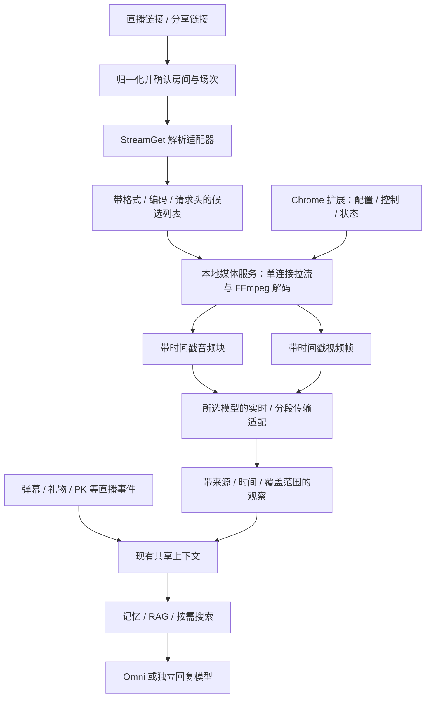

# lucky-box 原始直播流调研与 AI 感知复用建议

调研日期：2026-11-02。范围为 `/Users/eitan/Documents/Projects/Web/lucky-box` 当前工作区的源码、测试、部署文件和相关架构记录，以及本扩展当前媒体实现。旧项目存在未提交改动，因此下文描述的是所检查的工作区实现，不代表所有代码已经发布或通过真实直播验收。旧项目保持只读。

## 结论

**找到了可复用的原始直播流解析实现：StreamGet → 抖音 CDN 的 FLV/HLS。** 它可以作为 AI 音视频输入的上游，不需要录制网页或共享屏幕。旧项目实际采用“Node 后台启动 Python 解析地址、前端独立播放器解码”，尚不是完整的原生后台 AI 分析服务。

最适合本项目的方向是复用其链接归一化、StreamGet 解析适配和超时/并发边界；用独立的本地媒体服务负责 FFmpeg 解码、候选切换、过期刷新、时间戳和模型协议。保留现有纯扩展直连模式作为便捷选项。不要搬入整个旧后台，也不要把“拿到地址”显示为“AI 正在可靠识别”。

本轮没有连接真实抖音直播、读取用户 Cookie、调用付费模型或安装原生服务，因此**源码可行性已确认，当前真实直播的可拉取性、端到端延迟及长时间稳定性尚未确认**。

## “干净的直播流”具体是什么

| 内容 | 直接 CDN 拉流的结果 |
| --- | --- |
| 网页弹幕 DOM、网页按钮、浏览器浮层、扩展 UI | 不进入源流 |
| 系统提示音、麦克风、其他标签页的声音 | 独立解码源流时不进入输入 |
| 主播已经叠入编码画面的字幕、贴纸、水印、商品展示 | 仍在画面中，不能由直接拉流自动去除 |
| 主播的背景音乐、音效、PK/连麦混音 | 通常随平台下发的混音保留，不能承诺独立人声 |
| PK/连麦合成画面 | 以平台实际下发的画面为准，不能承诺获得每位主播的独立摄像头 |
| 原始摄像头无处理素材、独立原始音轨 | 已检查代码没有证明能获得 |

这里“原始”指平台提供的直播媒体资源，不代表平台转码前的原始素材。音频和视频通常封装在同一 FLV/HLS 中；先拉一次，再解复用出音频、视频，比重复拉两条直播连接更合适。

## 旧项目实际有哪些获取路径

### 1. 已接入：StreamGet Web 接口解析

核心文件：[douyin-playback-resolver.ts](/Users/eitan/Documents/Projects/Web/lucky-box/packages/backend/src/playback/douyin-playback-resolver.ts:13)。Python 程序实际调用：

```python
live = DouyinLiveStream(proxy_addr=..., cookies=..., stream_orientation=...)
data = await live.fetch_web_stream_data(url)
stream = await live.fetch_stream_url(data, quality)
```

Node 使用 `spawn` 启动 Python，输入通过 stdin 传 JSON，结果从 stdout 取 JSON。解析后返回 FLV/HLS 地址，而不是屏幕录制数据。

- 依赖固定为 `streamget==4.0.10`，见 [requirements.playback.txt](/Users/eitan/Documents/Projects/Web/lucky-box/packages/backend/requirements.playback.txt:1)。Docker 已安装 Python 和 venv；检查的 Dockerfile 未配置 FFmpeg。
- 默认画质 `OD`、默认方向参数 `1`；允许环境配置方向 `2`。这是解析偏好，实际是否有对应方向流取决于房间响应。
- 按归一化后的 `source_url`、`canonical_url`、`external_room_id` 去重尝试。这里是输入链接回退，不是多种解析引擎自动切换。
- 默认每次 Python 尝试超时 12 秒；每个 Node 进程最多同时两个解析任务，超限拒绝；输出限制 1 MiB。总耗时可能超过 12 秒，因为会串行尝试多个链接。
- 可配置 Cookie 与代理。当前解析器读取环境变量，不能据此认定已经自动接通旧项目登录侧车中保存的凭据。
- 支持多种 FLV/HLS 字段别名；明确未开播或没有可用地址会失败。
- 返回的 `expiresAt` 默认是“当前时间 + 5 分钟”的缓存期限，**不是从 CDN 签名中提取出的真实有效期**。

API 接口在 [live-rooms.controller.ts](/Users/eitan/Documents/Projects/Web/lucky-box/apps/api/src/live-rooms/live-rooms.controller.ts:249)：解析、状态查询、播放器错误上报。缓存和状态转换见 [playback-service.ts](/Users/eitan/Documents/Projects/Web/lucky-box/packages/backend/src/playback/playback-service.ts:21)。

### 2. 链接输入：分享文本、短链接、reflow 与房间号归一化

[source-resolver.ts](/Users/eitan/Documents/Projects/Web/lucky-box/packages/backend/src/live-rooms/source-resolver.ts:18) 已区分直播链接、分享落地页、`web_rid/webRid` 与 reflow 内部房间号。低可信度的内部 `room_id` 不应直接当作 Web 房间号；旧项目也标注了需要确认的情况。

这部分可以复用，尤其适合让扩展用户直接粘贴分享链接。但是当前播放解析器本身不等同于完整的分享链接解析器，需要明确串接两者。

### 3. 库提供、旧项目未调用：App reflow 接口

从 PyPI 正式 wheel 核对的 StreamGet 4.0.10 中，`fetch_app_stream_data()` 能从分享/reflow 链接提取 `room_id` 与 `sec_user_id`，请求 `webcast.amemv.com/webcast/room/reflow/info/`，再归一化出 FLV/HLS。

它只在特定 `UnsupportedUrlError` 分支回到 Web 路径；不是任意失败都自动降级。旧项目 Python 程序只调用 Web 方法，**尚未接入 App/Web 双解析策略**。这条路可作为后续受控备用候选，不能声称当前已验证有效。

### 4. 库的历史路径：HTML 内嵌房间状态

StreamGet 包含解析 HTML 内嵌状态的 `fetch_web_stream_data_v1()`，但从 4.0.9 起已标记弃用，推荐新 Web 方法。另有 `_get_app_web_stream_data()`，相关调用在所查版本中被注释。

HTML 结构与正则强耦合，不能因为库中存在这些方法就将其视为成熟的默认备用方案。本扩展已有读取当前页 SSR 房间数据的入口，适合保留为浏览器模式的现有能力。

### 5. 容易混淆的另外两条链路

- [douyin-live-adapter.ts](/Users/eitan/Documents/Projects/Web/lucky-box/packages/backend/src/live-monitor/douyin-live-adapter.ts) 对接直播事件采集；弹幕、礼物、在线观众等事件不是音视频媒体流。应与媒体观察按同一房间/场次汇合，而非互相替代。
- [sidecar.ts](/Users/eitan/Documents/Projects/Web/lucky-box/apps/douyin-credential-sidecar/src/sidecar.ts) 属于登录凭据侧车。它使用浏览器不代表媒体必须通过录屏获取，也不能把凭据获取能力等同于稳定拉流能力。

## 解析库核对：可以复用，但不能原样作为健康判断

本轮通过 [PyPI 元数据](https://pypi.org/pypi/streamget/json) 核对：查询时最新发布版本仍为 `4.0.10`，发布于 2026-05-13，要求 Python `>=3.10,<4.0`，MIT 许可证。仓库：[ihmily/streamget](https://github.com/ihmily/streamget)。这证明版本来源和许可，不能单凭版本号证明当前抖音接口仍然可用或项目维护足够活跃。

下载 wheel 后按 PyPI SHA256 校验，只读取源码，没有安装或运行整个包：

```text
9e79a54f1338320996e7d3ba82252762fa88efa8d4b6fbca80e893e029232b64
```

源码证据保存在 `output/lucky-box-stream-research-2026-11-02/upstream/`，主要发现如下：

| 位置 / 行号 | 已核实行为 | 对接要求 |
| --- | --- | --- |
| `platforms/douyin/live_stream.py:72` | Web enter 接口带签名请求，提取平台下发的地址；存在硬编码默认请求参数和 Cookie | 把平台解析封装成可更新适配器，拒绝将默认 Cookie 当作可靠会话；不要复制硬编码凭据 |
| 同文件 `:218`、`:295`、`:300` | App、当前 Web、弃用 HTML 方法彼此独立 | 由业务层明确编排、限次、记录策略；不能宣称旧项目已接入全部方法 |
| `platforms/base.py:51` | OD/UHD/HD/SD/LD 映射为列表索引 0–4 | OD 不是 AI 必需条件；应按清晰度、码率和编码兼容性选流，不能只信标签 |
| `platforms/douyin/live_stream.py:393` | 检查 HLS 的 HEAD 状态后，通过 `if not ok` 决定是否选相邻画质 | HTTP 403/404 也是非零整数，会被当作可用；相邻候选也未再次检查，FLV 未单独验证 |
| `requests/async_http.py:88` | `get_response_status()` 返回整数 HTTP 状态码，异常时返回 False | 在本地服务边界明确判断 HTTP 成功与实际可解码，而非依赖库返回 `is_live` |
| `requests/async_http.py:17`、`:88` | 请求函数默认关闭 TLS 证书校验 | 接入时必须核对并确保实际调用的证书校验开启，不能把上层声明当成库内部已生效 |

已将 wheel 中未经修改的 `fetch_stream_url` 方法单独提取为 AST，在隔离依赖、无网络环境下执行 200、403、404、False 四种输入：前三者均返回首个地址且 `is_live=True`；仅 False 改选相邻地址，仍返回 `is_live=True`。这直接复现了状态码与布尔值混用问题，**不是一次真实 CDN 拉流实验**。

签名主 Web 路径使用该版本自带 Python 签名代码；包中其他工具方法还有 PyExecJS 调用。后续服务应检查完整依赖与实际选用路径，不能笼统认定所有入口只依赖 Python，或所有入口都必须启动浏览器。

## 旧项目播放链路尚未补齐的环节

[PlaybackSurface.tsx](/Users/eitan/Documents/Projects/Web/lucky-box/apps/admin/src/features/live-guard/components/PlaybackSurface.tsx:306) 使用 mpegts.js 播 FLV、Hls.js/原生能力播 HLS。它仍在浏览器里解码，受 CORS、请求头和编码支持限制；播放器具备失败上报，但不等于后台已经具有媒体任务恢复能力。

具体证据：

- 播放描述里的 `proxy_url` 固定为 `null`，见 [playback-service.ts](/Users/eitan/Documents/Projects/Web/lucky-box/packages/backend/src/playback/playback-service.ts:172)。所查实际路径未实现媒体中继；架构文档提到代理不代表已经落地。
- `latency_mode=low` 来自是否有 FLV 地址，**不是测量结果**。
- [LiveGuardPage.tsx](/Users/eitan/Documents/Projects/Web/lucky-box/apps/admin/src/features/live-guard/LiveGuardPage.tsx:214) 的自动解析以 `selected_transport === unavailable` 为条件。已有地址但不可播放时，不保证触发新的解析。
- 运行时错误上报会记录错误；不能据此认定旧的成功缓存已经失效，或自动切换了另一候选。
- 旧测试使用注入的模拟 runner 与 `.example.com` 地址，见 [backend.test.ts](/Users/eitan/Documents/Projects/Web/lucky-box/packages/backend/tests/backend.test.ts:845)，不能作为真实直播播放成功证据。

## 与当前扩展的对照

当前扩展的 [live-stream.js](/Users/eitan/Documents/Projects/Web/douyin-live-operations-assistant/src/browser/live-stream.js:43) 已从当前页 SSR / 同源 Web enter 响应提取原始 FLV/HLS，创建独立解码器；它不录制网页播放器。媒体库在构建时打包，音频经 Web Audio 进入分析轨道。

现有实现最多收集八个候选，但 [createDirectStreamSource](/Users/eitan/Documents/Projects/Web/douyin-live-operations-assistant/src/browser/live-stream.js:86) 只选第一个；未形成持续的候选切换、重解析和重连循环。SDK 路径过滤部分不支持编码，仍需要对最终实际媒体做探测。当前运行依赖打开的房间页面，不能承诺浏览器关闭后继续。

当前 [omni-realtime.js](/Users/eitan/Documents/Projects/Web/douyin-live-operations-assistant/src/browser/omni-realtime.js:99) 使用 `RTCPeerConnection` 与 SDP，画面缩放后以约 1 fps 发送，稳定观察进入共享上下文；不是把 FLV URL 直接交给模型。响应依赖当前 VAD 配置，静音画面不保证主动产生观察。

因此，Python 解析出新地址可以改善“来源获取”，但要完全移出浏览器，还需新增本地媒体运行时及模型传输适配；FFmpeg 产出的 PCM/JPEG 不能直接传给现有接收 MediaStream 的 WebRTC 工厂。

## 推荐落地结构



建议复用成熟的 StreamGet 和 FFmpeg，自己实现必要的房间会话、恢复及 AI 协议边界，不另写 FLV/HLS 解码器。FFmpeg 的构建来源、编解码能力和随包分发许可需在确定发布方式时核对。

### 两种入口，统一观察出口

| 模式 | 好处 | 运行条件 |
| --- | --- | --- |
| 扩展直连 | 当前已有，安装与设置最简单，不需要选屏 | 浏览器与房间页面存活，CDN 跨域/编码兼容 |
| 本地原生服务 | 不依赖网页媒体 API，适合持续解码和后台任务 | 安装本地配套服务；独立服务监管与模型传输适配 |

Chrome MV3 不能自行启动 Python/FFmpeg。可以用 Native Messaging 连接本地宿主，或使用带鉴权的回环服务；连接通道不等于进程监管。若要求关闭浏览器仍工作，应使用独立受管理服务，而不是仅依赖 Native Messaging 端口生命周期。

### 必须首先建立的契约与恢复行为

1. **来源契约**：区分 Web 房间号、平台内部房间号和直播场次；候选保留 transport、codec、必要请求头、解析时间、真实已知的签名期限与缓存刷新时间。不能用缓存 TTL 冒充签名期限。
2. **运行状态**：明确“正在解析 → 正在连接 → 已解码 → AI 已接收 → 正在恢复/已停止”。实际出现首帧、音频及模型观察后才能分别确认对应能力。
3. **单一媒体任务**：每个房间/场次一个拥有者，一次拉流分出音画；切源递增 generation，旧回调和旧模型响应不得污染新场次。
4. **有界恢复**：读超时、无进展、HTTP 失效和解码错误分类处理；先切合理候选，再限次重新解析，退避且允许取消。不能无限重试或重复开启收费会话。
5. **同步与背压**：媒体 PTS 配合采集/接收时间；帧与音频块有大小、时长、队列上限。模型慢时丢弃过时画面并标记音频缺口，不能积压到分析几分钟前的内容。
6. **协议适配**：针对所选阿里模型支持的实时协议、音频格式和视频输入分别实现。不能把浏览器 SDP 配置中的采样率直接当作所有原生接口要求；持续静音画面要有独立观察策略与预算。
7. **上下文合流**：只把有来源与时效的观察交给现有共享上下文，保留事件、视觉、音频的差异；RAG/搜索和回复策略在其后，不耦合进拉流进程。

前台最少保留输入来源、直播链接、画质“自动”、识别/回复组合和启动/停止；本地服务发现、候选列表与恢复细节放在连接状态和诊断里。模型组合继续允许“Omni 感知 + 其他 LLM 回复”或“Omni 感知与回复”。

## 验证与后续验收

本轮已完成：

- 只读检查旧项目链接解析、播放解析、API、播放器、部署、测试与架构记录，核对实现与规划的差异。
- PyPI 版本、发布时间、许可与 wheel SHA256 核对；离线复现四种状态码输入的实际库行为。
- 运行本扩展 `node --test tests/unit/live-stream.test.mjs tests/unit/omni-realtime.test.mjs`，**11/11 通过**。覆盖直连候选、房间绑定、资源释放、取消、超时，以及 Omni 配置确认前不发送媒体等模拟行为。
- 未修改旧项目、运行时代码、Chrome 安装或模型配置。`crapper`、`dryer`、`mutator` 均未找到，未执行，不以其他检查替代。

下一阶段真正接入时需逐层验收：

| 层 | 可检查的完成条件 |
| --- | --- |
| 解析 | 同一实际房间正确识别开播状态、返回候选，分享链接不误认 room_id |
| 媒体 | 实际 CDN GET 可读，FFmpeg 解出连续帧和非空音频，明确所选编码/清晰度 |
| 现场真实性 | 人为在网页显示弹幕/按钮、播放系统提示音，确认这些不进入模型输入；保留源流内叠加内容 |
| 恢复 | 地址失效、断网、编码不兼容、切房和停播后恢复/停止正确，无多余进程或重复模型会话 |
| AI | 使用获授权真实模型，分别确认音频与静音画面观察；统计媒体年龄、观察延迟、缺口和费用 |
| 持续任务 | 长会话、关闭前台、浏览器退出/服务重启按所承诺模式运行，模型与解码资源可回收 |

研究证据保存在 `output/lucky-box-stream-research-2026-11-02/`；该目录是本地证据与初始草稿备份，未纳入研究提交。没有宣称已完成真实直播或阿里模型端到端验收。
